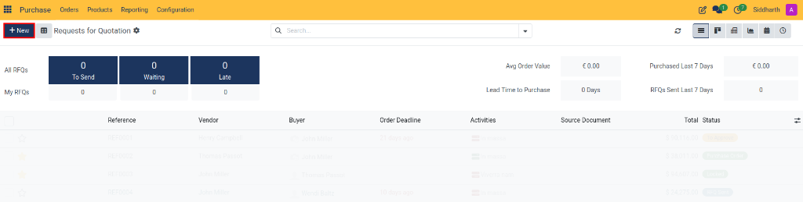
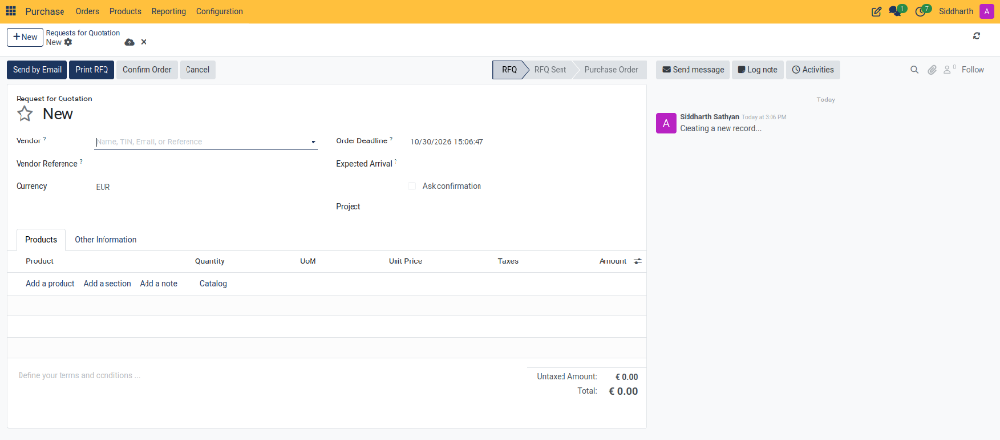
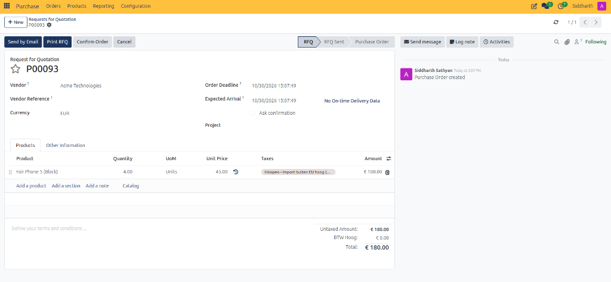
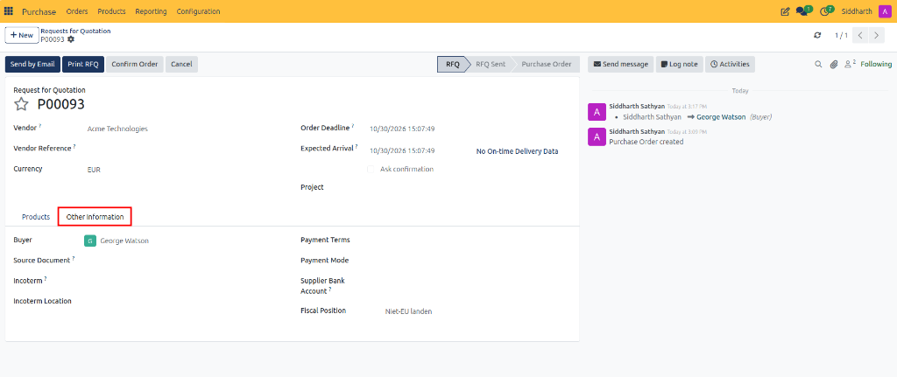

# Create and Manage Requests for Quotation

This guide covers how to initiate a new Request for Quotation (RFQ), select suppliers, configure delivery dates and destinations, add line items and sections, and review financial totals in CURQ 18.

---

## Task 1: Start a New RFQ

1. Open the **Purchase** application from the main dashboard.
2. In the top navigation, ensure you are on **Orders → Requests for Quotation**.
3. Click the blue **New** button in the upper-left corner to open a blank RFQ form.

---

## Task 2: Configure Vendor and Delivery Parameters

1. Select your supplier in the **Vendor** field (for example, *Acme Technologies*).
   The system automatically fills in their default **Currency** (e.g., *EUR*), **Payment Terms**, and **Fiscal Position** based on their contact record.
2. In the **Vendor Reference** field, enter any external reference, quotation code, or catalog number provided by the supplier.
3. In the **Order Deadline** field, select the date and time by which the vendor must respond with pricing or quote confirmation.
4. In the **Expected Arrival** field, specify the target delivery date when materials or products are expected at your facility:
   * **On-Time Delivery**: Displays the vendor's historical delivery reliability percentage (or *No On-time Delivery Data* if newly registered).
   * **Ask confirmation**: Check this box to enable automated receipt reminders. Enter the number of **day(s) before** receipt to automatically email the supplier a confirmation request prior to scheduled delivery.
5. *(Optional)* In the **Project** field, select an active project to allocate procurement expenses and material costs directly to that project's profitability sheet.
6. *(Optional)* Under the **Other Information** tab, verify the **Deliver To** warehouse operation (such as *Receipts* for your primary warehouse) and assign an active **Agreement** if purchasing against a blanket order or tender contract.

> For complete field definitions across quotation headers and shipping terms, see [RFQ and Purchase Order Field Definitions](../settings-and-fields/02-rfq-and-purchase-order-field-definitions.md).

---

## Task 3: Add Products and Line Items

1. Under the **Products** tab, click **Add a product**.
2. Select your item in the **Product** column (for example, *Fair Phone 5 (Black)*).
   The system automatically populates the line **Description** and default parameters.
3. Enter the requested order volume in the **Quantity** column (for example, `4.00`).
4. Verify the **Unit of Measure** (UoM) (e.g., `Units`). CURQ defaults to the purchase unit of measure configured on the product record.
5. Check the **Unit Price** column (for example, `45.00`): enter the agreed price or review the default product cost price.
6. Verify the applied **Taxes** mapped by the vendor fiscal position (e.g., *Inkopen - Import buiten EU hoog*).
7. *(Optional)* Click **Add a section** to organize items under descriptive headings, or click **Add a note** to insert inline instructions for the vendor.
8. Review the calculated financial summary at the bottom right:
   * **Untaxed Amount**: Net line sum before taxes (e.g., `€ 180.00`).
   * **Taxes**: Calculated tax total based on the applied fiscal position.
   * **Total**: Grand total including taxes (e.g., `€ 180.00`).

---

## Task 4: Configure Commercial and Incoterm Details

Open the **Other Information** tab to verify commercial ownership, payment terms, and accounting details:

1. **Buyer**: Assign the internal team member responsible for this procurement request (for example, *George Watson*).
2. **Source Document**: Note any originating sales order, project, or manufacturing order reference.
3. **Incoterm & Incoterm Location**: Select standardized freight risk terms (such as EXW, FOB, or CIF) and specify the agreed delivery location.
4. **Payment Terms & Payment Mode**: Define the agreed credit terms and payment execution method.
5. **Supplier Bank Account**: Select the vendor's registered bank account for disbursements.
6. **Fiscal Position**: Verify the automatic tax mapping rules applied to line items (for example, *Niet-EU landen*).

> For complete specifications of commercial fields, Incoterms, and payment terms, see [RFQ and Purchase Order Field Definitions](../settings-and-fields/02-rfq-and-purchase-order-field-definitions.md).

---

## Related Documentation

* [Send and Print Requests for Quotation](./02-send-and-print-requests-for-quotation.md)
* [Confirm Purchase Orders and Manage Approvals](./03-confirm-purchase-orders-and-manage-approvals.md)
* [RFQ and Purchase Order Field Definitions](../settings-and-fields/02-rfq-and-purchase-order-field-definitions.md)
