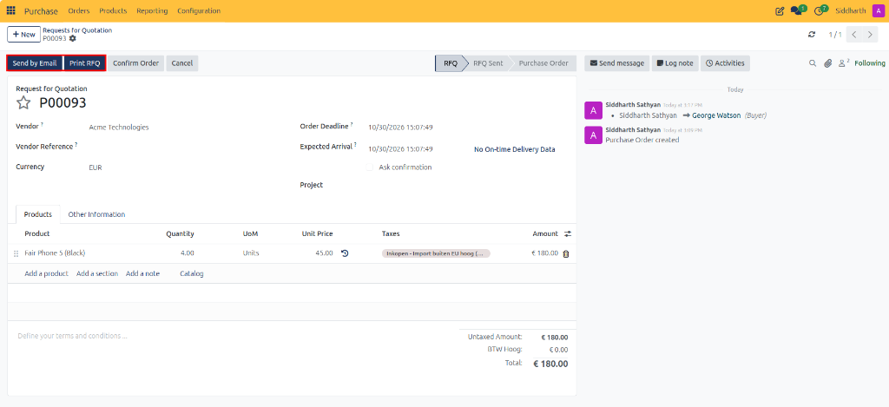
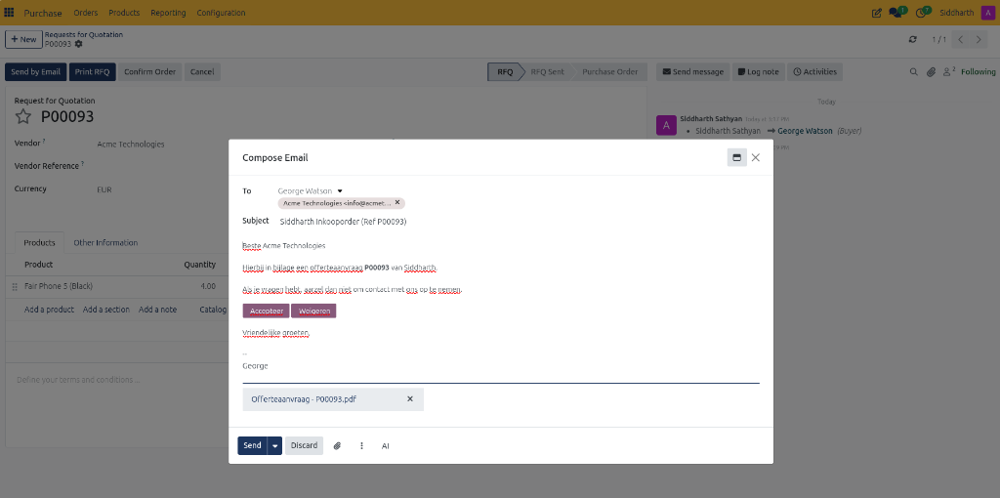
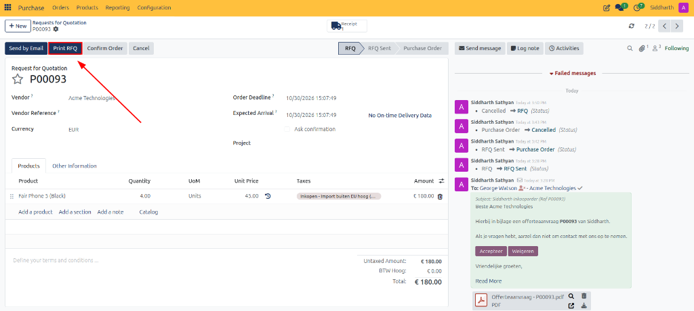
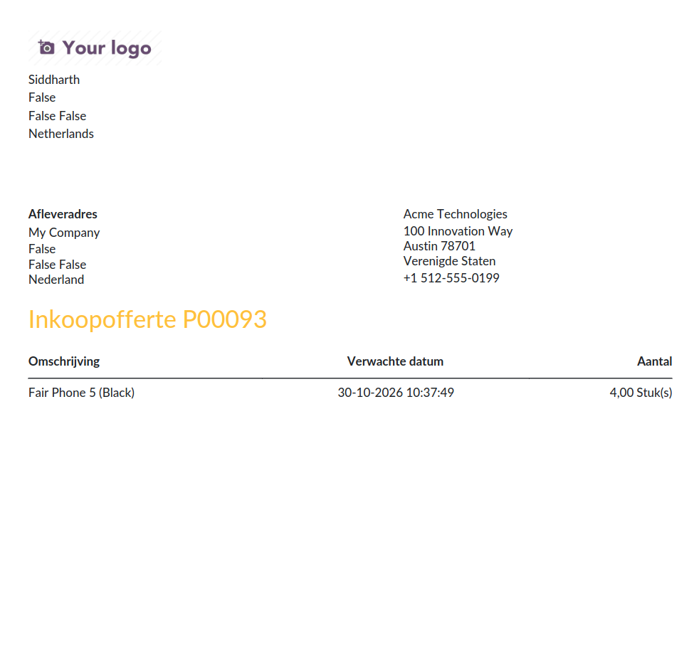
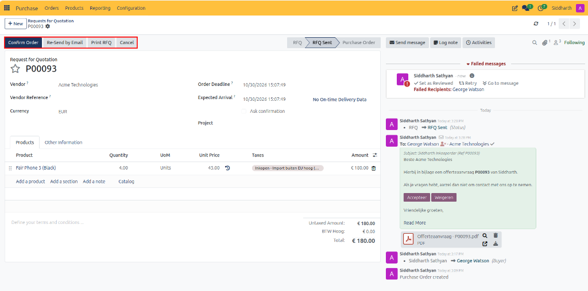

# Send and Print Requests for Quotation

This guide covers how to email Requests for Quotation (RFQs) with automated PDF attachments directly to suppliers, print physical quotation documents, and monitor document progression in the RFQ Sent stage in CURQ 18.

---

## Task 1: Send the RFQ by Email

1. Open the draft RFQ from **Purchase → Orders → Requests for Quotation**.
2. Click the **Send by Email** button in the top action bar.

3. An email composer modal appears, pre-populated with standard procurement details:
   * **Recipients**: Defaults to the supplier's contact card and assigned buyer (for example, *Acme Technologies* and *George Watson*). You can add additional recipient email addresses if required.
   * **Subject**: Pre-filled with your company name and order reference (such as *Order (Ref P00093)* or localized *Inkooporder (Ref P00093)*).
   * **Body**: Standard procurement text requesting price and availability confirmation, including action buttons for supplier quote acceptance.
   * **Attachments**: An automatically compiled PDF document titled `Request for Quotation - P00093.pdf` (or localized `Offerteaanvraag - P00093.pdf`).
   * *(Optional)* Click the paperclip attachment icon to attach external technical drawings, specifications, or compliance documents.

4. Review or edit the message text, then click **Send**.
5. Upon sending:
   * The status badge in the upper right automatically advances from **RFQ** to **RFQ Sent**.
   * A permanent audit copy of the outgoing email, recipient list, and attached PDF is recorded in the record chatter.

---

## Task 2: Print the RFQ Document

For suppliers who require physical paperwork or when hand-delivering procurement documents:

1. Open the draft RFQ from **Purchase → Orders → Requests for Quotation**.
2. Click the **Print RFQ** button in the top action bar.

3. CURQ immediately compiles and downloads the official PDF document to your computer (e.g., `Request for Quotation - P00093.pdf` or localized `Inkoopofferte P00093.pdf`).
4. The downloaded document includes your company branding, delivery destination, vendor address, product descriptions, expected arrival dates, and requested quantities:

5. The system automatically updates the status badge from **RFQ** to **RFQ Sent**.

---

## Task 3: Monitor the RFQ Sent Stage

While the document remains in the **RFQ Sent** stage:
* **Primary Highlighted Action**: The **Confirm Order** button becomes highlighted in dark blue, ready to convert the quotation into an active purchase order once the vendor accepts your terms.
* **Re-Send Options**: A **Re-Send by Email** button becomes available in the action bar to transmit follow-up reminders or revised quotations to the vendor.
* **Vendor Feedback & Updates**: If the vendor proposes price or delivery date revisions, open the form and update the unit prices or expected arrival dates directly before confirming.
* **Audit Trail**: Any subsequent vendor correspondence can be logged into the chatter via **Log note** or by replying to the tracked thread.

---

## Related Documentation

* [Create and Manage Requests for Quotation](./01-create-and-manage-requests-for-quotation.md)
* [Confirm Purchase Orders and Manage Approvals](./03-confirm-purchase-orders-and-manage-approvals.md)
* [Understanding the Procurement Lifecycle and Order States](../core-concepts/01-understanding-the-procurement-lifecycle-and-order-states.md)
