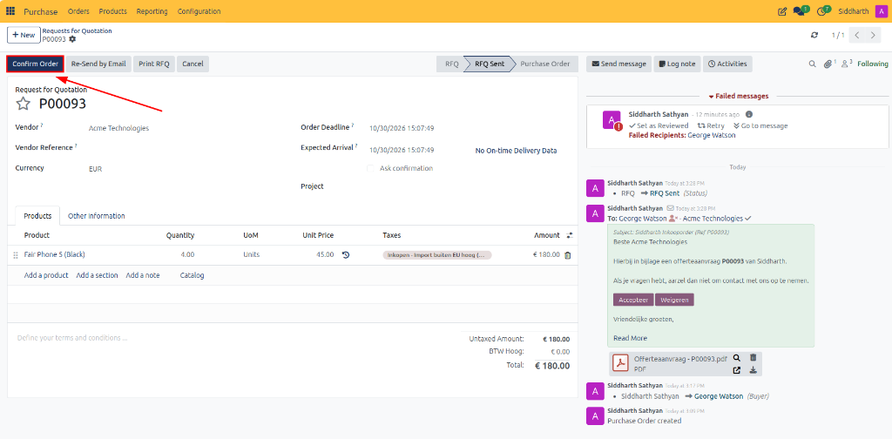
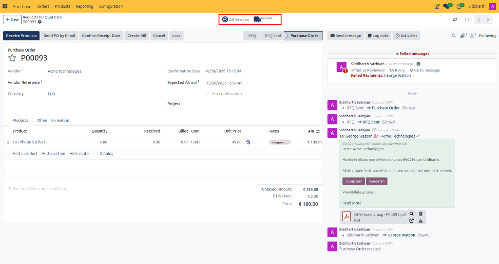
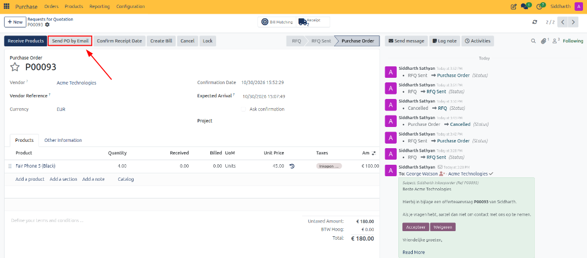
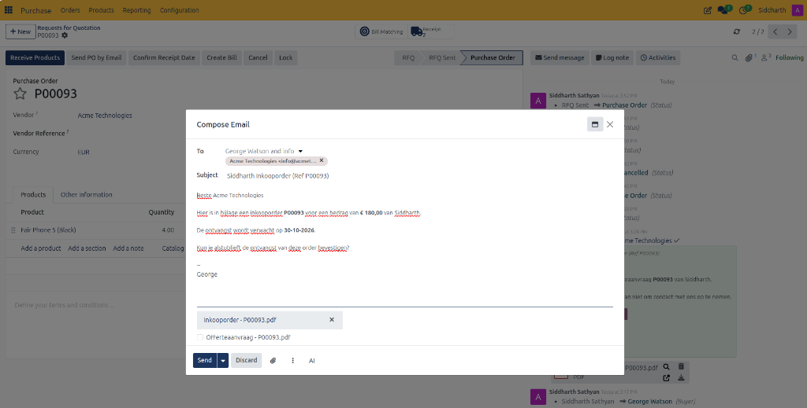
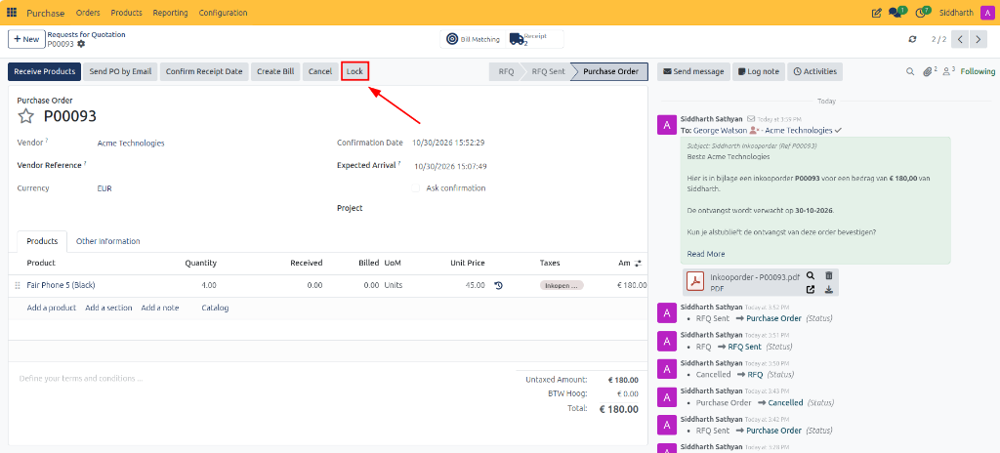
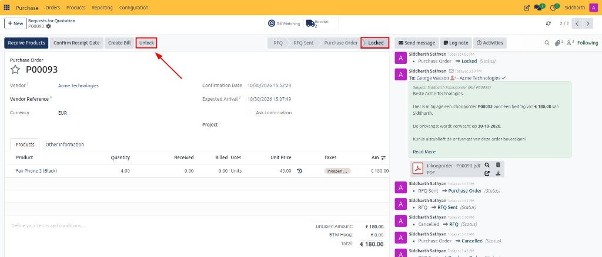
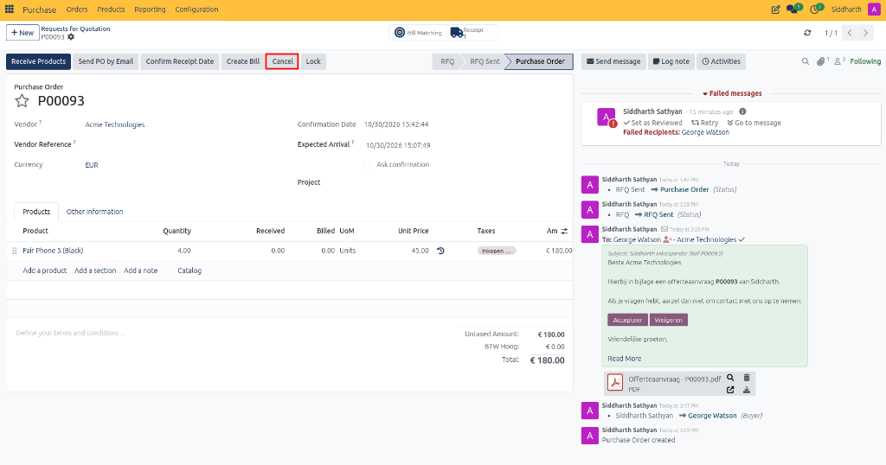
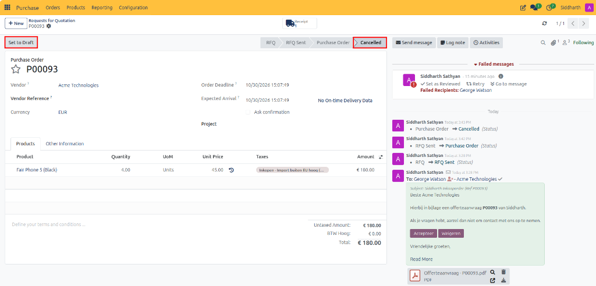

# Confirm Purchase Orders and Manage Approvals

This guide covers how to convert Requests for Quotation into official Purchase Orders, transmit purchase orders to vendors, manage order locks, and execute order cancellations in CURQ 18.

> **Prerequisites**
> * Active user account with **Purchase / User** rights.
> * Active vendor contacts in **Contacts** and defined catalog products.

---

## 1. Confirm and Transmit Purchase Orders

### 1.1 Confirm a Purchase Order

1. Open the quotation from **Purchase → Orders → Requests for Quotation** (or open an order from **Purchase → Orders → Purchase Orders**).
2. Click the **Confirm Order** button in the top action bar (highlighted in dark blue if previously sent to the vendor).

3. Upon clicking confirmation, the document status badge advances from **RFQ Sent** to **Purchase Order**.
4. Dedicated smart buttons appear at the top of the form:
   * **Receipt**: Direct shortcut to the generated incoming warehouse picking (`WH/IN/`) to receive the ordered items.
   * **Bill Matching**: Direct shortcut to the bill matching workspace to reconcile supplier invoices.

---

### 1.2 Transmit the Official Purchase Order

Once confirmed:
1. The status updates to **Purchase Order** (or **Locked** if automatic locking is active).
2. Click the **Send PO by Email** button in the top action bar.

3. An email composer modal appears, pre-populated with:
   * **Recipients**: Defaults to the supplier's contact card and assigned buyer (e.g., *George Watson*, *Acme Technologies*).
   * **Subject**: Pre-filled with your corporate entity name and order reference (e.g., *Inkooporder (Ref P00093)*).
   * **Body**: Standard procurement text confirming the purchase order total (e.g., `€ 180,00`) and expected delivery date (`30-10-2026`).
   * **Attachments**: An automatically compiled formal purchase order PDF document titled `Purchase Order - P00093.pdf` (or localized `Inkooporder - P00093.pdf`).
4. Click **Send** to transmit the formal purchase order to the vendor.

> For order locking settings, status transitions, and procurement states, see [**Understanding the Procurement Lifecycle and Order States**](../core-concepts/01-understanding-the-procurement-lifecycle-and-order-states.md).

---

## 2. Lock and Unlock Confirmed Orders

When **Lock Confirmed Orders** is enabled in settings (the system default):
* Confirming an order automatically places it in **Locked** status to prevent unauthorized modifications that could de-synchronize warehouse delivery receipts or accounting bills.
* You can also manually lock an active order at any time by clicking the **Lock** button in the top action bar:

* To modify an existing locked order:
  1. Open the locked order and click the **Unlock** button in the top action bar.
  2. Make the necessary price or line adjustments.
  3. Click **Lock** to lock the record again.

---

## 3. Cancel a Purchase Order

To void or cancel a confirmed order:

1. Open the purchase order and click the **Cancel** button in the top action bar.

2. The order status updates to **Cancelled**, any linked unvalidated warehouse delivery pickings are cancelled, and reserved stock allocations are reversed.
3. *(Optional)* If the cancellation was made in error, click **Set to Draft** to restore the document to draft status for revision and re-confirmation.

---

## Related Documentation

* [Create and Manage Requests for Quotation](./01-create-and-manage-requests-for-quotation.md)
* [Receive Products and Manage Backorders](./05-receive-products-and-manage-backorders.md)
* [RFQ, Purchase Order, and Blanket Order Field Definitions](../settings-and-fields/01-rfq-and-purchase-order-field-definitions.md)
* [Understanding the Procurement Lifecycle and Order States](../core-concepts/01-understanding-the-procurement-lifecycle-and-order-states.md)
