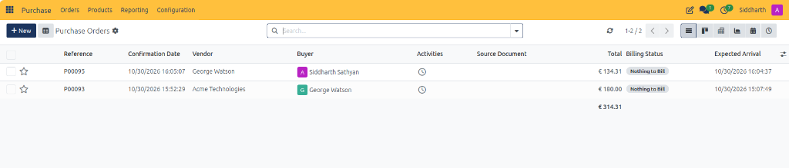
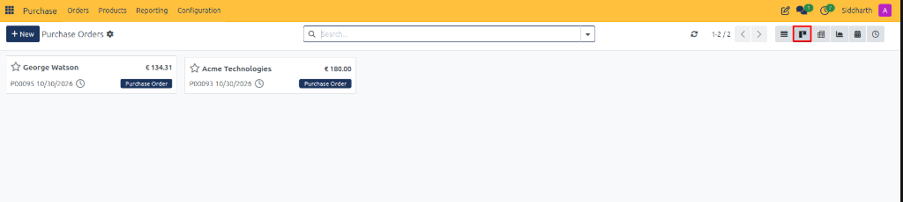
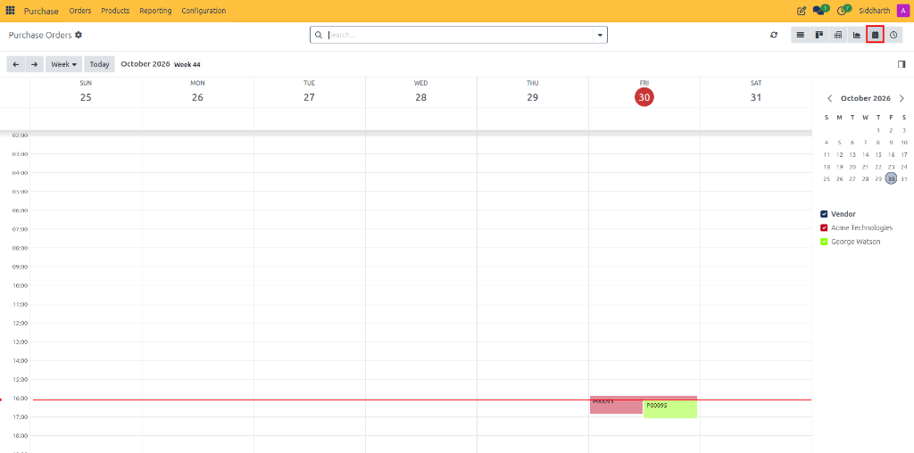
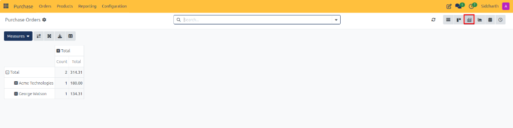
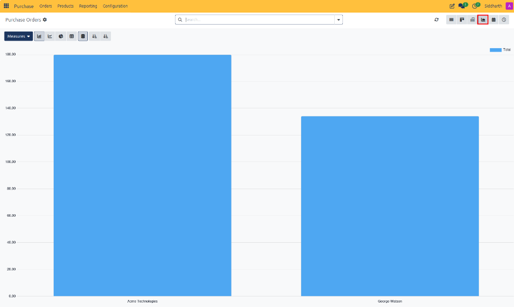
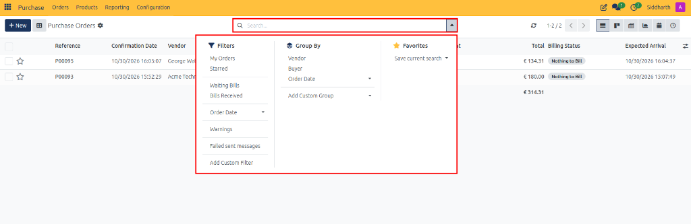
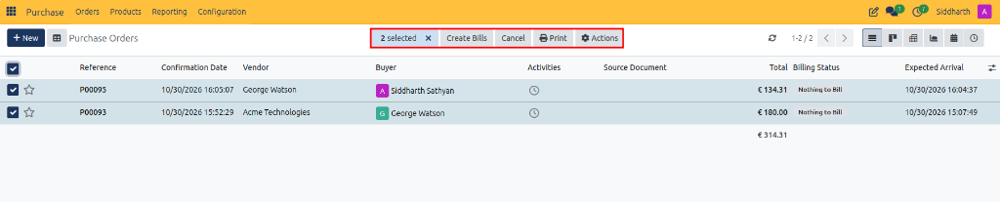

# Track and Manage Purchase Orders Across Views

This guide covers how to navigate the Purchase Orders workspace, browse orders across List, Kanban, Calendar, Pivot, Graph, and Activity views, apply filters and groupings, and execute batch operations in CURQ 18.

---

## Task 1: Open the Purchase Orders Workspace

1. Open the **Purchase** application from the main dashboard.
2. In the top navigation bar, select **Orders → Purchase Orders**.
3. CURQ displays all confirmed purchase orders (records in *Purchase Order* or *Locked* status).

> For definitions of all columns and billing statuses in the list view, see [**RFQ and Purchase Order Field Definitions**](../settings-and-fields/02-rfq-and-purchase-order-field-definitions.md).

---

## Task 2: Switch Between Operational Views

Use the view switcher in the upper-right toolbar to examine purchase orders from different perspectives:

### 1. Kanban View
Click the **Kanban** icon in the view switcher for a card-based visual overview showing vendor name, total amount, order reference, priority star, and order status badge.

### 2. Calendar View
Click the **Calendar** icon to inspect incoming shipments plotted across a monthly, weekly, or daily grid, color-coded by supplier.

### 3. Pivot View
Click the **Pivot** icon to generate aggregation tables summarizing total procurement spend, order line counts, and average prices grouped by vendor.

### 4. Graph View
Click the **Graph** icon to visualize procurement expenditure by vendor using interactive bar, line, or pie charts.

---

## Task 3: Filter and Group Orders

Use the search bar at the top of the workspace to filter, group, and slice procurement records:

* **Filters**:
  * **My Orders**: Displays purchase orders assigned to the logged-in user.
  * **Starred**: Filters for priority or flagged purchase orders.
  * **Waiting Bills**: Isolates orders where vendor bills have not yet been received or created.
  * **Bills Received**: Shows orders with received or processed vendor bills.
  * **Order Date**: Filters records by specific timeframes (e.g., Year, Quarter, Month).
  * **Warnings**: Highlights orders flagged with system warnings or notices.
  * **Failed sent messages**: Identifies orders where automated email notifications or messages failed to deliver.
  * **Add Custom Filter**: Builds tailored filter conditions using any standard or custom purchase order field.
* **Group By**:
  * **Vendor**: Groups orders by supplier name.
  * **Buyer**: Groups orders by the responsible purchasing representative.
  * **Order Date**: Groups records chronologically by Year, Quarter, Month, or Week.
  * **Add Custom Group**: Groups orders dynamically by any chosen attribute.
* **Favorites**:
  * **Save current search**: Saves the active filter and grouping criteria for one-click access or sets it as your default workspace view.

---

## Task 4: Execute Batch Operations

1. In the **List View**, select multiple purchase orders using the checkboxes in the leftmost column.
2. A batch action toolbar appears in the header displaying the number of selected records along with bulk operations:

3. Perform any of the available batch operations:
   * **Create Bills**: Generates vendor bills in bulk for all selected purchase orders that are eligible for billing.
   * **Cancel**: Cancels the selected purchase orders simultaneously.
   * **Print**: Generates and downloads PDF copies (e.g., Purchase Orders or RFQs) for all selected records.
   * **Actions (⚙)**: Opens the dropdown menu for additional batch utilities:
     * **Export**: Exports selected order data into an XLSX or CSV spreadsheet.
     * **Duplicate**: Clones the selected purchase order records.
     * **Delete**: Deletes draft or cancelled purchase orders in bulk.

---

## Related Documentation

* [Create and Manage Requests for Quotation](./01-create-and-manage-requests-for-quotation.md)
* [Confirm Purchase Orders and Manage Approvals](./03-confirm-purchase-orders-and-manage-approvals.md)
* [Receive Products and Manage Backorders](./05-receive-products-and-manage-backorders.md)
* [RFQ and Purchase Order Field Definitions](../settings-and-fields/02-rfq-and-purchase-order-field-definitions.md)
