# Receive Products and Manage Backorders

This guide covers how to process incoming vendor shipments directly from purchase orders, validate physical warehouse receipts, manage partial shipments with automated backorders, handle over-deliveries, and process vendor returns in CURQ 18.

---

## Task 1: Open the Incoming Warehouse Receipt

1. Open the confirmed purchase order from **Purchase → Orders → Purchase Orders**.
2. Click the **Receive Products** button in the top action bar, or click the **Receipt** smart button in the top-right stat area.

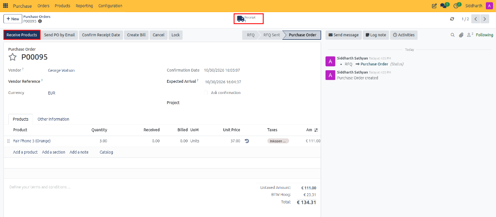

3. CURQ opens the linked incoming receipt form (`WH/IN/`).

> For complete field definitions of warehouse receipts and stock moves, see [Warehouse Receipt and Vendor Bill Field Definitions](../settings-and-fields/03-warehouse-receipt-and-vendor-bill-field-definitions.md).

---

## Task 2: Validate Full Delivery Receipts

1. Under the **Operations** tab, verify that physical deliveries match the **Demand** column.
2. If quantities match exactly, click **Validate** in the top action bar.

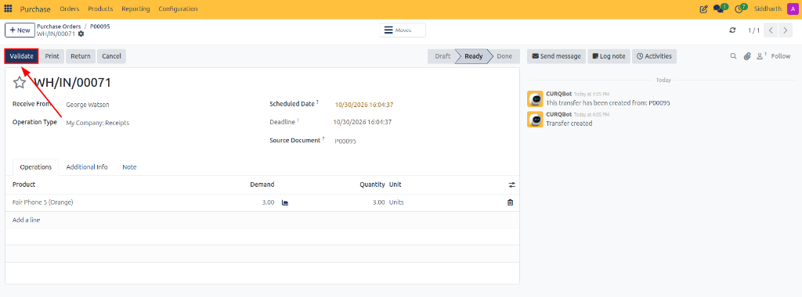

3. CURQ automatically marks the receipt as **Done** and updates warehouse on-hand stock counts.

---

## Task 3: Handle Partial Deliveries and Automated Backorders

When a supplier delivers fewer items than originally ordered:

1. Under the **Operations** tab of the receipt, click into the **Quantity** column and enter the actual physical count received (e.g., `1.00` out of `3.00`).
2. Click **Validate** in the top action bar.

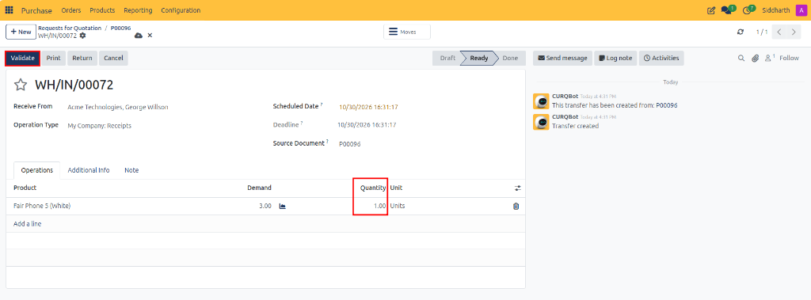

3. CURQ detects the partial quantity and opens the **Create Backorder?** modal dialog:

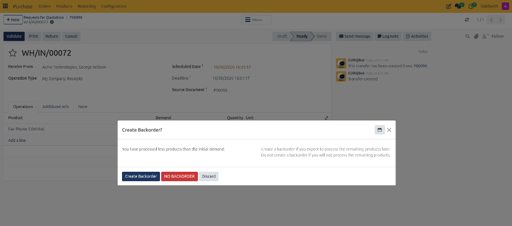

4. Select your fulfillment handling:
   * **Create Backorder**: Validates the received units and automatically generates a secondary receipt record (`WH/IN/...`) for the remaining balance.
   * **NO BACKORDER**: Closes the shipment at the received count and cancels remaining undelivered lines.
   * **Discard**: Returns to the receipt form without validating.

5. When you click **Create Backorder**:
   * The initial receipt is validated and marked as **Done** for the received quantity.
   * CURQ logs the created backorder in the chatter and adjusts the initial demand of the processed receipt to match the delivered units.

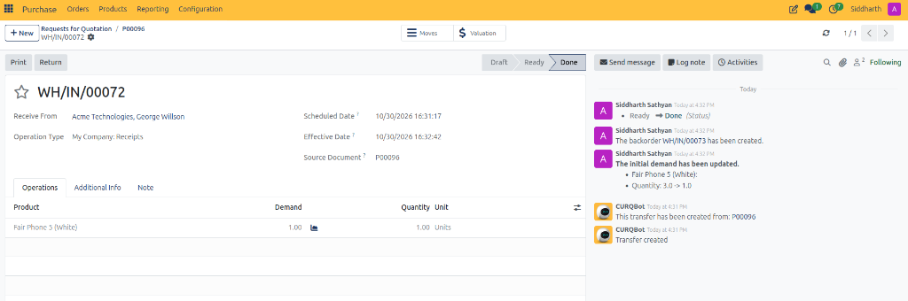

6. Click the **Transfers** breadcrumb or the **Receipt** smart button on the purchase order to view linked warehouse shipments. CURQ displays both the completed transfer (`Done`) and the new backorder transfer in **Ready** status.

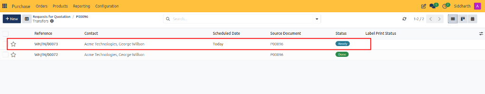

7. Open the pending backorder (`WH/IN/...`) to inspect details:
   * The **Back Order of** field references the original receipt.
   * The **Demand** reflects the exact remaining balance (e.g., `2.00` units), ready to be validated when the subsequent shipment arrives.

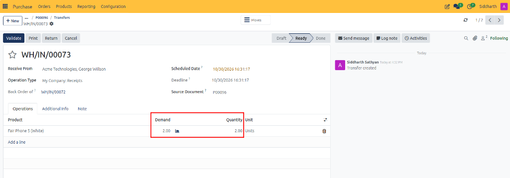

---

## Task 4: Handle Over-Deliveries

When a supplier ships more items than ordered:

1. Under the **Operations** tab of the receipt, click into the **Quantity** column and enter the higher physical count delivered (e.g., `10.00` instead of initial demand of `6.00`).
2. Click **Validate** in the top action bar.

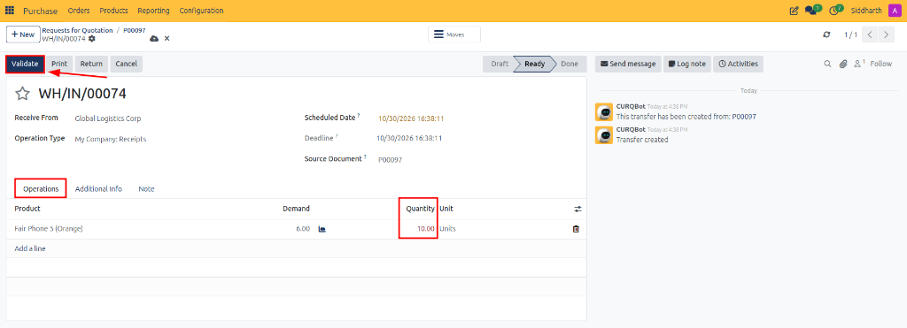

3. CURQ receives the entire delivered count into inventory and updates the originating purchase order line to reflect the increased received quantity.

---

## Task 5: Process Vendor Returns

If received goods are damaged, defective, or incorrect and must be returned to the supplier:

1. Open the validated receipt (`WH/IN/`) in **Done** status.
2. Click the **Return** button in the top action bar.

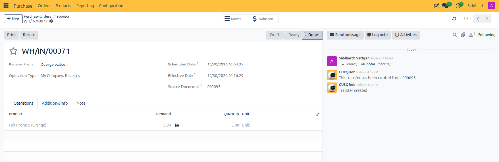

3. In the **Return** modal dialog:
   * Specify the exact **Quantity** to return for each product line.
   * Keep **Update quantities** checked to automatically synchronize inventory valuation and warehouse balances.
   * Choose the appropriate return action:
     * **Return**: Generates an outgoing return transfer to ship the specified items back to the vendor.
     * **Return All**: Automatically populates all line quantities to return the entire delivery.
     * **Return for Exchange**: Processes the return while scheduling an incoming replacement transfer from the vendor.

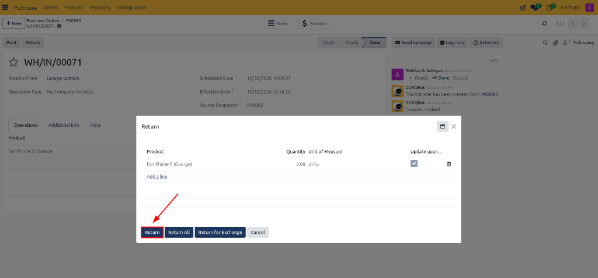

4. CURQ generates an outgoing delivery order (`WH/OUT/`). Click **Validate** in the top action bar to confirm dispatch back to the vendor.

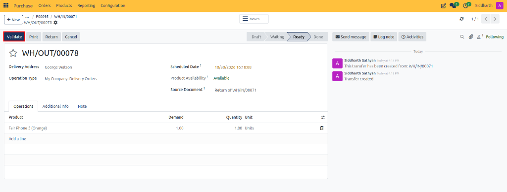

5. Returning the shipment automatically decreases the **Received** quantity on the originating purchase order line (e.g., decreasing from `3.00` down to `2.00`), with an automated tracking note recorded in the order chatter.

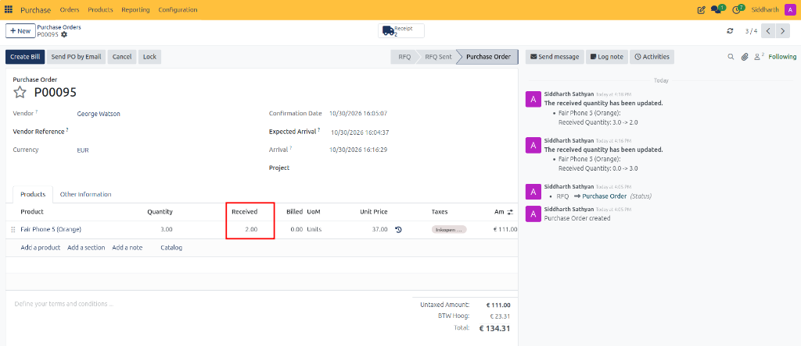

---

## Related Documentation

* [Create and Process Your First Purchase Order](../getting-started/01-create-and-process-your-first-purchase-order.md)
* [Generate and Validate Vendor Bills](./06-generate-and-validate-vendor-bills.md)
* [Reconcile Vendor Bills with Bill Matching](./07-reconcile-vendor-bills-with-bill-matching.md)
* [Understanding Bill Control and 3-Way Matching](../core-concepts/02-understanding-bill-control-and-3-way-matching.md)
* [Warehouse Receipt and Vendor Bill Field Definitions](../settings-and-fields/03-warehouse-receipt-and-vendor-bill-field-definitions.md)
