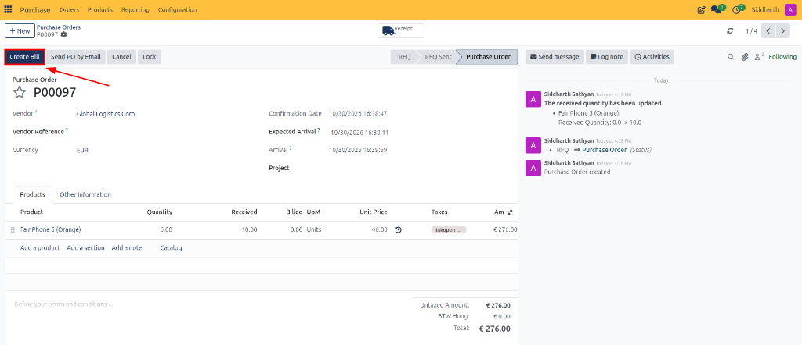
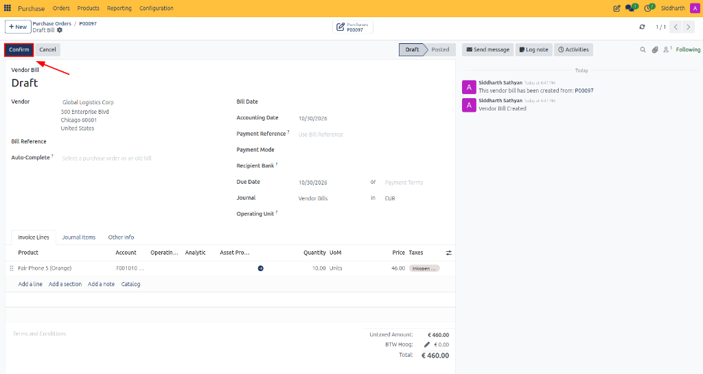
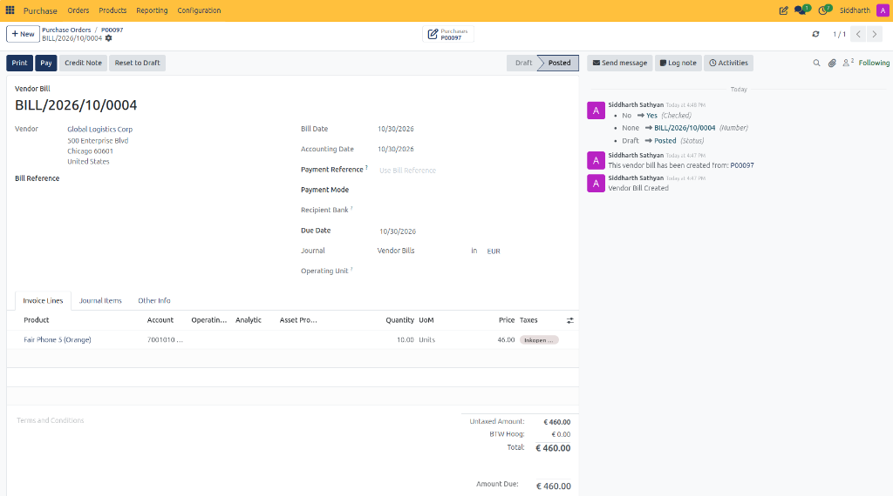
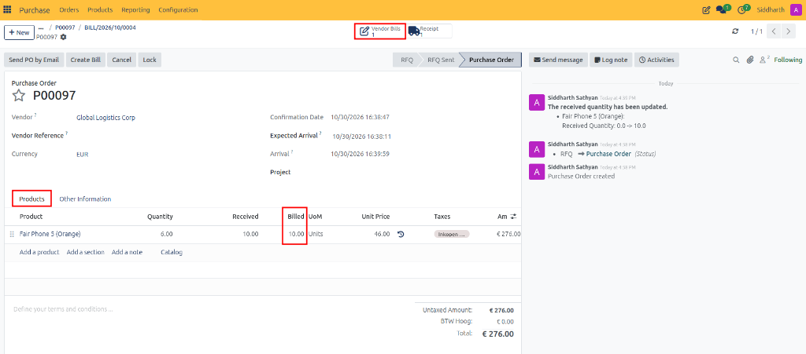
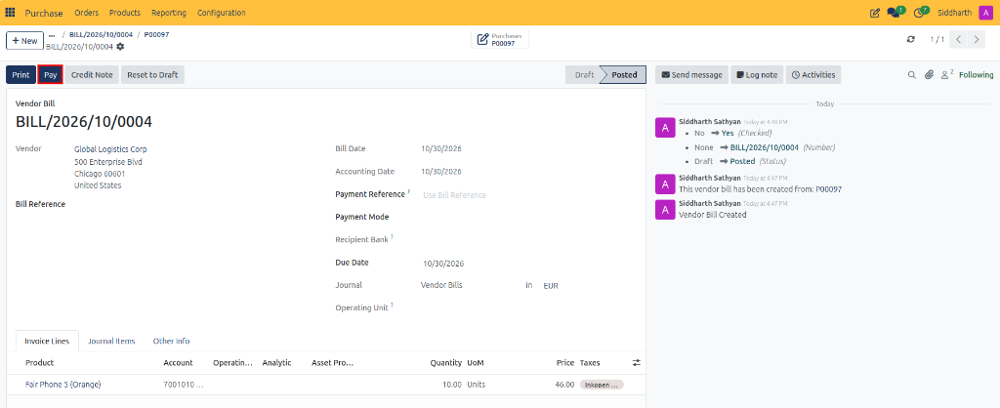
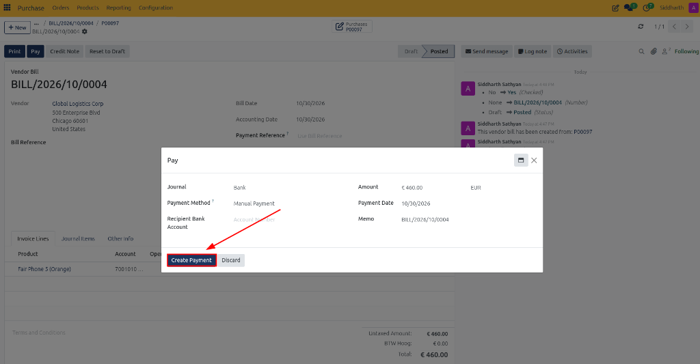
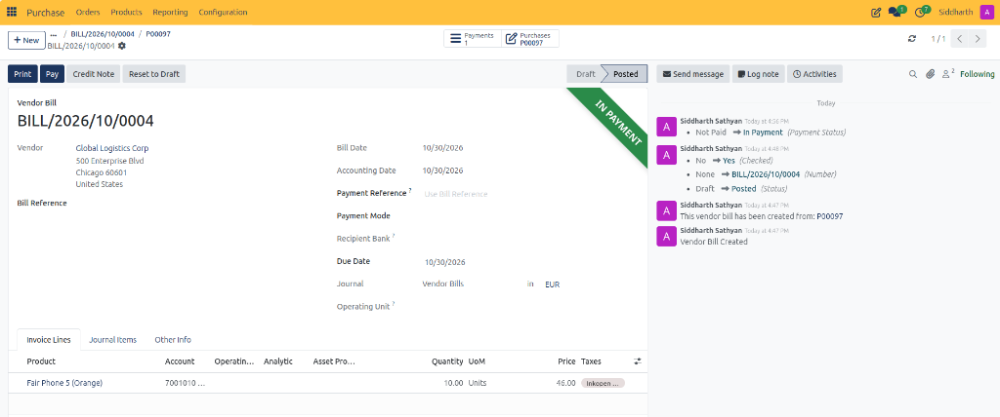

# Generate and Validate Vendor Bills

This guide covers how to generate vendor bills directly from confirmed purchase orders, complete and post bills to the general ledger, and register supplier payments in CURQ 18.

> **Prerequisites**
> * Active user account with **Purchase / User** rights.
> * Configured Chart of Accounts and partner records in **Contacts**.

---

## 1. Vendor Bill Processing Lifecycle

### 1.1 Create a Vendor Bill from the Purchase Order

1. Navigate to **Purchase → Orders → Purchase Orders** and open the confirmed order.
2. Click the **Create Bill** button in the top action bar.

3. CURQ automatically drafts a new vendor bill pre-filled with the order's vendor, line items, verified received quantities, negotiated unit prices, and applicable taxes.

---

### 1.2 Complete and Confirm the Bill

1. On the draft vendor bill form:
   * **Bill Reference**: Enter the supplier's formal invoice or tax receipt number.
   * **Bill Date**: Set the issue date stated on the vendor's invoice.
   * **Payment Terms**: Verify the agreed payment schedule (e.g., *30 Days*).
2. Click the **Confirm** button in the top action bar to post the journal entry to the general ledger.

3. The bill status updates to **Posted**, assigning an official bill number (e.g., `BILL/2026/10/0004`).

4. Returning to the originating purchase order:
   * The **Vendor Bills** smart button displays the count of linked bills.
   * Under the **Products** tab, the **Billed** column updates to reflect the invoiced quantity.

---

### 1.3 Register Supplier Payment

1. On the posted vendor bill, click the **Pay** button in the top action bar.

2. In the **Pay** modal dialog:
   * **Journal**: Select the disbursement account (e.g., *Bank*).
   * **Payment Method**: Choose the settlement method (e.g., *Manual Payment*).
   * **Amount**: Confirm the payment amount (e.g., `€ 460.00`).
   * **Payment Date**: Specify the transaction execution date.
   * **Memo**: CURQ automatically populates the bill reference (e.g., `BILL/2026/10/0004`).
3. Click **Create Payment**.

4. CURQ processes the payment:
   * The bill displays an **IN PAYMENT** ribbon across the upper-right corner.
   * A **Payments** smart button appears in the stat area to trace the linked disbursement record.
   * An automated status entry is logged in the chatter (*Not Paid → In Payment*).

---

> For complete vendor bill form field definitions (**Bill Reference**, **Bill Date**, **Accounting Date**, **Payment Terms**, **Journal**), see [**Vendor Bill Form Fields**](../settings-and-fields/02-warehouse-receipt-and-vendor-bill-field-definitions.md#4-vendor-bill-form-fields).

---

## Related Documentation

* [Reconcile Vendor Bills with Bill Matching](./07-reconcile-vendor-bills-with-bill-matching.md)
* [Receive Products and Manage Backorders](./05-receive-products-and-manage-backorders.md)
* [Understanding Bill Control and 3-Way Matching](../core-concepts/02-understanding-bill-control-and-3-way-matching.md)
* [Warehouse Receipt and Vendor Bill Field Definitions](../settings-and-fields/02-warehouse-receipt-and-vendor-bill-field-definitions.md)
