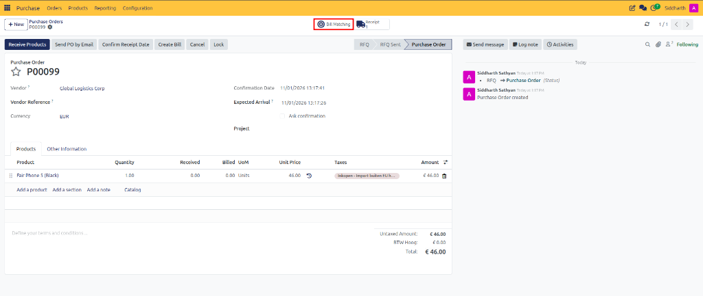
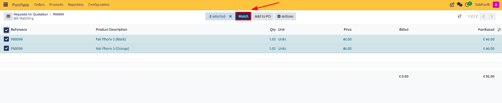

# Reconcile Vendor Bills with Bill Matching

This guide covers how to identify and reconcile procurement billing discrepancies using CURQ 18 bill matching, verify quantities and prices across purchase orders and supplier invoices, and resolve variances.

---

## 1. Reconcile Vendor Bills via Bill Matching

### 1.1 Access the Bill Matching Workspace

1. Open the confirmed purchase order from **Purchase → Orders → Purchase Orders**.
2. Click the **Bill Matching** smart button in the top-right stat area.

3. CURQ opens the linked **Bill Matching** workspace displaying the purchase order lines alongside billed quantities and unit prices.

> For definitions of all columns and discrepancy flags in the bill matching workspace, see [**Warehouse Receipt and Vendor Bill Field Definitions**](../settings-and-fields/03-warehouse-receipt-and-vendor-bill-field-definitions.md).

---

### 1.2 Match Lines and Identify Discrepancies

1. Review the paired purchase order lines and vendor bill lines:
   * **Exact Match**: Billed quantities and unit prices match confirmed purchase order lines and validated warehouse receipts exactly.
   * **Quantity Discrepancy**: The vendor billed for more units than were physically verified on warehouse receipts.
   * **Price Variance**: The vendor invoiced a higher or lower unit rate than the agreed purchase order price.

---

### 1.3 Reconcile and Match Discrepancies

1. Select the lines to reconcile using the checkboxes on the left.
2. A selection toolbar appears displaying the count of selected records (e.g., `2 selected`).
3. Click the **Match** button in the action toolbar to pair the documents and clear the verification flag.

4. Once matched, CURQ aligns the procurement lines with accounting records, confirming full reconciliation across commercial, logistics, and billing data.

---

## Related Documentation

* [Generate and Validate Vendor Bills](./06-generate-and-validate-vendor-bills.md)
* [Receive Products and Manage Backorders](./05-receive-products-and-manage-backorders.md)
* [Understanding Bill Control and 3-Way Matching](../core-concepts/02-understanding-bill-control-and-3-way-matching.md)
* [Warehouse Receipt and Vendor Bill Field Definitions](../settings-and-fields/03-warehouse-receipt-and-vendor-bill-field-definitions.md)
