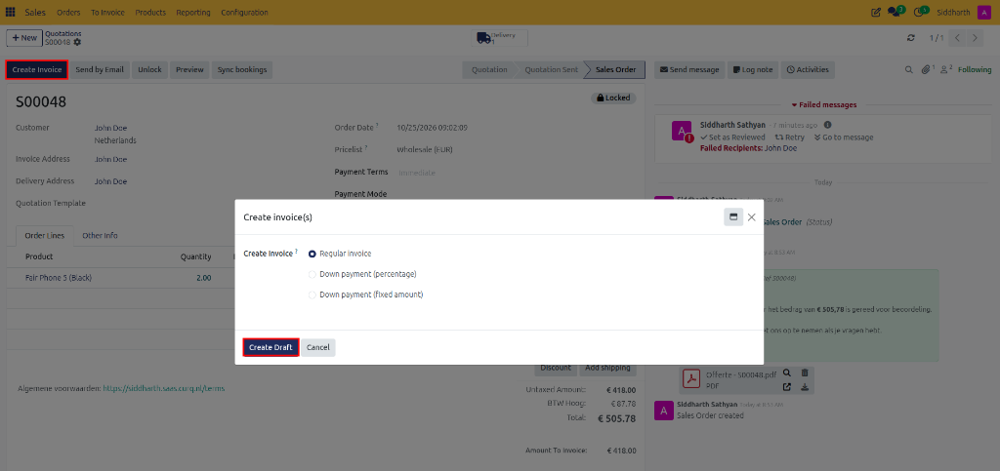

# Overview & Process Your First Sale from Quote to Invoice

Welcome to CURQ Sales. The **Sales** application acts as the central revenue engine, orchestrating the entire commercial transaction lifecycle from initial inquiry to payment reconciliation. It connects commercial negotiation, product catalog governance, warehouse fulfillment, and accounts receivable invoicing into a single, cohesive workflow.

In this tutorial, you will build a clear mental model of how CURQ organizes the sales cycle and complete a hands-on exercise to draft a customer quotation, confirm it into a binding sales order, generate an invoice, and record payment in 5 quick steps.

```{mermaid}
flowchart LR
    Q["`**Draft Quotation**
    Products & Pricing`"] --> S["`**Sent Quotation**
    Customer Review`"] --> C["`**Confirmed Order**
    Locked Agreement`"]
    C --> D["`**Delivery**
    Warehouse Picking`"]
    C --> I["`**Invoicing**
    Payment & Ledger`"]
```

---

## Hands-On Exercise: Process Your First Sale from Quote to Invoice

### Scenario Overview

A prospective customer, **John Doe**, contacts your sales department requesting a quotation for mobile devices:
* **Product**: `Fair Phone 5 (Black)`
* **Quantity**: `2`
* **Price**: Catalog price (`€ 209.00` each)

You will guide this transaction through the complete commercial sales cycle:

```{mermaid}
flowchart LR
    D["`**Draft Quote**`"] --> S["`**Send Email**`"] --> C["`**Confirm Order**`"] --> I["`**Create Invoice**`"] --> P["`**Paid**`"]
```

---

## Step 1: Create a Draft Quotation

1. Open the **Sales** app from your main CURQ dashboard.
2. In the top action bar, click **+ New** to open a blank quotation form.

   

3. In the **Customer** field, select `John Doe`. CURQ automatically populates default payment terms and customer address details.
4. Leave the **Expiration** date and default currency settings at their system defaults.

---

## Step 2: Add Products to the Order

1. Under the **Order Lines** tab, click **Add a product**.
2. In the **Product** column, select `Fair Phone 5 (Black)`.
3. In the **Quantity** field, enter `2.00`.

   

4. Verify that CURQ calculates the line subtotal (`€ 418.00`) and adds the 21% tax rate (`€ 87.78`) automatically, displaying a total of `€ 505.78` in the bottom-right summary.

---

## Step 3: Send the Quotation to the Customer

1. In the top-left action header, click **Send by Email**.

   

2. A pre-formatted email composition window appears with a PDF copy of the quotation attached *(e.g., `Offerte - S00048.pdf`)*.
3. Review the recipient email address and message template, then click **Send**.

   

4. Observe the order status in the upper right progress bar change from **Quotation** to **Quotation Sent**.

---

## Step 4: Confirm the Sales Order

When the customer agrees to the proposal:

1. On the quotation screen, observe the status is now **Quotation Sent**. Click **Confirm** in the top action bar.

   

2. The status indicator advances to **Sales Order**, and CURQ automatically assigns an official sales order sequence number *(e.g., `S00048`)*.
3. A delivery order smart button appears in the upper right corner to notify warehouse personnel.

---

## Step 5: Create the Customer Invoice and Record Payment

1. With the order confirmed, click **Create Invoice** in the top action bar.
2. In the modal dialog, ensure **Regular invoice** is selected, then click **Create Draft**.

   

3. Review the generated customer invoice, then click **Confirm** to post it to the financial ledger.
4. Click **Register Payment**, verify the bank journal and payment amount, and click **Create Payment**.
5. The invoice status badge immediately displays a green **Paid** ribbon.

---

## What You Accomplished

You completed an end-to-end sales cycle in CURQ 18:
* Created and customized a professional customer offer.
* Dispatched the quote with an automated PDF attachment.
* Transitioned the prospect into a confirmed legal sales order.
* Generated the accounting invoice and collected payment.

---

## Related Documentation

* [Complete a Sale with Online Signature and Payment](./02-complete-a-sale-with-online-signature-and-payment.md)
* [Create and Send Quotations](../task-guides/01-create-and-send-quotations.md)
* [Configure Pricelists and Pricing Rules](../task-guides/08-configure-pricelists-and-pricing-rules.md)
* [Quotation and Sales Order Field Definitions](../settings-and-fields/01-quotation-and-sales-order-field-definitions.md)
* [Understanding the Sales Order Lifecycle and State Machine](../core-concepts/01-understanding-the-sales-order-lifecycle.md)
* [Understanding Invoicing and Fulfillment](../core-concepts/02-understanding-invoicing-and-fulfillment.md)
* [Frequently Asked Questions](../faq.md)
