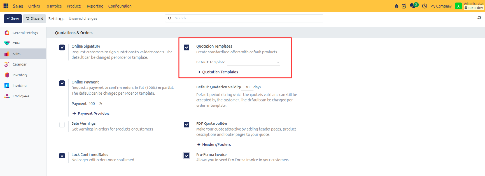
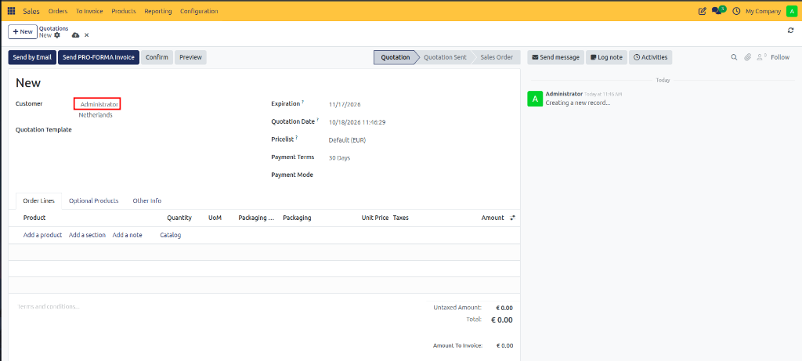
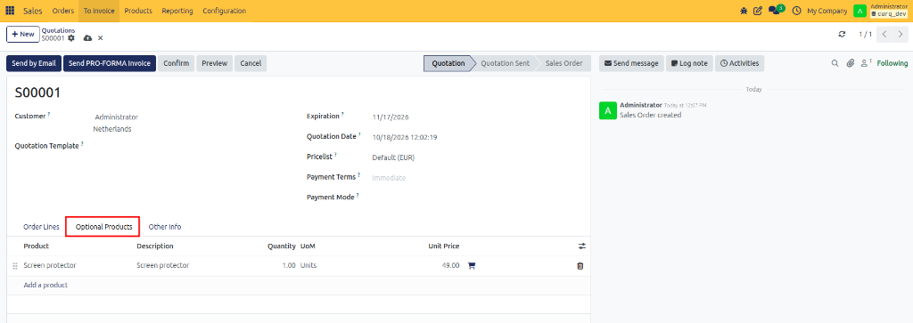
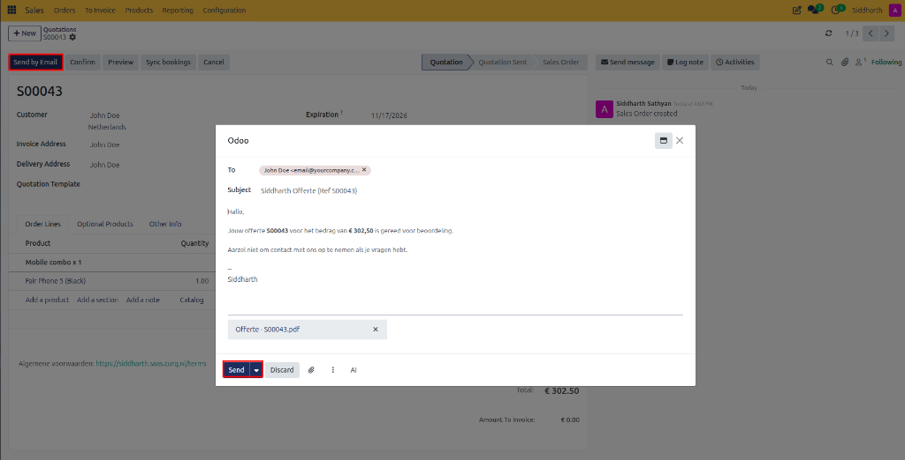
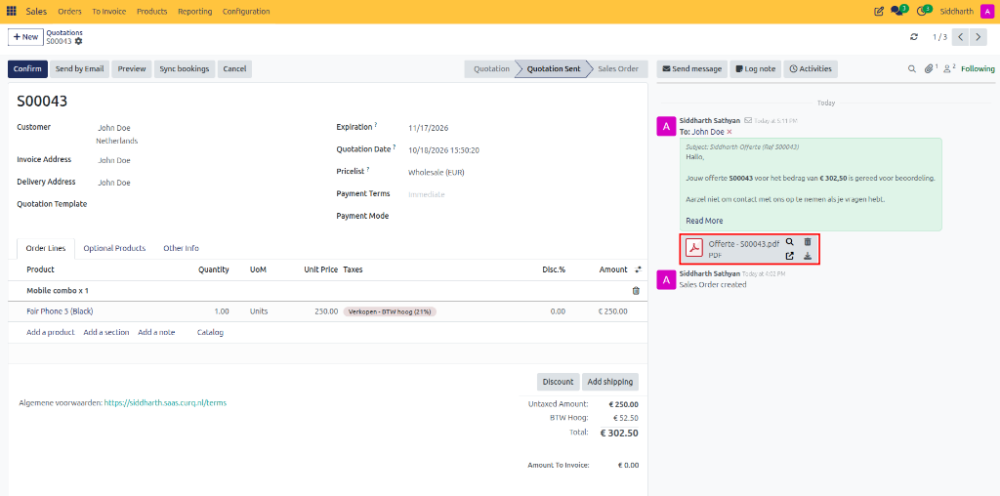

# How-To: Create and Send Quotations

Create commercial offers, organize lines with sections and notes, configure packaging, attach optional add-on products, deliver proposals via email, track customer views, and print formal PDF quotes in CURQ 18 Sales.

---

### Prerequisites
* Ensure customer records are registered in [Contacts](../../Contacts/how-to/01-create-and-manage-contacts.md) or created directly from the quotation customer dropdown.
* Verify products are configured in **Sales > Products > Products**.
* Outgoing email servers must be operational in system settings.
* *(Optional)* To use quotation templates and pre-defined packaging lots, ensure they are enabled in **Sales > Configuration > Settings**:

   

   

---

### Task 1: Create a Blank Quotation and Select Customer

1. Open the **Sales** app.
2. In the top action bar, click **+ New**.

   

3. In the **Customer** field, select an existing contact or type a new company name and click **Create and edit...**.
4. Review the auto-populated addresses:
   * **Invoice Address**: The legal billing destination.
   * **Delivery Address**: The destination warehouse or physical delivery location.
5. In the **Expiration** field, choose a validity deadline. After this date, the customer cannot confirm the quotation online.
6. *(Optional)* Select a **Quotation Template** to load standard product bundles and default terms.

   

---

### Task 2: Add and Structure Order Lines

1. Under the **Order Lines** tab, click **Add a product**.
2. Select your catalog item from the dropdown. CURQ automatically retrieves the unit price, applicable taxes, and unit of measure.
3. In the **Quantity** column, enter the quantity to sell.
4. *(Optional)* If selling in pre-packaged lots:
   * In the **Packaging** column, select the packaging standard *(e.g., `Box of 10`)*.
   * In **Packaging Qty**, enter the number of packages; CURQ updates the total item quantity automatically.

   

5. Organize complex quotations using structural lines:
   * Click **Add a section** to create bold grouping headers *(e.g., `Hardware Components`)*.
   * Click **Add a note** to insert client-facing delivery instructions or warranty terms.
   * Use the drag handles on the left of each row to reorder items within sections.

---

### Task 3: Attach Optional Products

Provide suggestive up-sells that customers can browse and add independently in the customer portal:

1. Click the **Optional Products** tab.
2. Click **Add a product**.
3. Select complementary items *(such as maintenance agreements, screen protectors, or power cables)* and enter recommended quantities.

   

4. When the customer opens the online quotation, optional items appear in a dedicated section with an **Add to Order** button.

---

### Task 4: Configure Commercial and Shipping Details

1. Open the **Other Info** tab.

   

2. Review commercial attribution fields:
   * **Salesperson**: The internal executive managing the account.
   * **Sales Team**: The revenue unit credited for reporting.
   * **Customer Reference**: The customer's internal purchase order (PO) number.
   * **Tags**: Color-coded categorization labels.
3. Review delivery and fiscal policies:
   * **Shipping Policy**: Choose **As soon as possible** or **When all products are ready**.
   * **Fiscal Position**: Automatic or manual tax mapping rule for international sales.
4. Click the cloud icon in the top header (or press `Ctrl+S`) to save your quotation.

---

### Task 5: Send the Quotation by Email

1. Open the quotation from **Sales > Orders > Quotations** *(e.g., `S00043`)*.
2. In the top-left action header, click **Send by Email**.

   

3. In the email composer modal:
   * **Recipients**: Verified customer contacts are added automatically *(e.g., `John Doe`)*. Click to append colleagues or internal account managers.
   * **Subject**: Defaults to standard template syntax *(e.g., `Siddharth Offerte (Ref S00043)`)*.
   * **Body**: Edit the cover message or leave the automated dynamic greetings.
   * **Attachments**: CURQ automatically compiles and attaches a real-time PDF copy of the quotation *(e.g., `Offerte - S00043.pdf`)*.

   

4. Click **Send**.
5. The top status bar changes from **Quotation** to **Quotation Sent**.
6. The email transmission, PDF copy, and timestamp are logged in the right-hand **Chatter**:

   

---

### Task 6: Preview Customer Portal and Print Formal PDF Quotes

Before sending, or while reviewing terms over the phone with a customer:

1. In the header action bar, click **Customer Preview**.

   

2. CURQ opens the customer portal view in a browser tab.
3. Observe the client perspective:
   * Professional itemized table with prices, quantities, taxes, and totals.
   * Download and Print buttons for the customer to export PDF copies.
   * Interactive **Optional Products** section where clients can toggle add-ons.
   * **Sign & Pay** action buttons (if enabled in settings).
4. Close the preview tab to return to the backend.
5. **Printing Physical PDF Quotations**:
   * For in-person meetings or postal delivery, click the **⚙ Actions** menu (or click the **Print** icon at the top).
   * Select **Quotation / Order**.
   * CURQ downloads a formatted PDF document containing your company logo, billing address, tax breakdown, and general sales terms.

---

### Edge Cases & Recovery Steps

* **Quotation Expired Before Customer Signature**: If a customer attempts to sign an expired quote, CURQ displays a notice that the offer has expired. To revalidate, open the quote in the backend, extend the date in the **Expiration** field, and click **Send by Email** to inform the client.
* **Customer Address Missing**: If a selected customer lacks an invoice or delivery address, click the external link arrow next to the **Customer** field, enter the required addresses in the contact modal, and click **Save**.
* **Accidental Item Deletion**: If an order line is deleted by mistake, click **Add a product** to restore it. Once saved, line changes are audited in the right-hand Chatter.
* **Customer Bounces or Reports Missing Email**: Open the quotation Chatter. If an email fails, a red warning icon appears next to the Chatter entry. Verify the customer's email address by clicking the external link on their contact record, update the address, and click **Send by Email** again.
* **Customer Viewed Tracking**: When the recipient clicks the secure link in their email to open the customer portal, CURQ logs an automated system message in Chatter: *"Quotation viewed by customer"*. This confirms deliverability without requiring follow-up phone calls.
* **Re-Sending Revised Quotations**: If prices or quantities change after sending, make the modifications, save, and click **Send by Email**. CURQ generates a fresh PDF reflecting the latest revisions.

---

### Related Documentation
* [Tutorial: Process Your First Sale from Quote to Invoice](../tutorials/01-process-your-first-sale.md)
* [How-To: Confirm and Lock Sales Orders](./03-confirm-and-lock-sales-orders.md)
* [How-To: Configure Quotation Templates and PDF Quote Builder](./10-configure-quotation-templates.md)
* [How-To: Track Sales Margins and Reports](./15-track-sales-margins-and-reports.md)
* [Reference: Quotation and Sales Order Field Definitions](../reference/01-quotation-and-sales-order-field-definitions.md)
