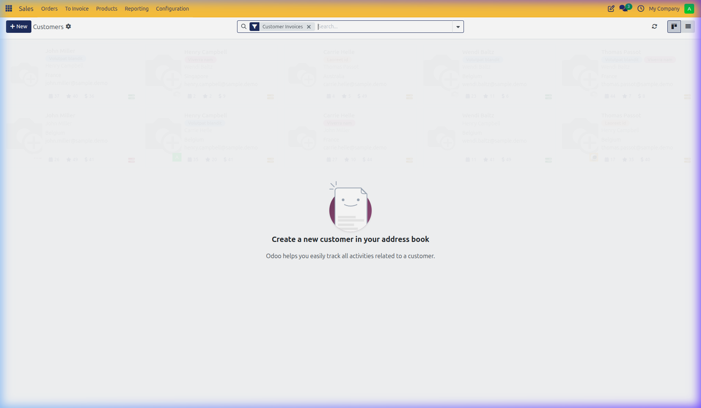
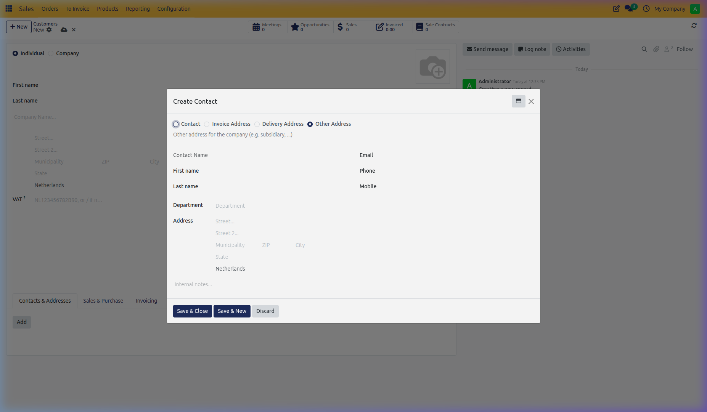
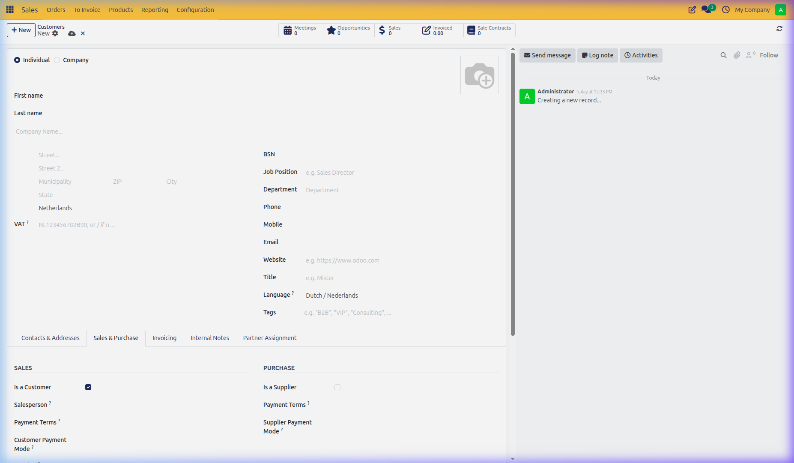
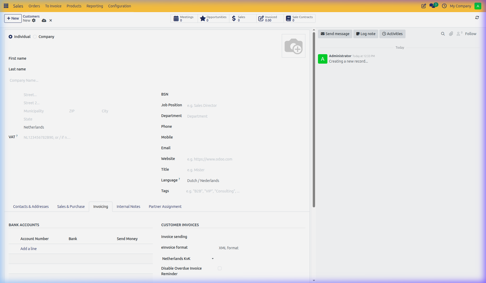
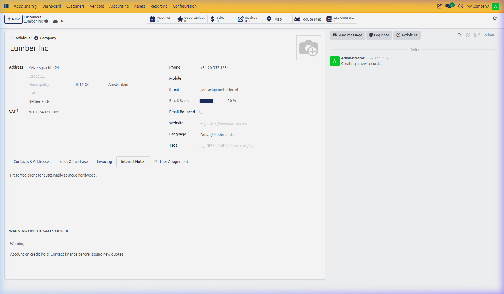

# How-To: Manage Customers and Commercial Addresses

Create customer records, configure multiple delivery and invoicing addresses, set commercial pricing terms, and establish sales order warning rules in CURQ 18 Sales.

---

### Prerequisites
* Sales User or Administrator access in CURQ 18.
* *(Optional)* To enable warning pop-ups, check **Sale Warnings** in **Sales > Configuration > Settings**.

---

### Task 1: Create a Customer Record (Individual vs. Company)

Every quotation and sales order requires a customer account. To create a new customer:

1. In the top navigation bar, click **Orders > Customers**.
2. Click **+ New** at the top left of the screen.

   

3. Select whether the contact is an **Individual** or a **Company**:

   

4. Configure primary contact fields:
   * **Company Name**: When creating an individual, link them to an existing parent corporate account.
   * **Job Position & Title**: Specify the contact's professional role *(e.g., Purchasing Director)* and honorific *(e.g., Mr., Dr.)*.
   * **Email**: Primary electronic mailbox required for sending quotation emails and customer portal invitations.
   * **Phone & Mobile**: Direct phone numbers displayed on quotations, delivery slips, and invoices.
   * **Language**: Select the client's preferred language. Quotation PDFs, portal pages, and invoice emails render in this language automatically.
   * **Tags**: Assign categorization badges *(such as `VIP`, `Wholesale`, or `Prospect`)*.
5. CURQ auto-saves updates as you enter information.

---

### Task 2: Manage Multiple Delivery and Invoicing Addresses

Large corporate customers often centralize accounting at headquarters while receiving goods at regional warehouses or branch offices:

1. On the customer record, locate the **Contacts & Addresses** tab.
2. Click **Add**.
3. In the **Create Contact** modal, choose the address type:
   * **Invoice Address**: The dedicated billing office where invoices and statements are routed.
   * **Delivery Address**: Physical shipping warehouse or receiving dock printed on warehouse picking and delivery slips.
   * **Contact**: An employee, buyer, or site manager linked to this company.
   * **Other Address**: Secondary office, showroom, or regional branch.

   

4. Enter the contact name, street address, and direct phone/email coordinates for this location.
5. Click **Save & Close** (or **Save & New** to add additional branch addresses).
6. When drafting a quotation for this client, selecting their company automatically populates the default invoice and delivery addresses while allowing sales reps to select branch alternatives.

---

### Task 3: Configure Commercial and Fiscal Terms

Open the customer record and click the **Sales & Purchase** tab:

1. Under the **Sales** section:
   * **Salesperson**: Assign a dedicated internal account executive. New quotations prefill this salesperson automatically.
   * **Payment Terms**: Select the default payment schedule *(e.g., `30 Days` or `Immediate Payment`)*.
   * **Pricelist**: Assign customer-specific negotiated pricing tiers, wholesale schedules, or foreign currencies.
   * **Delivery Method**: Assign a default shipping carrier *(e.g., `Standard Ground Shipping`)*.
2. Under the **Fiscal Information** section:
   * **Fiscal Position**: Assign tax mapping rules for tax-exempt, domestic, or international B2B clients.
3. Under the **Miscellaneous** section:
   * **Reference**: Enter an internal client account code or legacy customer ID.
   * **Company ID**: Official government business registration number.

---

### Task 4: Configure Electronic Invoicing and Banking

Under the **Invoicing** tab, establish banking coordinates and e-invoicing exchange parameters:

1. **Bank Accounts**: Click **Add a line** to register the partner's bank account number (`IBAN`), bank name, and check **Send Money** if issuing refunds.
2. **Customer Invoices Settings**:
   * **Invoice sending**: Choose **by Email** or **Download**.
   * **eInvoice format**: Select applicable XML e-invoicing standards *(such as `France Factur-X`, `EU Peppol BIS 3.0`, `Germany XRechnung`, or `Netherlands NLCIUS`)*.
   * **Peppol ID**: Enter the company's Peppol participant identifier and scheme *(e.g., VAT or SIRET)*.
3. **Automated Vendor Bill Rules**:
   * **Auto-post bills**: Choose **Ask after 3 validations without edits** (default), **Always**, or **Never**.
   * **Ignore Abnormal Invoice Amount**: Check to bypass unusual high-value verification warning alerts for trusted partners.
   * **Ignore Abnormal Invoice Date**: Check to bypass date discrepancy warnings when bills or invoices carry backdated or distant future dates.

---

### Task 5: Set Customer Sales Order Warnings and Credit Holds

If a customer has a credit hold, pending lawsuit, or strict packaging requirement, configure automatic alerts:

1. Open the customer record and click the **Internal Notes** tab.
2. In the **Warning on the Sales Order** section, select an alert level:
   * **No Message**: Standard operation with no alerts.
   * **Warning**: Displays an informative pop-up alert on screen when sales reps select this customer, but allows them to proceed.
   * **Blocking Message**: Displays an error modal and completely blocks sales staff from saving or confirming quotations for this customer.
3. Type the message text in the prompt box *(e.g., `Account on credit hold: Contact finance before issuing new quotes`)*.

   

4. Click the cloud icon to save.

---

### Edge Cases & Recovery Steps

* **Overriding a Blocking Message**: If an executive authorizes an exception for a customer with a blocking message, open the customer record, temporarily set **Warning on the Sales Order** to **Warning** or **No Message**, confirm the quote, and restore the block.
* **Customer Address Conflict on Existing Quotations**: Changing a customer's address on their master contact card does not alter already-confirmed historical sales orders, protecting historical delivery slips and tax audits.

---

### Related Documentation
* [How-To: Create and Manage Quotations](./01-create-and-send-quotations.md)
* [How-To: Configure Pricelists and Pricing Rules](./08-configure-pricelists-and-pricing-rules.md)
* [Reference: Quotation and Sales Order Field Definitions](../reference/01-quotation-and-sales-order-field-definitions.md)
