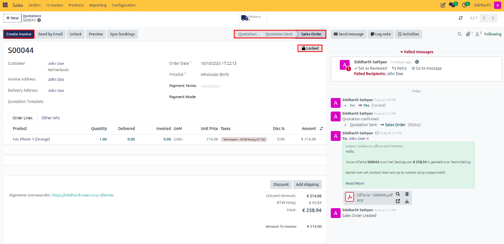
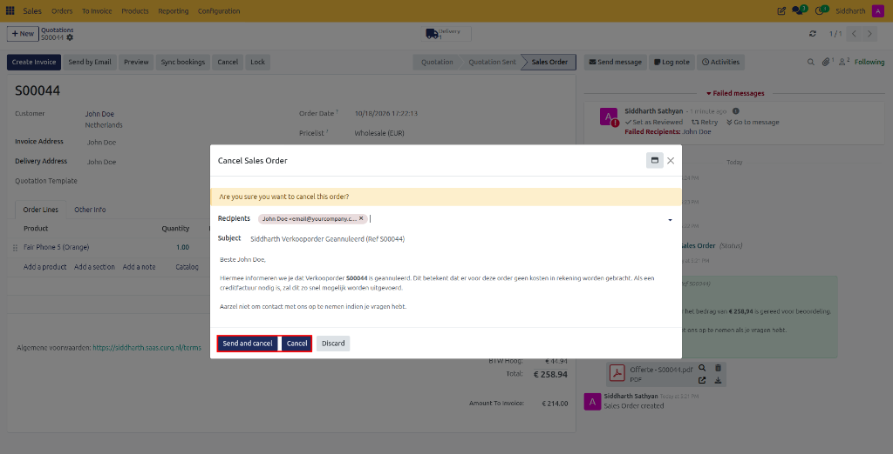

# How-To: Confirm and Lock Sales Orders

Transition quotations into binding sales orders, manage automatic order locking, perform authorized revisions, and process order cancellations in CURQ 18 Sales.

---

### Prerequisites
* An open quotation in **Draft** or **Quotation Sent** status.
* Appropriate user access rights (Sales User or Sales Administrator).

---

### Task 1: Manually Confirm a Quotation into a Sales Order

When a customer accepts a proposal via phone, email, or in-person agreement:

1. Open the quotation (e.g., `S00044`) from **Sales > Orders > Quotations**.
2. In the top action bar, click **Confirm**.

   

3. Observe the operational triggers executed by CURQ:
   * The status progression bar advances to **Sales Order**.
   * A **Delivery** smart button appears in the top stat bar (e.g., `Delivery 1`), tracking linked warehouse pickings.
   * The primary action button updates to **Create Invoice**.
   * If automatic locking is active, a black **Locked** badge appears in the sheet header and the **Unlock** button is displayed.
   * The chatter records the confirmation and lock transitions.

   

---

### Task 2: Lock and Unlock Confirmed Sales Orders

To prevent accidental price tampering or unauthorized alterations once production or shipping begins:

1. In **Sales > Configuration > Settings**, ensure **Lock Confirmed Sales** is checked under the **Quotations & Orders** section.
2. When enabled, confirmed orders automatically display a **Locked** badge in the upper right of the form sheet.
3. If an authorized modification is required *(such as increasing ordered quantities or updating shipping notes)*:
   * Click **Unlock** in the top action bar.
   * The order enters an editable state.
   * Make your adjustments, save, and click **Lock** to re-secure the contract.

---

### Task 3: Cancel a Sales Order

If a customer retracts an order or a commercial agreement dissolves:

1. Open the confirmed sales order.
2. In the top action bar, click **Cancel**.

   

3. The **Cancel Sales Order** dialog opens with the prompt *"Are you sure you want to cancel this order?"*, pre-populating customer **Recipients** and the cancellation email template.
4. Select your preferred cancellation action:
   * Click **Send and cancel** to deliver the cancellation notification email to the customer and cancel the order simultaneously.
   * Click **Cancel** to cancel the sales order immediately without sending an email notification.
   *(Or click **Discard** to abort the cancellation and retain the active order).*
5. CURQ executes safety rollbacks:
   * The status bar updates to **Cancelled**.
   * Any linked unfulfilled warehouse delivery pickings are cancelled automatically.
   * Reserved stock quantities are immediately released back into available inventory.
   * Chatter logs the cancellation and any sent customer communications.

---

### Task 4: Reactivate a Cancelled Order

If a customer reconsiders or a cancellation was executed prematurely:

1. Open the cancelled sales order.
2. In the top action bar, click **Set to Quotation**.
3. The order resets to **Draft Quotation** status.
4. Modify prices, terms, or quantities as required, and click **Confirm** when ready to proceed.

---

### Edge Cases & Recovery Steps

* **Order Has Draft or Posted Invoices**: You cannot cancel a sales order if an active posted invoice exists. You must first open the invoice via the **Invoices** smart button, click **Add Credit Note** (or **Reset to Draft > Cancel**), and then return to cancel the sales order.
* **Partial Deliveries Already Processed**: If warehouse personnel already validated shipment for part of the order, cancelling the sales order will cancel remaining backorders, but will preserve the historical record of already-delivered items for billing.

---

### Related Documentation
* [Tutorial: Process Your First Sale from Quote to Invoice](../tutorials/01-process-your-first-sale.md)
* [How-To: Invoice Sales Orders](./04-invoice-sales-orders.md)
* [Explanation: Understanding the Sales Order Lifecycle and State Machine](../explanation/01-understanding-the-sales-order-lifecycle.md)
* [Reference: Quotation and Sales Order Field Definitions](../reference/01-quotation-and-sales-order-field-definitions.md)
