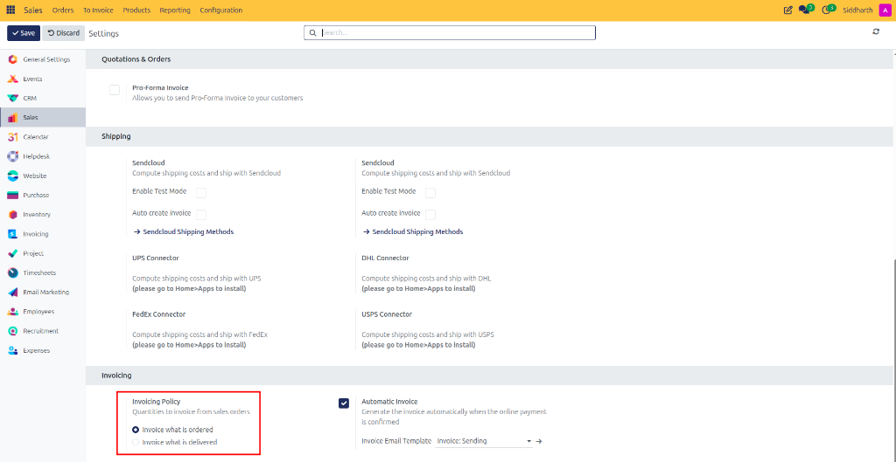
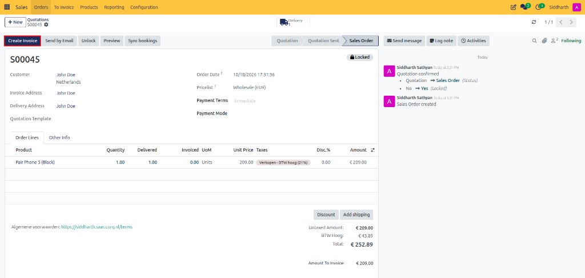
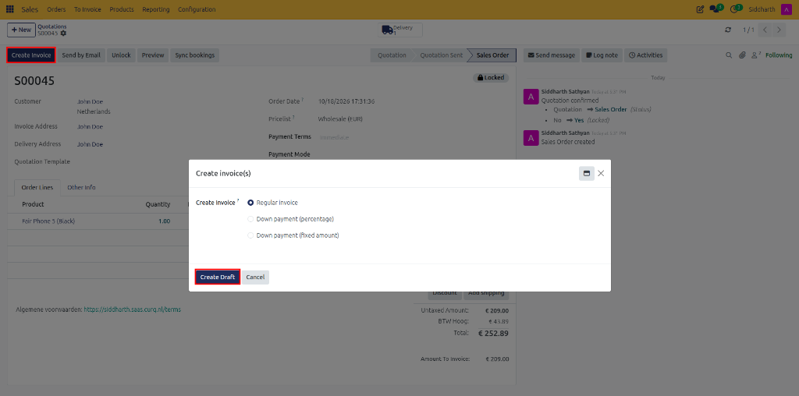
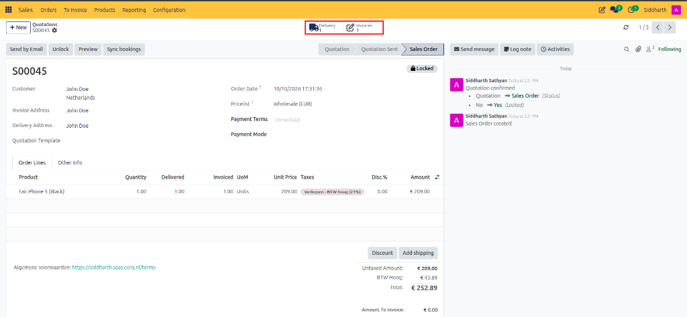
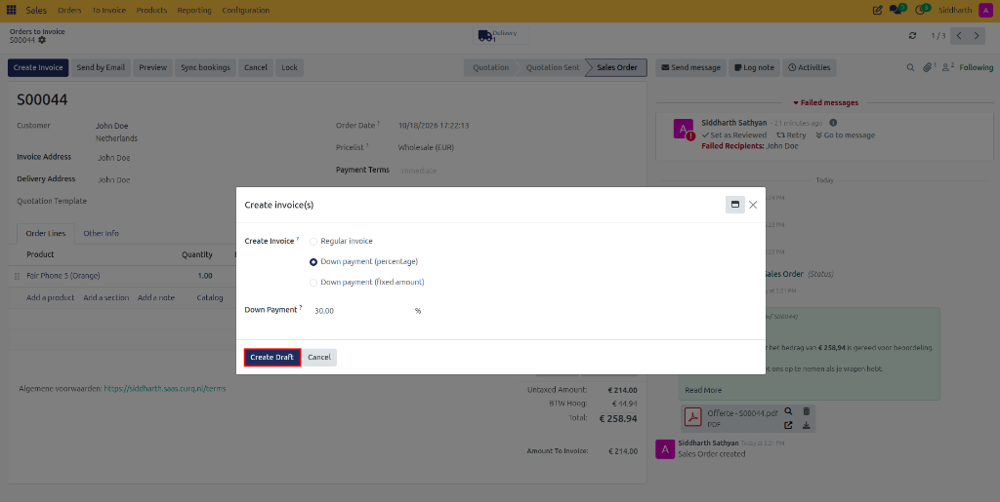
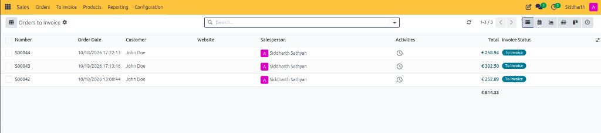
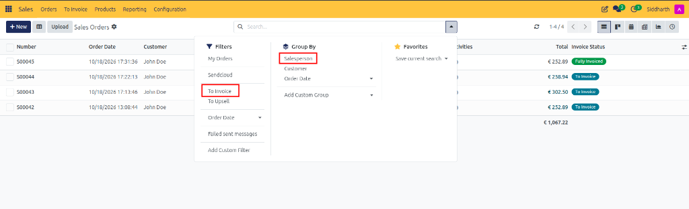
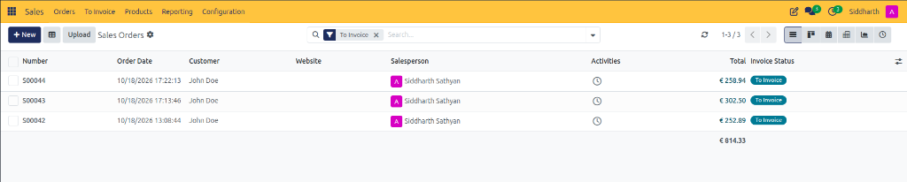
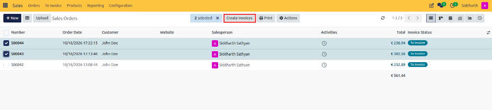

# How-To: Invoice Sales Orders

Generate customer invoices from confirmed sales orders, bill down payments and retainers, and batch-process pending orders to invoice in CURQ 18 Sales.

---

### Prerequisites
* A confirmed sales order in **Sales Order** status (e.g., `S00045`).
* If products use the **Invoice what is delivered** policy, warehouse delivery slips (e.g., `WH/OUT/00072`) must be validated before invoiceable lines appear:

   

* Sales invoicing settings configured in **Sales > Configuration > Settings**:

   

---

### Task 1: Create a Standard Invoice from a Sales Order

1. Open the confirmed sales order (e.g., `S00045`) from **Sales > Orders > Orders** (or **Quotations**).
2. In the top action bar, click **Create Invoice**.

   

3. In the **Create invoice(s)** modal dialog, ensure **Regular invoice** is selected.

   

4. Click **Create Draft** to generate and open the draft customer invoice.
5. On the draft invoice (e.g., `INV/2026/00001`):
   * Verify line items, quantities, prices, taxes, and accounting journals.
   * Notice the linked source document reference (`S00045`) in the chatter and the **Sale Orders** smart button.

   

6. Click **Confirm** to post the invoice and assign an official invoice sequence number.
7. Click **Send & Print** to email the invoice to the customer.
8. Track invoicing progress directly from the confirmed sales order via the stat buttons and line item columns:
   * Observe the **Invoices 1** smart button appearing alongside **Delivery 1**.
   * Note the **Invoiced** column updating to `1.00`, and **Amount To Invoice** reducing to `€ 0.00`.

   

---

### Task 2: Bill Down Payments and Retainers

For custom manufacturing, large enterprise contracts, or service agreements requiring upfront deposits:

1. On the confirmed sales order (e.g., `S00044`), click **Create Invoice**.
2. Select your down payment method:
   * **Down payment (percentage)**: Enter a percentage of the total order *(e.g., `30.00 %`)*.
   * **Down payment (fixed amount)**: Enter a precise monetary deposit value *(e.g., `$ 500.00`)*.

   

3. In the **Income Account** field, verify the unearned revenue balance account if prompted.
4. Click **Create Draft** and confirm the deposit invoice in Accounting.
5. **Deducting Down Payments on Final Invoicing**:
   * When final delivery occurs, return to the sales order and click **Create Invoice**.
   * Select **Regular invoice** and ensure **Deduct down payments** is checked.
   * CURQ adds the delivered products and automatically inserts negative line items corresponding to the previously billed down payments, ensuring the customer is billed only for the remaining balance.

---

### Task 3: Batch Process Orders Ready to Invoice

To process billing efficiently across multiple completed deliveries at the end of a week or month:

1. In the top navigation bar, click **To Invoice > Orders to Invoice**.

   

2. Review the list of all sales orders where delivered or ordered quantities exceed invoiced quantities (e.g., `S00044`, `S00043`, `S00042` displaying **To Invoice** status):

   

   Use search filters such as **To Invoice** and group by **Salesperson** to organize orders ready for billing:

   

   The filtered list displays all unbilled orders matching your criteria:

   

3. Select the checkboxes on the left for all orders you wish to bill (e.g., `S00044` and `S00043`), or click the master checkbox at the top left to select all.
4. Click **Create Invoices** in the top action bar.

   

5. In the confirmation modal, select **Regular invoice** and click **Create Draft**.
6. CURQ generates distinct draft invoices grouped by customer and fiscal policy.

---

### Edge Cases & Recovery Steps

* **"There are no invoiceable lines" Error**: If clicking *Create Invoice* triggers this warning, verify your product invoicing policy under **Product > General Information > Invoicing Policy**. If set to *Delivered quantities*, the warehouse must validate delivery first (`Delivered` column must be greater than `0`).
* **Correcting an Incorrectly Invoiced Amount**: If an invoice is confirmed with incorrect amounts, open the invoice from the **Invoices** smart button, click **Credit Note**, enter the credit reason, and post the refund. The sales order lines automatically recalculate their un-invoiced balances.

---

### Related Documentation
* [Tutorial: Process Your First Sale from Quote to Invoice](../tutorials/01-process-your-first-sale.md)
* [Explanation: Understanding Invoicing and Fulfillment](../explanation/02-understanding-invoicing-and-fulfillment.md)
* [Reference: Sales Configuration and Delivery Settings](../reference/03-sales-configuration-and-delivery-settings.md)
