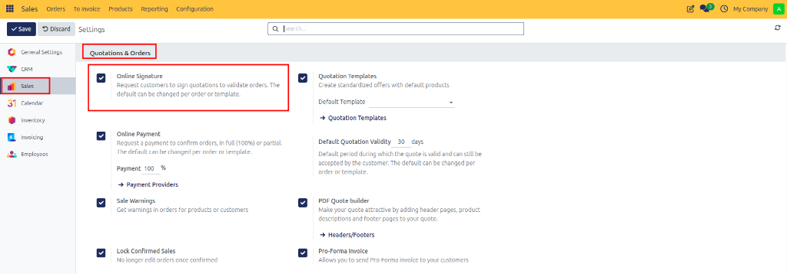
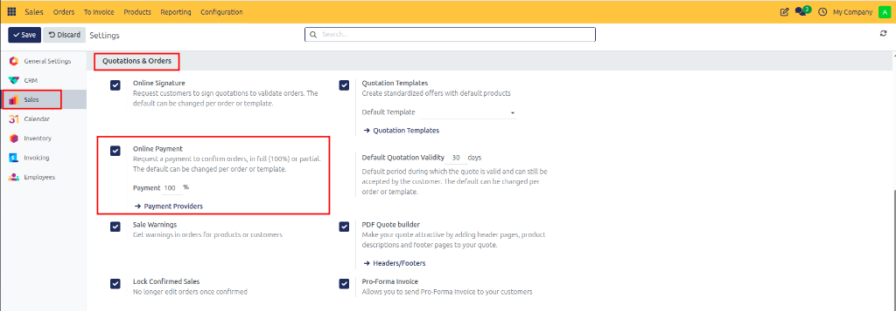
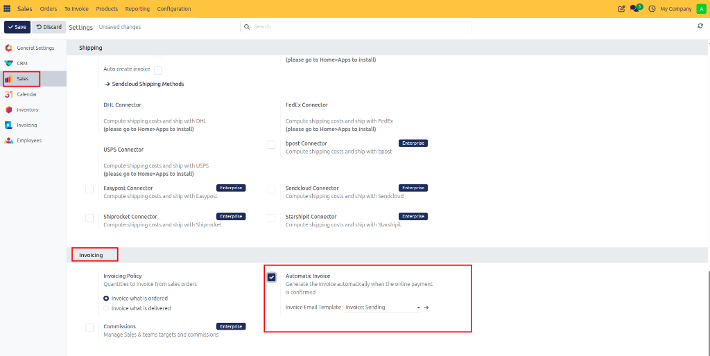
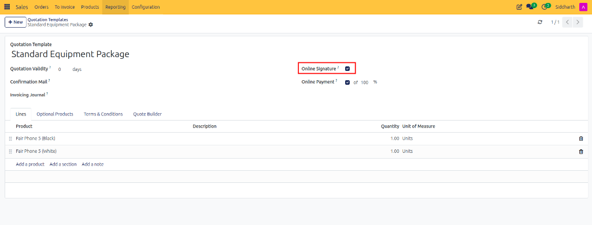
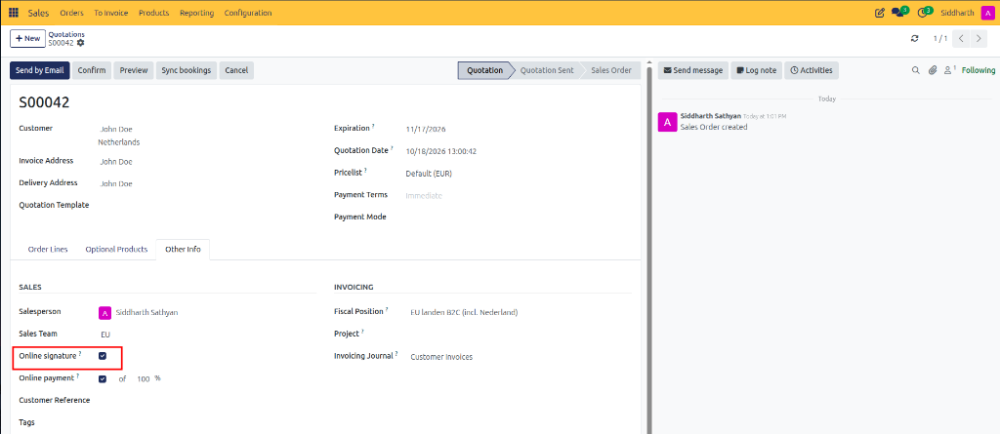
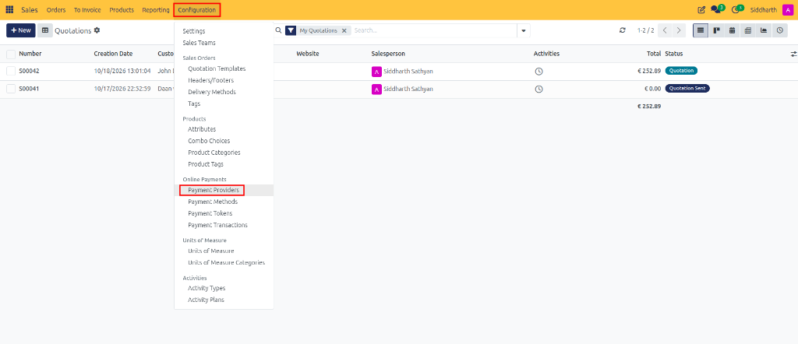
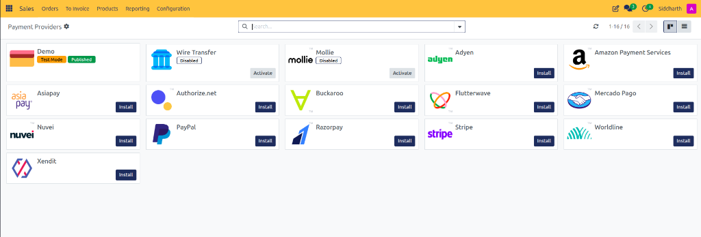
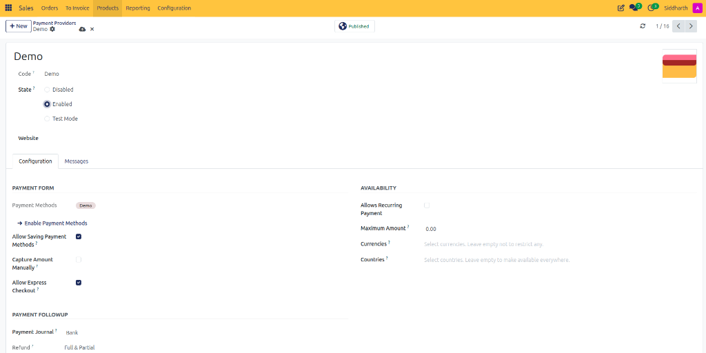
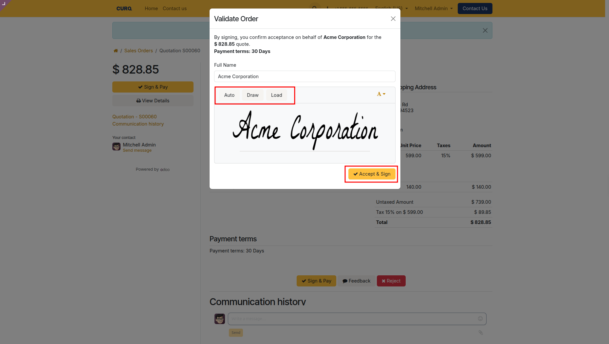

# How-To: Manage Customer Approvals and Online Payments

Configure digital signatures, require online prepayments, set deposit percentages, and connect payment provider gateways in CURQ 18 Sales.

---

### Prerequisites
* Sales Administrator rights to modify settings and payment gateways.
* Valid merchant account credentials (if connecting live online payment providers like Stripe, PayPal, or Adyen).

---

### Task 1: Enable Online Signature and Payment Globally

1. Open **Sales > Configuration > Settings**.
2. Locate the **Quotations & Orders** section:

   

3. Configure confirmation controls:
   * Check **Online Signature**: Requests digital customer signatures on portal quotes.
   * Check **Online Payment**: Demands an online prepayment to confirm orders.
   * Set the default **Prepayment amount** *(e.g., `100.00 %` or a standard deposit like `20.00 %`)*:

   

4. Under **Invoicing**, enable **Automatic Invoice** if you want invoices automatically generated and posted upon payment:

   

5. Click **Save** in the top action bar.

---

### Task 2: Configure Quotation-Specific and Template Sign and Pay Rules

You can establish default rules on quotation templates or customize policies on individual contracts:

1. **On Quotation Templates**:
   * Navigate to **Sales > Configuration > Quotation Templates** and open a template.
   * Under the **Optional Products** tab, configure the **Online Confirmation** section:

   

2. **On Individual Quotations**:
   * Open your quotation in **Sales > Orders > Quotations**.
   * Click the **Other Info** tab.
   * Under **Quotations & Orders**, toggle **Online signature** and **Online payment** or override the deposit percentage:

   

3. Save the quotation.

---

### Task 3: Configure Payment Providers

To offer credit cards, instant bank transfers, or mobile wallets in the customer portal:

1. Open **Sales > Configuration > Payment Providers** (or via **Accounting > Configuration > Payment Providers**):

   

2. The Kanban view lists available integration connectors:

   

3. Select your provider *(such as Stripe, PayPal, Authorize.Net, or Wire Transfer)*:
   * In the **State** dropdown, select **Test Mode** (for sandbox verification) or **Enabled** (for live production).
   * Under the **Credentials** tab, paste your API Publishable Key and Secret Key.
   * Under the **Configuration** tab, select supported currencies, journal, and payment icons:

   

   * Under the **Messages** tab, customize feedback messages displayed during checkout:

   

4. Click **Save**.

---

### Task 4: The Customer Signing Experience and Offline Overrides

1. **Customer Portal Signing**:
   * When customers open the quote online, clicking **Sign & Pay** launches the signature modal with Draw, Auto-type, and Load options:

   

2. **Override Online Requirements for Offline Settlements**:
   * If a client with an online payment requirement agrees to pay via offline corporate check or bank wire transfer:
   * Open the quotation in the backend.
   * In the top action bar, click **Confirm** directly.
   * CURQ bypasses the online portal gateway, confirms the sales order immediately, and releases inventory reserves.
   * When the physical check or wire arrives, register payment against the generated invoice in Accounting.

---

### Edge Cases & Recovery Steps

* **Customer Paid but Webhook Failed to Confirm Order**: If a payment processor charges the customer but network latency prevents the automated callback, open the sales order Chatter. Locate the transaction ID, click into the transaction, and click **Capture Transaction** or click **Confirm** manually on the order.
* **Customer Signature Audit Trail Needed**: If legal counsel requires proof of signature, open the sales order Chatter. Click on the attached `Order_S00042_Signed.pdf`. The document includes the visual signature, signer's printed name, UTC timestamp, and client IP address.

---

### Related Documentation
* [Tutorial: Complete a Sale with Online Signature and Payment](../tutorials/02-complete-a-sale-with-online-signature-and-payment.md)
* [Explanation: Understanding the Sales Order Lifecycle and State Machine](../explanation/01-understanding-the-sales-order-lifecycle.md)
* [Reference: Sales Configuration and Delivery Settings](../reference/03-sales-configuration-and-delivery-settings.md)
