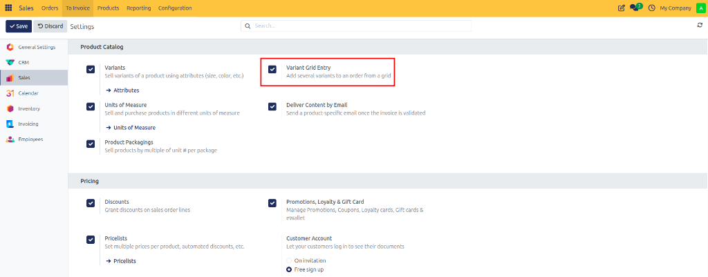
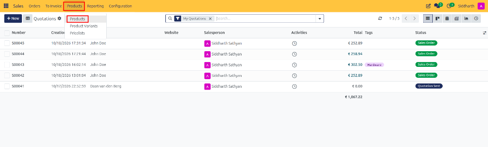
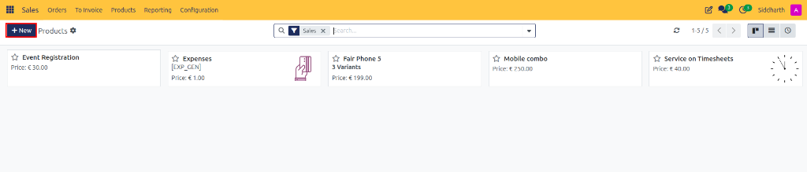
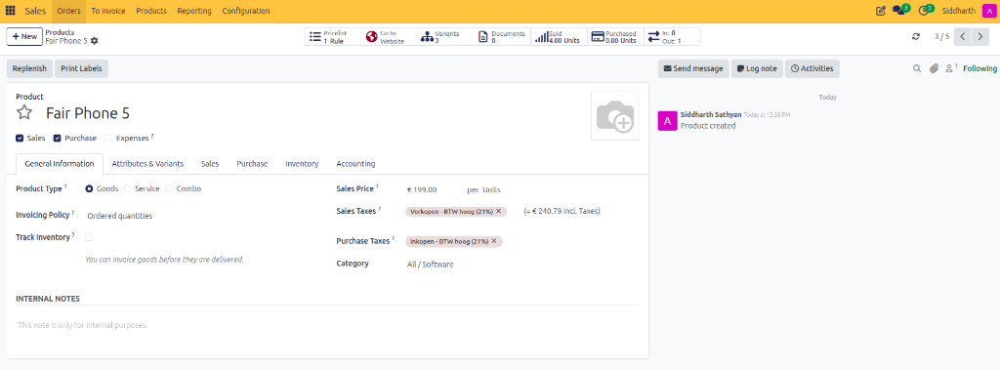
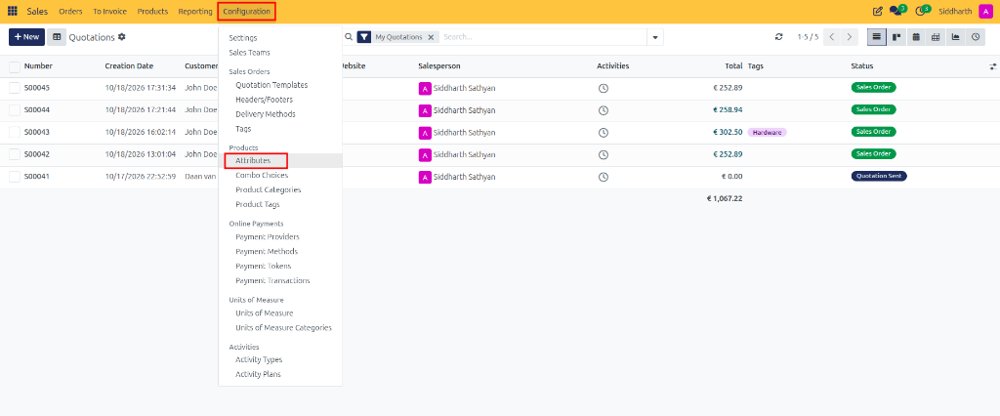
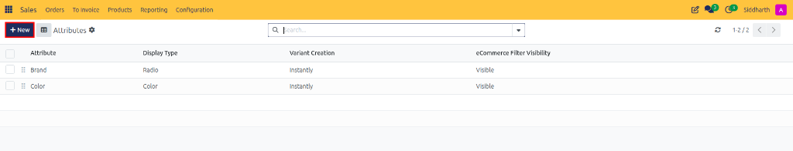
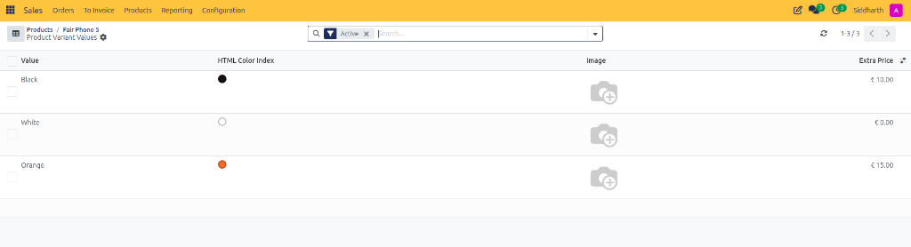
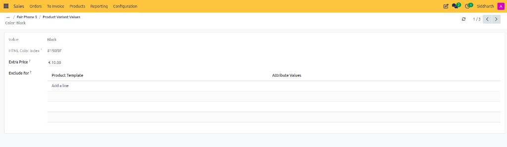
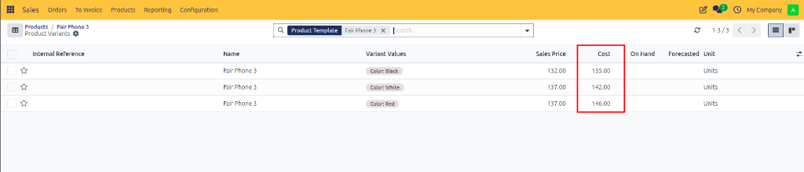
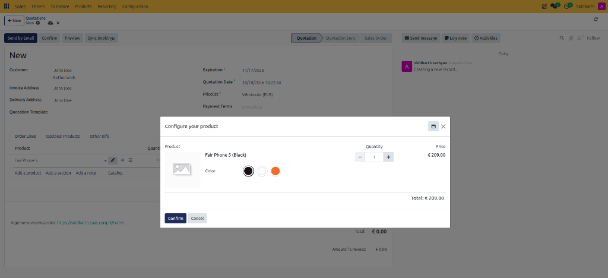

# How-To: Configure Products and Product Variants

Create master product catalog items, configure attributes and variations, set variant price surcharges, and assign catalog tags in CURQ 18 Sales.

---

### Prerequisites
* To manage multi-attribute items, verify that **Variants** is enabled in **Sales > Configuration > Settings**:

   

* *(Optional)* To enable matrix order entry for apparel or bulk goods, check **Variant Grid Entry**:

   

---

### Task 1: Create a Master Product

1. Navigate to **Sales > Products > Products**.

   

2. In the products catalog view, click **+ New** to open a blank product template form.

   

3. In the top title field, enter the product name *(e.g., `Fair Phone 5`)*.
4. Under the **General Information** tab, configure core attributes:
   * **Product Type**:
     * **Goods**: Tangible physical products tracked with stock inventory or consumable supplies.
     * **Service**: Intangible services, consulting hours, or maintenance agreements.
     * **Combo**: Bundled choices across multiple products.
   * **Invoicing Policy**: Choose **Ordered quantities** (billed on order confirmation) or **Delivered quantities** (billed on validated warehouse shipment).
   * **Sales Price**: The standard base selling price excluding taxes *(e.g., `€ 199.00 per Units`)*.
   * **Sales Taxes**: Select applicable customer sales tax rates *(e.g., `Verkopen - BTW hoog (21%)`)*.
   * **Purchase Taxes**: Select vendor procurement taxes *(e.g., `Inkopen - BTW hoog (21%)`)*.
   * **Category**: The internal accounting classification *(e.g., `All / Software` or `All / Physical`)*.

   

5. In the top-right corner, click the camera icon to upload a high-resolution catalog photo.

---

### Task 2: Configure Global Attributes and Values

Before assigning variations, define reusable product dimensions:

1. Navigate to **Sales > Configuration > Attributes**.

   

   

2. Click **+ New** to create an attribute *(e.g., `Color`, `Brand`)*.

   

3. Configure display and generation behavior:
   * **Attribute Name**: Enter the dimension label *(e.g., `Color`)*.
   * **Display Type**: Choose how options render on quotes and portal views:
     * **Radio**: Circular radio buttons for short text lists.
     * **Pills**: Clickable interactive buttons.
     * **Select**: Compact dropdown selector for extensive value lists.
     * **Color**: Visual color swatch circles with HTML hex codes.
     * **Multi-checkbox**: Checkboxes allowing multi-value selection.
   * **Variant Creation**:
     * **Instantly**: Automatically generates every possible variant SKU the moment the product is saved.
     * **Dynamically**: Generates a variant record only when that specific option is first selected on a quotation.
     * **Never**: Treats the attribute as a purely visual customization without generating separate database SKUs.
   * **eCommerce Filter**: Set visibility in online catalogs to **Visible** or **Hidden**.
4. In the **Attribute Values** table, click **Add a line** to enter each value *(e.g., `Black` with extra price `10.00`, `White` with `0.00`, `Orange` with `15.00`)*.

---

### Task 3: Configure Attributes and Generate Variants on a Product

1. On the product form (e.g., `Fair Phone 5`), click the **Attributes & Variants** tab.
2. Click **Add a line**.

   

3. In the **Attribute** column, select an attribute *(e.g., `Color`)*.
4. In the **Values** column, select all available choices *(such as `Black`, `White`, `Orange`)*.
5. Repeat for additional dimensions if needed.
6. CURQ computes the matrix and generates individual variant records automatically. A smart button labeled **Variants 3** appears in the top stat bar displaying the count.

---

### Task 4: Set Variant Price Extras, Exclusions, and Costs

If specific variations incur higher manufacturing expenses or warrant premium pricing:

1. On the **Attributes & Variants** tab, click the **Configure** button next to an attribute row (e.g., next to `Color`).
2. In the **Product Variant Values** list:
   * In the **Extra Price** column, enter or verify the surcharge *(e.g., `€ 10.00` for Black, `€ 0.00` for White, `€ 15.00` for Orange)*. When a salesperson or portal customer selects a variant, CURQ automatically appends the extra price to the product base price.

   

3. **Configuring Incompatible Variant Exclusions**:
   * Click into an attribute value row (e.g., `Black`) to open its detail form.
   * View the assigned **HTML Color Index** *(e.g., `#150f0f`)* and **Extra Price** *(e.g., `€ 10.00`)*.
   * Under the **Exclude for** table, click **Add a line** to establish conditional exclusions that prohibit invalid product or attribute combinations.

   

4. **Setting Variant-Specific Costs**:
   * Return to the product form and click the **Variants** stat button.
   * Click into a specific variant record.
   * Under **General Information**, enter the exact procurement **Cost** for this specific SKU.

   

---

### Task 5: Configure Sales Tab, Upsell Products, and Customer Descriptions

Open the **Sales** tab on the product template form (e.g., `Fair Phone 5`):

1. **Upsell and Cross-Sell Recommendations**:
   * In the **Optional Products** field, select complementary items *(such as protective cases, chargers, or cables)*.
   * When this product is quoted, these optional items appear automatically on customer portal quotation views, allowing clients to add them with a single click before digitally signing.
2. **Product & eCommerce Tags**:
   * Assign categorization labels *(e.g., `Phone`)* under **eCommerce Shop > Tags** to group and filter products quickly in the catalog.

   

3. **Quotation Description**:
   * In the **Quotation Description** box, enter customer-facing technical specifications or marketing copy. Anything typed here prints directly under the product line on quotation PDFs, the portal view, and customer invoices.

---

### Task 6: Selling Product Variants on Quotations

When adding multi-attribute products to a sales quotation:

1. **Product Configurator Modal**:
   * When adding a product template with variants (e.g., `Fair Phone 5`), CURQ displays the **Configure your product** pop-up modal.
   * Select options using visual color swatches *(Black, White, Orange)*. CURQ calculates the price in real time *(e.g., € 199.00 base + € 10.00 = `€ 209.00` for Black)*.
   * Adjust the quantity and click **Confirm** to add the configured variant to the order lines.

   

2. **Order Grid Entry Modal (Matrix Entry)**:
   * If **Variant Grid Entry** is active, CURQ displays a tabular grid *(e.g., sizes on rows, colors on columns)*.
   * Enter quantities directly into grid cells. Incompatible or excluded combinations appear crossed out.

---

### Edge Cases & Recovery Steps

* **"Cost" Field Hidden on Master Product Form**: When a product template has multiple variants, CURQ intentionally hides the master cost input because each variation may have a different manufacturing cost. Open the **Variants** smart button and set the cost directly on each individual variant card.
* **Archiving an Individual Variant**: If a specific size or color is discontinued while other options remain active, click the **Variants** smart button, select the discontinued variant, click **⚙ Actions > Archive**. The variant will no longer appear on new quotations.

---

### Related Documentation
* [How-To: Configure Pricelists and Pricing Rules](./08-configure-pricelists-and-pricing-rules.md)
* [How-To: Track Sales Margins and Costs](./15-track-sales-margins-and-reports.md)
* [Reference: Quotation and Sales Order Field Definitions](../reference/01-quotation-and-sales-order-field-definitions.md)
