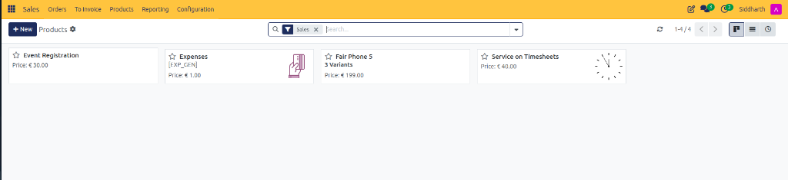
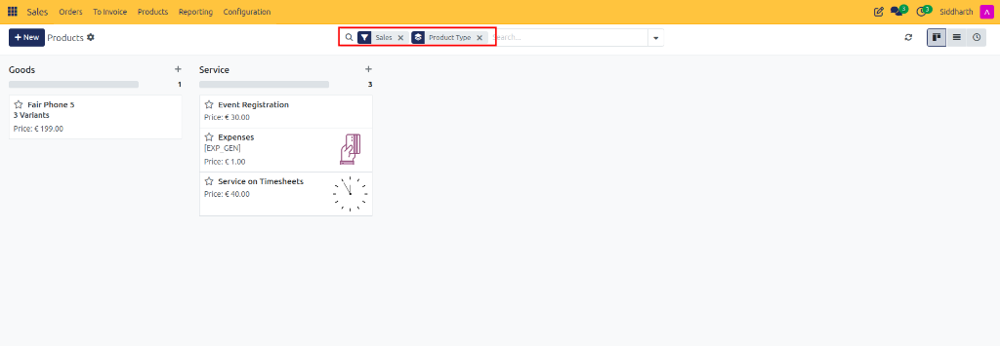
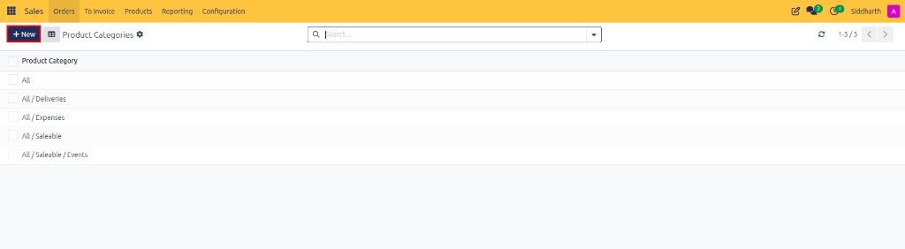
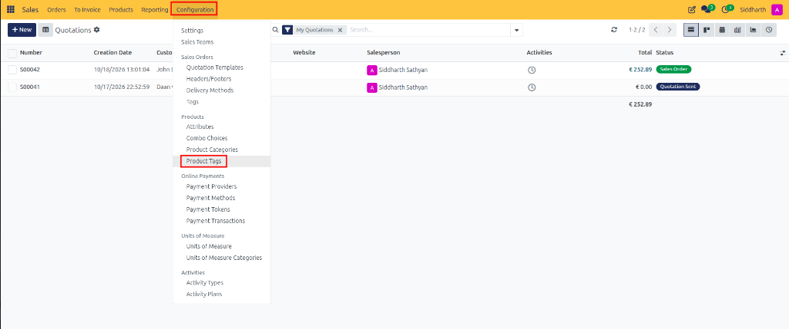
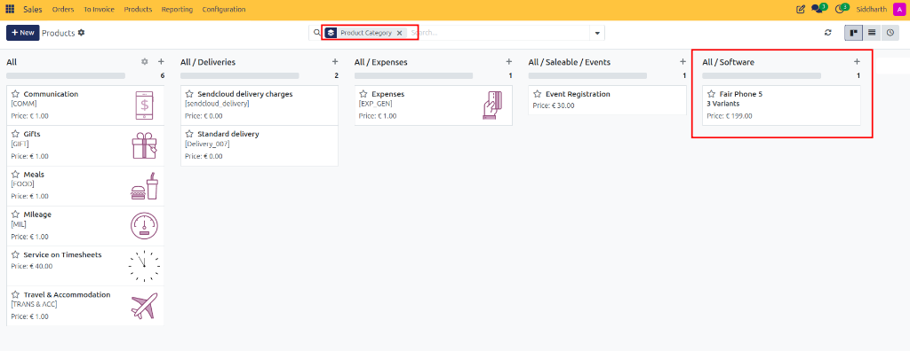
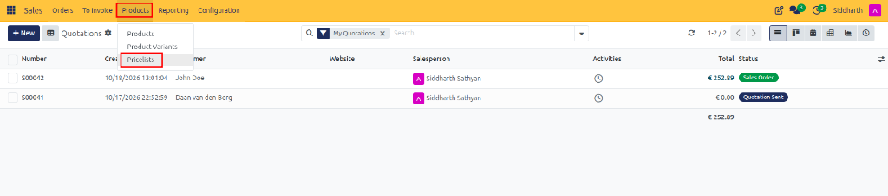
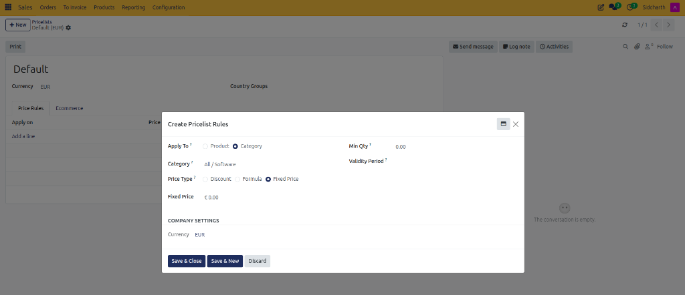
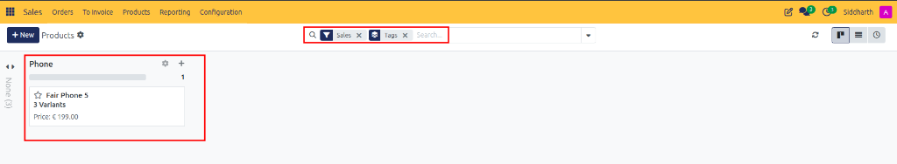

# How-To: Configure Product Categories and Tags

Organize catalog items, browse and filter products in Kanban and List views, establish hierarchical category trees, configure warehouse removal strategies, set inventory costing methods, and manage centralized product tags in CURQ 18 Sales.

---

### Prerequisites
* Access permissions as Sales Administrator.
* Products registered in the catalog under **Sales > Products > Products**.

---

### Task 1: Browse, Search, and Filter Catalog Products

1. Open the **Sales** app and click **Products > Products** (or **Products > Product Variants**).

   

2. Switch between layouts using the view switcher icons at the top right:
   * **Kanban Card View**: Displays visual cards with catalog pictures, prices, on-hand inventory levels, and variant counts.

      

   * **List View**: Displays an expandable table showing internal references (SKUs), names, sales prices, costs, stock levels, and units of measure.
3. Click into any product row or card to open the master product overview form:

   

4. **Search and Filter Results**:
   * Type a product name, internal reference SKU *(e.g., `[FURN_5555]`)*, or scan a barcode into the top search bar.

      

   * Select filter toggles: **Sales** (active items), **Services**, **Goods**, or **Combo**.
   * Under **Group By**, choose **Product Type** to separate items into distinct columns:

      

---

### Task 2: Create a Product Category and Hierarchy Tree

Product categories organize catalog items into structured accounting and logistical groups:

1. In the top navigation bar, click **Configuration > Products > Product Categories**.

   

2. Review the list of existing categories arranged by their full hierarchical path *(such as `All / Saleable / Office Furniture`)*:

   

3. Click **+ New** at the top left of the list view.

   

4. Configure core identity fields:
   * **Category**: Enter a clear name *(e.g., `Office Furniture` or `Consumables`)*.
   * **Parent Category**: Select the broader classification this group belongs to *(such as `Saleable` or `All`)*, or leave empty for a top-level category.

   

---

### Task 3: Configure Warehouse Logistics and Packaging Rules

Under the **Logistics** section of the category form:

1. **Force Removal Strategy**: Select how warehouse pickers retrieve goods when fulfilling orders:
   * **First In First Out (FIFO)**: Picks the oldest available inventory lots first (essential for goods with shelf-life concerns).
   * **Last In First Out (LIFO)**: Picks the most recently received lots first.
   * **Closest Location**: Routes pickers to the nearest physical stock bin to optimize travel time.
   * **Least Packages**: Selects larger packages to minimize picking operations.
2. **Reserve Packagings**:
   * **Reserve Only Full Packagings**: Prevents splitting packaging containers. If an order requests 2 pallets (1,000 units each) and only 1,600 units are in stock, CURQ reserves only 1 full pallet (1,000 units), leaving 600 units unreserved.
   * **Reserve Partial Packagings**: Allows breaking open boxes or pallets to fulfill orders up to available stock.

---

### Task 4: Configure Costing and Inventory Valuation Methods

Under the **Inventory Valuation** section, establish how CURQ values items in this category:

1. **Costing Method**:
   * **Standard Price**: The cost is managed manually by entering an amount in the **Cost** field on each product record. Vendor purchases do not alter the recorded cost.
   * **Average Cost (AVCO)**: CURQ recalculates the cost automatically as a weighted average upon receiving each vendor shipment:
     $$\text{New Cost} = \frac{(\text{Current Qty} \times \text{Old Cost}) + (\text{Received Qty} \times \text{Purchase Price})}{\text{Total New Qty}}$$
   * **First In First Out (FIFO)**: Costs sold products based on the exact purchase invoice price of the oldest available inventory lot.
2. Click the cloud icon to save.

---

### Task 5: Create and Manage Centralized Product Tags

Unlike categories (where every item has exactly one category), tags allow multiple labels to be attached across products and variants:

1. Navigate to **Sales > Configuration > Product Tags**.

   

2. Review configured tags, their display sequence, and linked items:

   

3. Click **+ New**.
4. In the **Name** field, enter a concise label *(e.g., `Bestseller`, `Eco-Friendly`, `Fragile`)*.
5. Manage tag scopes:
   * **Product Templates tab**: Click **Add a line** to attach this tag to a master product across all its variations:

      

   * **Product Variants tab**: Click **Add a line** to attach this tag exclusively to specific variants *(such as tagging only the White finish of a smartphone)*:

      

   * **All Products tab**: Displays the consolidated list of every variant covered by this tag:

      

6. **Reorder Tag Sequences**: In the list view, hover over the drag handle on the far left of any row and drag it up or down. The sequence controls the order in which badges appear on product pages and search filters.

---

### Task 6: Assign Categories and Tags to Products

1. **Assign Category to Product**:
   * Open **Sales > Products > Products**.
   * Under the **General Information** tab, set the **Product Category** field *(e.g., `All / Saleable / Office Furniture`)*:

   

2. **Group Products by Category in Kanban**:
   * In **Sales > Products > Products**, switch to the **Kanban** card view.
   * In the search bar dropdown, open **Group By** and select **Product Category**.
   * CURQ organizes the screen into category columns showing products and stock levels:

   

3. **Apply Category-Wide Pricing in Pricelists**:
   * Open **Sales > Products > Pricelists** and select an active list:

   

   * In **Price Rules**, click **Add a line**, set **Apply To** to **Product Category**, and choose your category.
   * Enter a discount percentage or formula. The rule applies automatically to all products inside this category and its subcategories:

   

4. **Assign Tags to a Master Product**:
   * Open the product form and click the **Sales** tab.
   * Under **Extra Info**, click the **Tags** field and select or type tags:

   

5. **Assign Tags to an Individual Variant**:
   * Click the **Variants** stat button on the product form:

      

   * Review the filtered list of variants for this template:

      

   * Select a specific variant and open its form.
   * In the **Variant Tags** field, assign variant-specific labels:

      

6. **Group Products by Tags in Kanban View**:
   * Open **Sales > Products > Products** in Kanban view.
   * Open **Group By** in the search bar and select **Tags**. Products display organized into tag columns:

   

---

### Edge Cases & Recovery Steps

* **Preventing Circular Hierarchy Loops**: CURQ prevents setting a category as its own parent or choosing a descendant sub-category as a parent. If an error occurs, verify the category hierarchy tree.
* **Protected System Categories**: Top-level root categories *(such as `All` and `Saleable`)* are protected from deletion to safeguard system costing integrity.
* **Variant Already Tagged Through Master Template**: If an individual variant is unavailable for selection under the **Product Variants** tab on a tag, check the **Product Templates** tab. If the parent product template is already linked, all of its variants already inherit the tag automatically.
* **Filtering Archived Products**: To view discontinued or archived items, click into the search bar, open **Filters**, and check **Archived**.

---

### Related Documentation
* [How-To: Configure Products and Product Variants](./06-configure-products-and-variants.md)
* [How-To: Configure Pricelists and Pricing Rules](./08-configure-pricelists-and-pricing-rules.md)
* [Reference: Quotation and Sales Order Field Definitions](../reference/01-quotation-and-sales-order-field-definitions.md)
* [Reference: Sales Configuration and Delivery Settings](../reference/03-sales-configuration-and-delivery-settings.md)
