# How-To: Configure Discount and Loyalty Programs

Create marketing promotions, generate single-use coupon codes, configure customer loyalty points, and issue gift cards in CURQ 18 Sales.

---

### Prerequisites
* Enable **Discounts, Loyalty & Gift Card** in **Sales > Configuration > Settings**:

   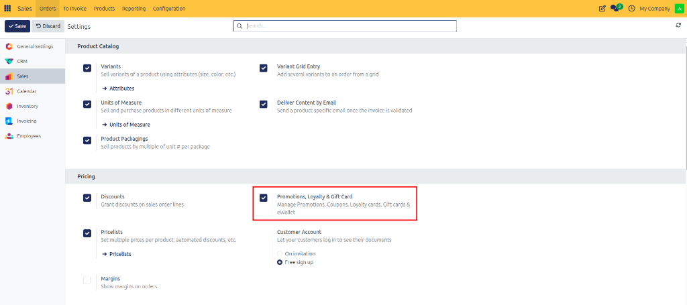

---

### Task 1: Create a Promotion or Loyalty Program

1. Open **Sales > Products > Discount & Loyalty**:

   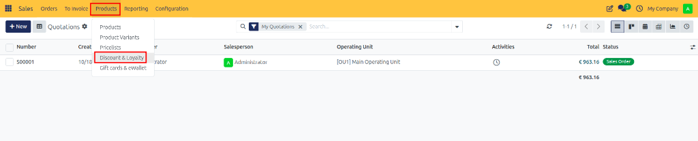

   Review existing programs or templates from the list view:

   

2. Click **+ New** to open the program configuration form:

   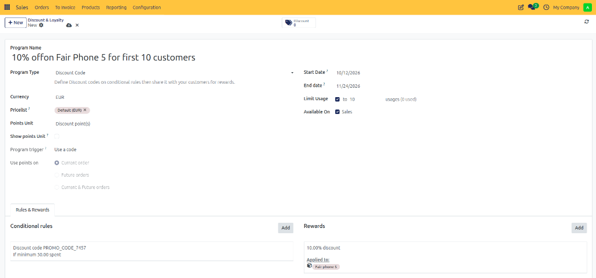

3. In the **Program Name** field, enter a campaign title *(e.g., `Summer Clearance 10% Off` or `VIP Customer Rewards`)*.
4. Select the **Program Type**:
   * **Coupons**: Generates unique single-use or multi-use alpha-numeric redemption codes.
   * **Promotions**: Automatically applies rewards when cart conditions are satisfied.
   * **Loyalty Cards**: Accrues customer points per purchase unit or spend amount.
   * **Discount Code**: Single shared promo code *(e.g., `SUMMER2026`)*.
   * **Buy X Get Y**: Rewarding specific free or discounted items upon purchasing qualifying goods.
   * **eWallet & Gift Card**: Prepaid monetary credit balances.
5. In **Currency**, specify the operational currency.
6. In **Validity**, define active start and end dates.

---

### Task 2: Define Conditional Rules

Click the **Rules & Conditions** tab, then click **Add a line** to specify qualifying criteria:

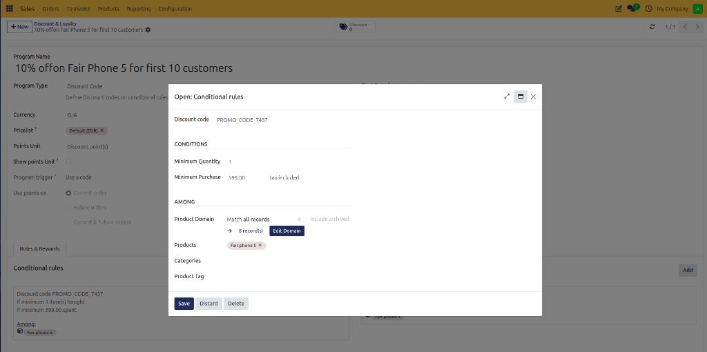

1. **Minimum Purchase**: Require a minimum spending threshold *(e.g., `$ 100.00 (tax excluded)`)*.
2. **Minimum Quantity**: Require a minimum number of units.
3. **Products Filter**: Restrict qualifying items to specific catalog products, categories, or tags.
4. **Grant Points**: Define how many points or units the customer earns per spent dollar or purchased product.
5. Click **Save & Close**.

---

### Task 3: Configure Customer Rewards

Click the **Rewards** tab, then click **Add a line** to define what the customer receives:

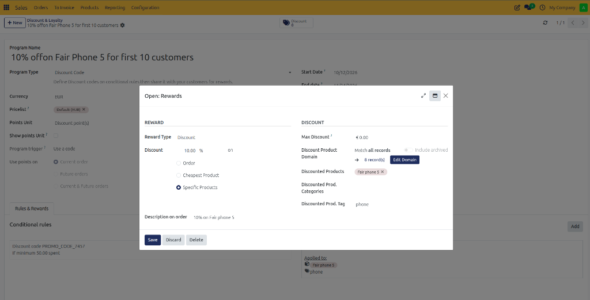

1. Select **Reward Type**:
   * **Free Product**: Grants a specific item for 0 cost.
   * **Discount**: Grants a price deduction:
     * **Percentage**: Percentage off the order *(e.g., `10 %`)*.
     * **Fixed Amount**: Flat dollar deduction *(e.g., `$ 25.00`)*.
     * **Discount Apply On**: Select **Order**, **Cheapest Product**, or **Specific Products**.
   * **Free Shipping**: Waives delivery charges.
2. Under **In exchange of**, enter the required points cost (for loyalty programs) or leave at default.
3. Click **Save & Close**.

---

### Task 4: Configure Gift Cards and eWallets

To issue prepaid store credit balances or gift card promotions:

1. Navigate to **Sales > Products > Gift cards & eWallet**:

   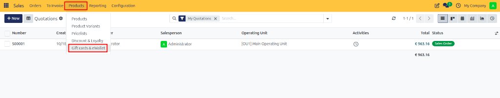

   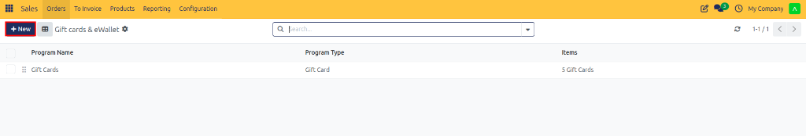

2. Click **+ New** to configure a Gift Card program.

   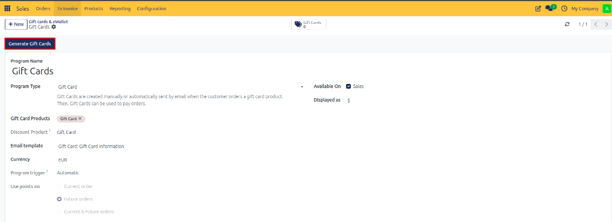

3. Click **Generate Gift Cards** in the header.
4. In the **Generate** modal:
   * Select customer distribution *(e.g., **Anonymous Customers**)*.
   * Enter the description *(e.g., `$10 gift cards`)*, quantity to generate *(e.g., `5`)*, and card monetary value *(e.g., `10.00 $`)*.

   

5. Click **Generate Gift Card**. The **Gift Cards** stat button updates with the total issued cards:

   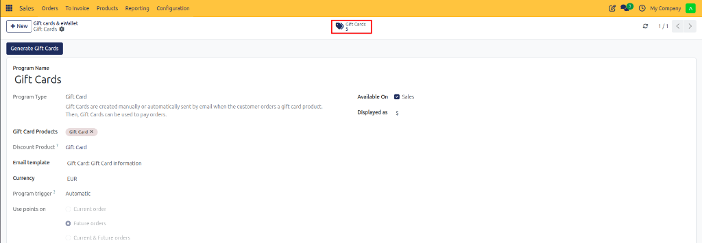

6. Click into the **Gift Cards** stat button to view unique alphanumeric codes, balances, and email distribution logs:

   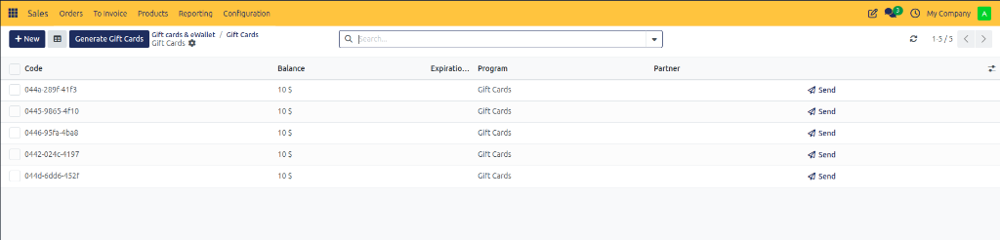

---

### Task 5: Generate and Apply Coupon Codes on Quotations

1. **Generating Coupon Codes**:
   * On any coupon program form, click **Generate Codes**.
   * Enter the number of codes *(e.g., `50`)* and expiration date.
   * Review codes in the **Coupons** smart button.

2. **Applying a Code to a Quotation**:
   * Open any draft quotation *(e.g., `S00003`)*.
   * In the bottom action bar under order lines, click **Coupon Code**.
   * Enter the code *(e.g., `PROMO_CODE_7457`)* into the **Enter Promotion or Coupon Code** modal and click **Apply**.

   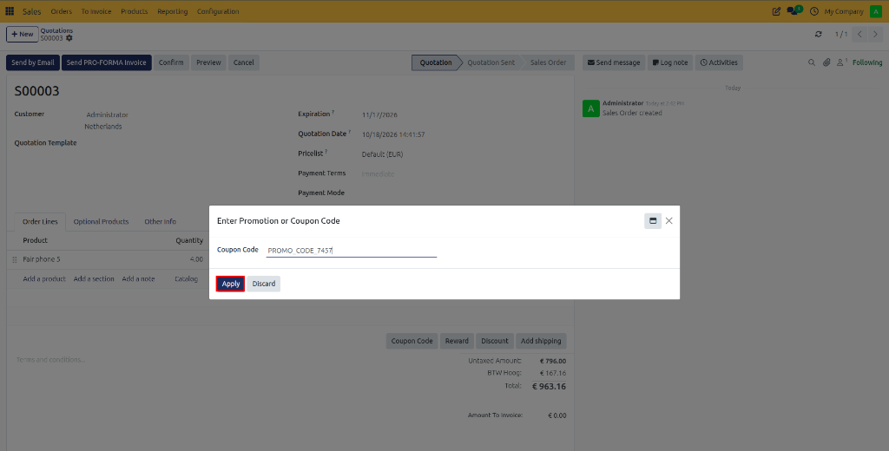

   * If qualifying conditions are met, CURQ prompts with an **Available Rewards** selector (or automatically injects the discount):

   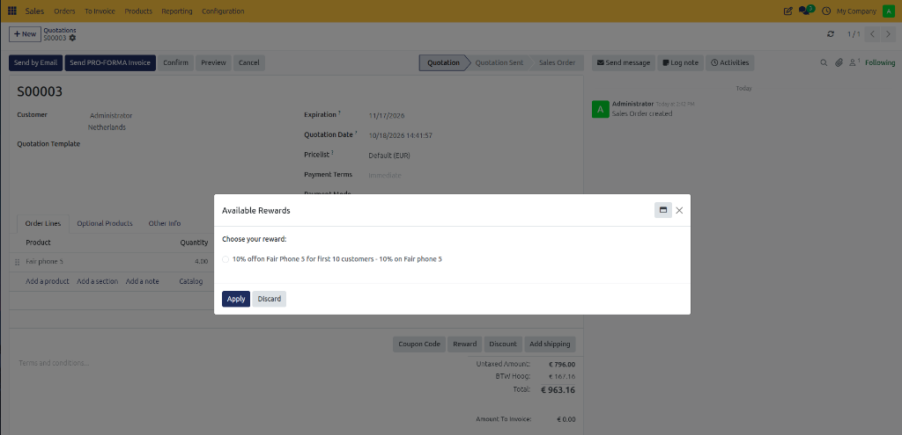

   * Select the reward and click **Apply**. The discount line displays as a negative amount on the quotation, instantly recalculating untaxed and total payable amounts:

   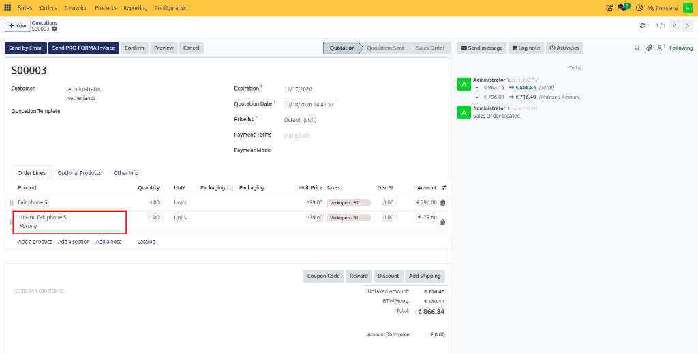

3. **Manual Loyalty Points Adjustment**:
   * To credit or deduct loyalty/discount points manually for customer service recovery, open the card record and click the **Balance** value *(e.g., `0 Discount point(s)`)*.
   * In the **Update Balance** modal, enter the **New Balance** *(e.g., `100.00`)* and a **Description** *(e.g., `initial balance`)*, then click **Confirm**:

   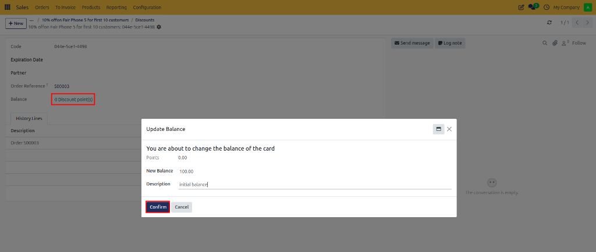

---

### Edge Cases & Recovery Steps

* **Coupon Marked as Already Used**: If a customer attempts to reuse a single-use coupon, CURQ displays a validation error. Check the code status in **Discount & Loyalty > Coupons**. If the previous order was cancelled, click into the coupon record and click **Re-activate**.
* **Reward Not Triggering Automatically**: Ensure the order lines satisfy both the minimum quantity and minimum untaxed amount specified in **Rules & Conditions**.

---

### Related Documentation
* [How-To: Configure Pricelists and Pricing Rules](./08-configure-pricelists-and-pricing-rules.md)
* [Reference: Pricing, Pricelists, and Discount Specifications](../reference/02-pricing-pricelists-and-discount-specifications.md)
