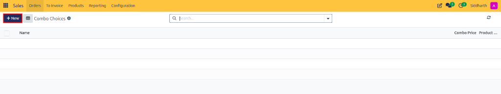
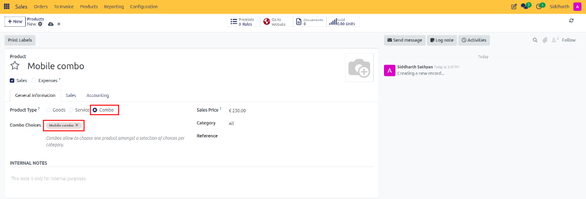
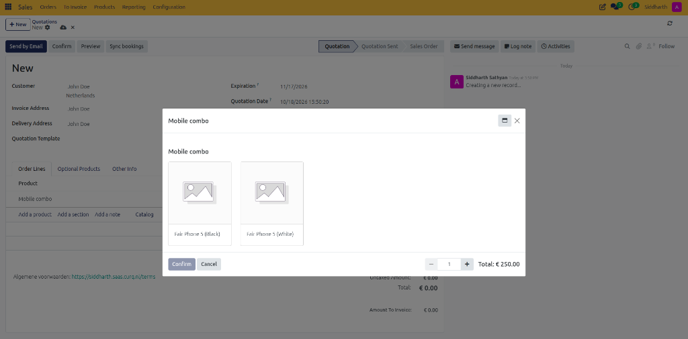

# How-To: Configure Product Combos and Choice Bundles

Configure combo choices, package multi-item product bundles, and select flexible customer options in CURQ 18 Sales.

---

### Prerequisites
* Base catalog products that will form the individual combo choices must exist in **Sales > Products > Products**.

---

### Task 1: Create Combo Choices

Combo choices define the selectable categories or subgroups from which customers or salespeople select items *(such as choosing a main item, accessory, or warranty tier)*:

1. Navigate to **Sales > Configuration > Combo Choices** (under the Products section):

   

2. In the **Combo Choices** list view, click **+ New**:

   

3. On the combo choice form:
   * In the top title field, type a group name *(e.g., `Mobile combo`)*.
   * Under the **Product** table, click **Add a line** and select the eligible catalog items *(e.g., `Fair Phone 5 (Black)` and `Fair Phone 5 (White)`)*.
   * *(Optional)* In the **Extra Price** column, enter any surcharge applied when selecting premium choices.

   

4. Save the record. Repeat for any additional option pools.

---

### Task 2: Create the Master Combo Product

1. Navigate to **Sales > Products > Products** and click **+ New**.
2. Enter the bundle name *(e.g., `Mobile combo`)*.
3. In the **General Information** tab:
   * Set **Product Type** to **Combo**.
   * In **Combo Choices**, select the option groups created in Task 1 *(e.g., `Mobile combo`)*.
   * In **Sales Price**, enter the base bundle package price *(e.g., `€ 250.00`)*.

   

4. Save the product.

---

### Task 3: Add and Configure Combos on Quotations

1. Open **Sales > Orders > Quotations** and click **+ New**.
2. Under **Order Lines**, click **Add a product** and select your master combo product *(e.g., `Mobile combo`)*.
3. CURQ automatically opens the combo configurator modal:
   * Select one item from each configured choice group *(e.g., `Fair Phone 5 (Black)` or `Fair Phone 5 (White)`)*.
   * Adjust the bundle quantity *(e.g., `1`)* and verify the calculated total price *(e.g., `Total: € 250.00`)*.

   

4. Click **Confirm**.
5. CURQ adds the parent bundle section along with its selected component to the sales quotation:

   

---

### Edge Cases & Recovery Steps

* **Inventory Reservations on Combo Components**: When a sales order containing a combo is confirmed, CURQ reserves stock for the individual chosen components (Goods/Storable items) in inventory, ensuring warehouse dispatchers receive accurate picking slips.
* **Component Out of Stock**: If one choice within a combo is depleted in the warehouse, sales reps can edit the quote line before confirmation and choose an alternative item from the combo choice pool.

---

### Related Documentation
* [How-To: Configure Products and Product Variants](./06-configure-products-and-variants.md)
* [Reference: Quotation and Sales Order Field Definitions](../reference/01-quotation-and-sales-order-field-definitions.md)
