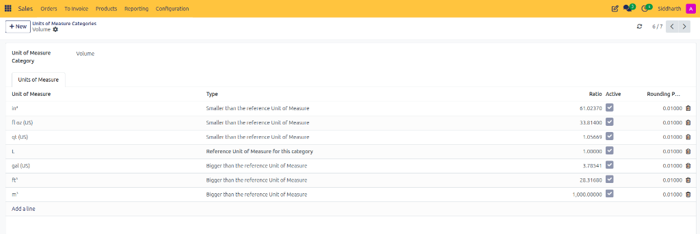
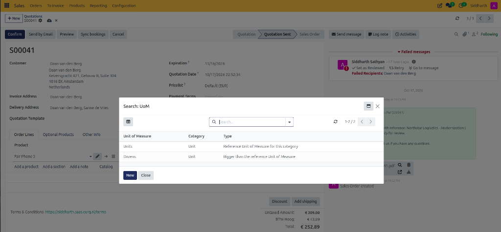
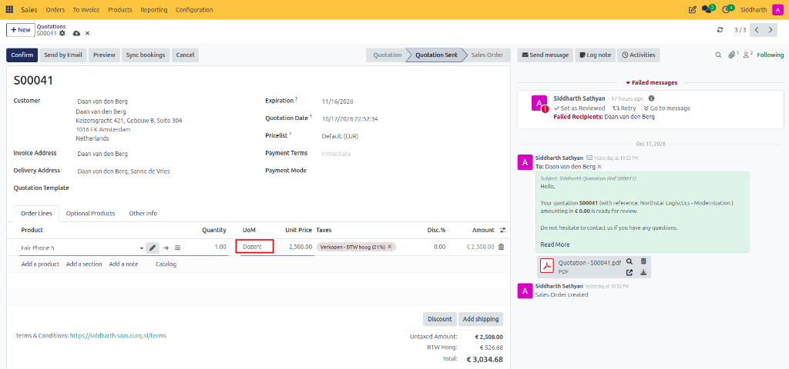

# How-To: Configure Units of Measure

Enable multiple units of measure, establish measurement categories, define conversion ratios, and sell products in diverse packaging units in CURQ 18 Sales.

---

### Prerequisites
* Enable **Units of Measure** in **Sales > Configuration > Settings**.

---

### Task 1: Access and Create UoM Categories

Units of measure must belong to a shared measurement category *(e.g., Weight, Volume, Length, or Unit)* to enable mathematical conversions:

1. Navigate to **Sales > Configuration > Units of Measure Categories**.

   

2. Review the standard system categories:

   

3. Click **+ New** (or open an existing category to append new units).
4. Enter the category name *(e.g., `Packaging Units` or `Specialty Volumes`)*.

---

### Task 2: Configure Units of Measure and Conversion Ratios

Within your selected category, click **Add a line** under the **Units of Measure** table:

1. **Unit of Measure Name**: Enter a descriptive label *(e.g., `Dozen`, `Box of 24`, or `Pallet`)*.
2. **Type**:
   * **Reference Unit of Measure for this category**: The baseline standard *(such as `Units` for quantity or `kg` for weight)*. Every category must have exactly one reference unit.
   * **Bigger than the reference Unit of Measure**: Enter a **Ratio** greater than 1 *(e.g., enter `12.00` for a Dozen, indicating 1 Dozen = 12 Reference Units)*.
   * **Smaller than the reference Unit of Measure**: Enter a **Ratio** indicating how many subunits make 1 reference unit *(e.g., `0.001` for grams in a kilogram category)*.
3. **Rounding Precision**: Specify decimal tolerance *(e.g., `0.01` or `1.000`)* to avoid fractional conversion artifacts.
4. Click **Save**.

---

### Task 3: Apply Units of Measure to Products and Quotes

1. **Assign Default UoM on Master Product**:
   * Open the product form in **Sales > Products > Products** *(e.g., `Fair Phone 5`)*.
   * Under **General Information**, verify or set the base **Unit of Measure** *(displayed inline next to **Sales Price**, e.g., `per Units`)*:

   

2. **Select Alternative UoM on Quotation Lines**:
   * Create or open a sales quotation *(e.g., `S00043`)*.
   * In the **Order Lines** table, click into the **UoM** column:

      

   * Click into the dropdown or click **Search More...** to open the **Search: UoM** modal, then select an alternative unit *(e.g., `Dozens`)*:

      

   * CURQ automatically recalculates the converted unit price based on the ratio *(e.g., 1 `Dozens` of Fair Phone 5 recomputes to 12 times the unit price at `€ 2,508.00`)*:

      

---

### Edge Cases & Recovery Steps

* **"Cannot Convert Between Different Categories" Error**: You cannot convert between units belonging to different categories *(e.g., converting Kilograms directly to Liters or Hours)* without specific density attributes. Ensure both units share the same UoM Category.
* **Changing the Reference Unit on an Active Category**: Never change the reference unit on an existing category that contains historical sales or inventory transactions, as this will recalculate historical stock balances incorrectly. Instead, create a new UoM Category.

---

### Related Documentation
* [How-To: Configure Products and Product Variants](./06-configure-products-and-variants.md)
* [Reference: Pricing, Pricelists, and Discount Specifications](../reference/02-pricing-pricelists-and-discount-specifications.md)
