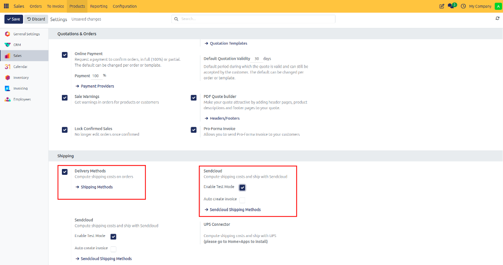
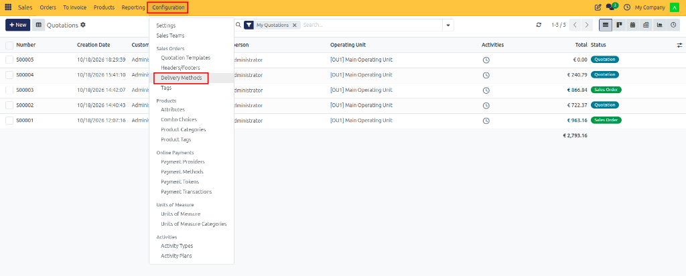
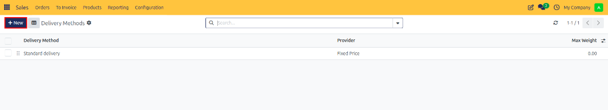
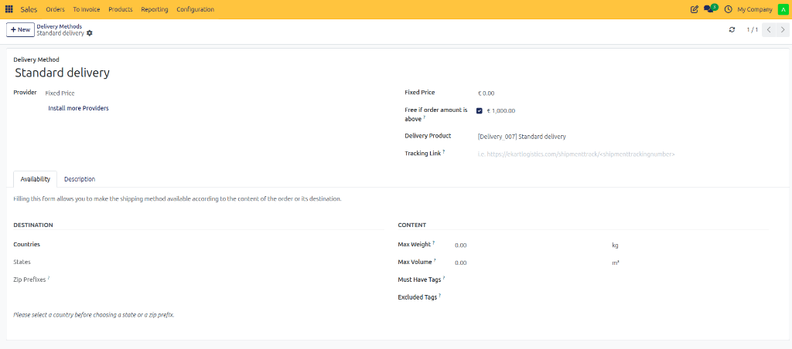
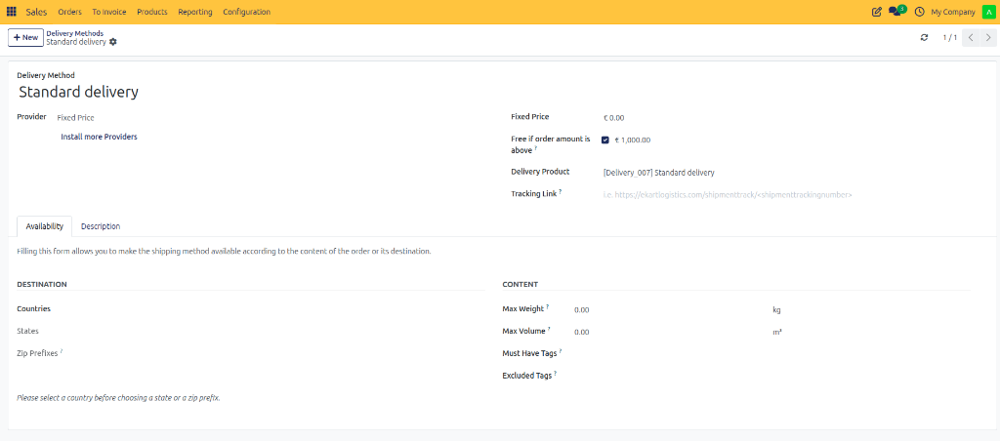
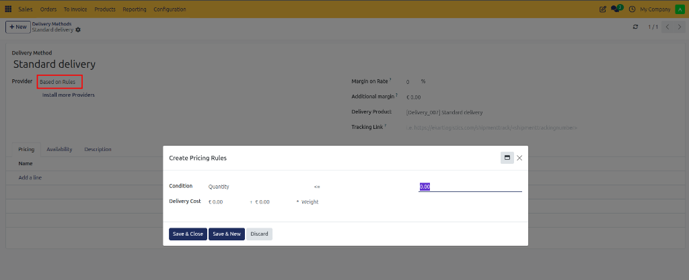
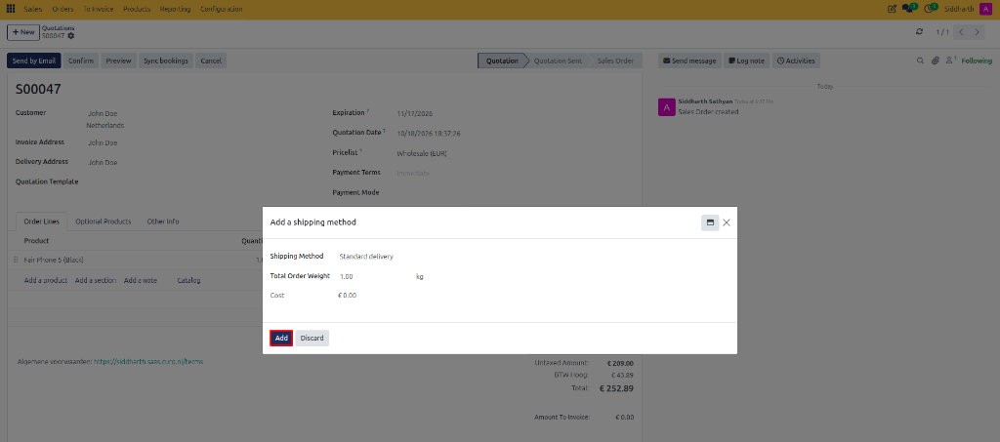
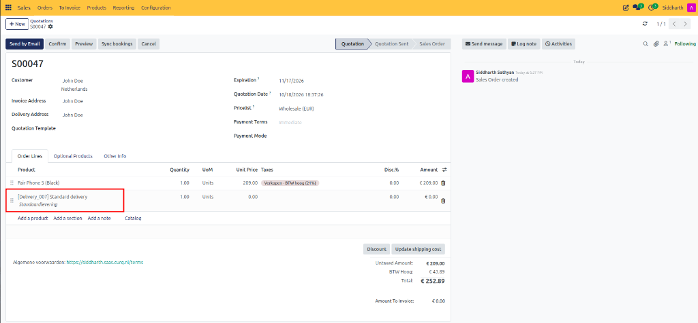
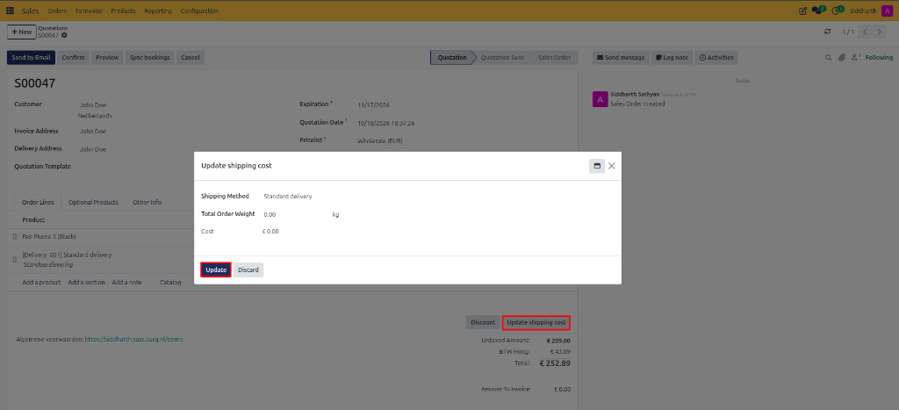

# How-To: Configure Shipping and Delivery Methods

Configure fixed-rate freight, establish rule-based shipping calculations, connect Sendcloud carrier logistics, and add delivery charges to quotations in CURQ 18 Sales.

---

### Prerequisites
* Enable **Delivery Methods** (and optionally **Sendcloud** carrier integration) in **Sales > Configuration > Settings**:

   

---

### Task 1: Create a Fixed-Price Delivery Method

1. Navigate to **Sales > Configuration > Delivery Methods**:

   

   

2. Click **+ New**.
3. In the **Delivery Method** title field, enter a customer-facing name *(e.g., `Standard delivery`)*.
4. Configure pricing parameters:
   * Set **Provider** to **Fixed Price**.
   * In the **Fixed Price** field, enter the standard delivery rate *(e.g., `€ 0.00`)*.
   * *(Optional)* Check **Free if order amount is above** and enter a qualification threshold *(e.g., `€ 1,000.00`)*. Orders exceeding this subtotal automatically receive free shipping.
   * Link a catalog **Delivery Product** *(e.g., `[Delivery_007] Standard delivery`)* and optional carrier **Tracking Link**.

   

5. Under the **Availability** tab, restrict delivery eligibility based on destination filters *(Countries, States, Zip Prefixes)* or content constraints *(Max Weight in kg, Max Volume in m³, Must Have Tags, Excluded Tags)*:

   

6. Save the record.

---

### Task 2: Configure Rule-Based Shipping by Weight or Total

When shipping costs scale according to physical weight, volume, or order subtotal:

1. Create or edit a delivery method and set **Provider** to **Based on Rules**.
2. Under the **Pricing** tab, click **Add a line** in the pricing rules matrix:

   

3. In the **Create Pricing Rules** modal, define condition thresholds:
   * **Condition**: Select criteria *(e.g., `Weight`, `Volume`, `Price`, or `Quantity <= 5.00`)*.
   * **Delivery Cost**: Enter the fixed base charge and variable coefficient *(e.g., `€ 0.00 + € 0.00 * Weight`)*.
4. Click **Save & Close** (or **Save & New** to configure additional tiered thresholds).

---

### Task 3: Configure Sendcloud Carrier Integration

To connect live carrier rates, print shipping labels, and track shipments through Sendcloud:

1. Create a delivery method and set **Provider** to **Sendcloud**.

2. Under the **Sendcloud Configuration** tab:
   * Enter your Sendcloud Public Key and Secret Key.
   * Select the contracted shipping product *(e.g., `DHL Parcel Connect` or `PostNL Standard`)*.
3. Under the **Sendcloud Availability** tab, select supported destination zones.

4. Save the record.

---

### Task 4: Add Shipping to a Quotation

1. Open a draft quotation (e.g., `S00047`).
2. Below the order lines, click the **Add shipping** button.

   

3. In the **Add a shipping method** modal, select your configured **Shipping Method** *(e.g., `Standard delivery`)*.
4. CURQ automatically checks the total order weight *(e.g., `1.00 kg`)*, applies rule qualifications or free shipping thresholds, and displays the calculated fee *(e.g., `€ 0.00`)*.
5. Click **Add**. CURQ appends the delivery product line item directly to the quotation:

   

6. If ordered quantities, weights, or items change, click **Update shipping cost** below the order lines:

   

7. In the **Update shipping cost** pop-up, review the updated weight and cost, then click **Update** to refresh the quotation line.

---

### Edge Cases & Recovery Steps

* **"No Matching Delivery Method Found for Address"**: If a customer address in the portal fails to show delivery options, check the **Destination Availability** tab on your delivery methods. Ensure the customer's country or state is either explicitly listed or that the filter is left blank for worldwide availability.
* **Overriding a Shipping Fee**: Sales representatives with pricing permissions can manually edit the unit price on the added delivery line to provide custom freight discounts.

---

### Related Documentation
* [How-To: Create and Manage Quotations](./01-create-and-send-quotations.md)
* [Reference: Sales Configuration and Delivery Settings](../reference/03-sales-configuration-and-delivery-settings.md)
