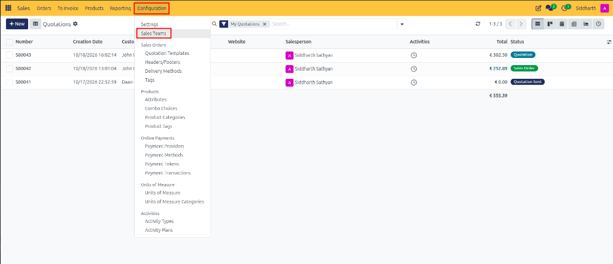
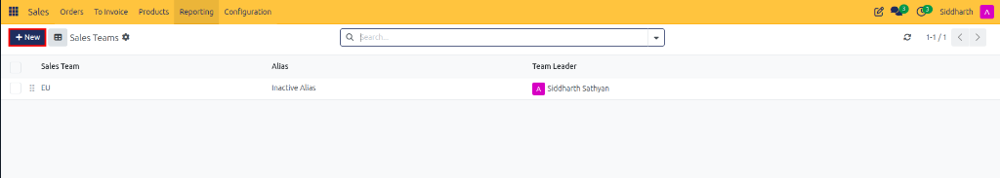
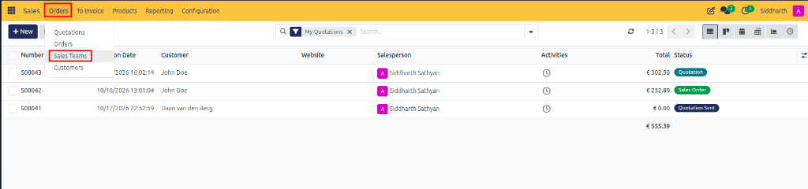
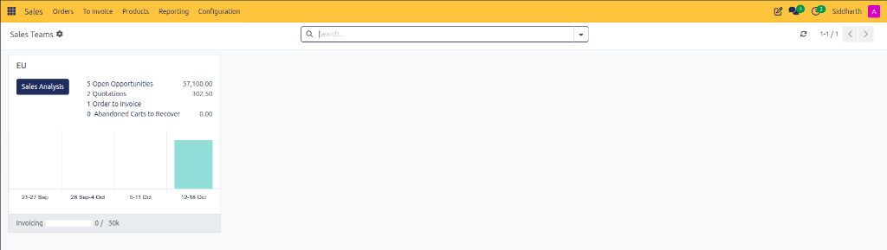
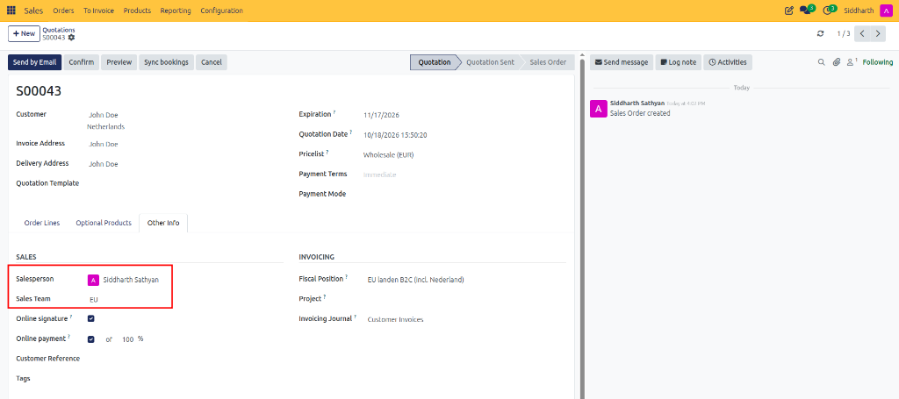
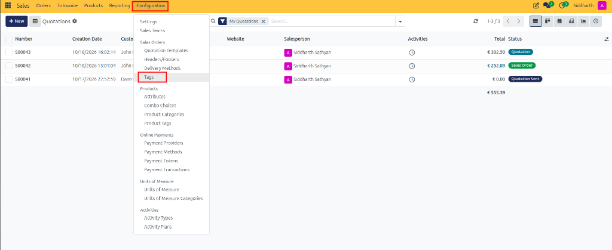
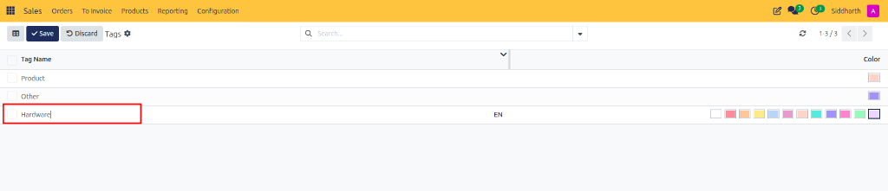
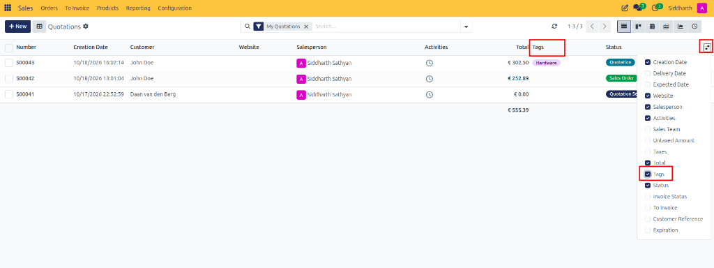

# How-To: Configure Sales Teams and Order Tags

Organize regional or product sales teams, set monthly invoicing revenue targets, and classify commercial deals using color-coded order tags in CURQ 18 Sales.

---

### Prerequisites
* Access permissions as Sales Administrator.

---

### Task 1: Create and Structure a Sales Team

1. Navigate to **Sales > Configuration > Sales Teams**.

   

2. Review the list of active sales units, then click **+ New**:

   

3. On the sales team form:

   

   * **Sales Team**: Enter an organizational unit name *(e.g., `EU`)*.
   * **Team Leader**: Select the supervising sales manager *(e.g., `Siddharth Sathyan`)*.
   * **Email Alias**: Assign a dedicated inbound email prefix *(e.g., `alias`)* so inbound communications route directly to this team.
   * **Invoicing Target**: Enter the monthly revenue quota in company currency *(e.g., `50,000.00 / Month`)* used in executive performance dashboards.
   * In the **Members** tab, click **Add** to assign salespeople belonging to this unit *(e.g., `John Doe`)*.
   * *(Optional)* Enable **Pipeline** or **Leads** checkboxes and configure automated lead assignment rules.
4. Save the sales team record.
5. **Monitoring Sales Team Performance**:
   * Navigate to **Sales > Orders > Sales Teams**:

      

   * View real-time graphical progress bars, deal pipelines, and target gauges in the Kanban dashboard:

      

---

### Task 2: Assign Sales Teams to Quotations

1. Open any draft quotation or sales order *(e.g., `S00043`)*.
2. Click the **Other Info** tab.
3. In the **Sales** section, select the assigned **Salesperson** *(e.g., `Siddharth Sathyan`)* and credited **Sales Team** *(e.g., `EU`)*:

   

4. If a salesperson is assigned, CURQ automatically defaults to their primary team.

---

### Task 3: Configure and Assign Sales Order Tags

Tags allow flexible categorization of deals by industry, campaign, or strategic priority:

1. Navigate to **Sales > Configuration > Tags** (under Sales Orders):

   

2. Review the tags list, then click **+ New**:

   

3. In the **Tag Name** field, type your category *(e.g., `Hardware`)*, then select a color from the color palette:

   

4. Click **Save**.
5. **Assigning Tags to Orders**:
   * Open any quotation or sales order *(e.g., `S00043`)*.
   * In the **Other Info** tab, locate the **Tags** field and select one or more tags *(e.g., `Hardware`)*:

   

   * To display tags in the quotation list view, click the optional column toggle icon on the top right of the table and enable **Tags**:

   

---

### Edge Cases & Recovery Steps

* **Team Target Mismatch Across Currencies**: The invoicing target is evaluated in the company's base currency. In multi-company environments, ensure sales orders match the sales team's associated operating company to ensure dashboard calculations align.
* **Archiving a Sales Team**: If an organizational unit merges, open the team form and select **⚙ Actions > Archive**. Historical sales orders retain their team attribution, but the team will no longer appear in selection dropdowns for new deals.

---

### Related Documentation
* [How-To: Analyze Sales Performance and Reporting](./15-track-sales-margins-and-reports.md)
* [Reference: Quotation and Sales Order Field Definitions](../reference/01-quotation-and-sales-order-field-definitions.md)
