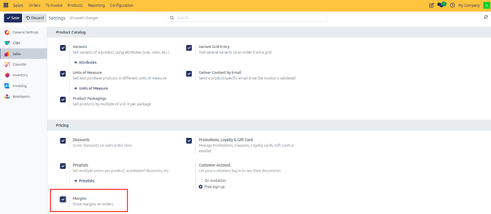
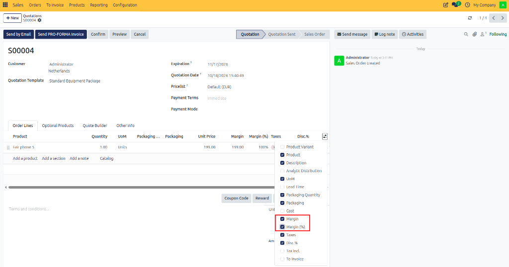
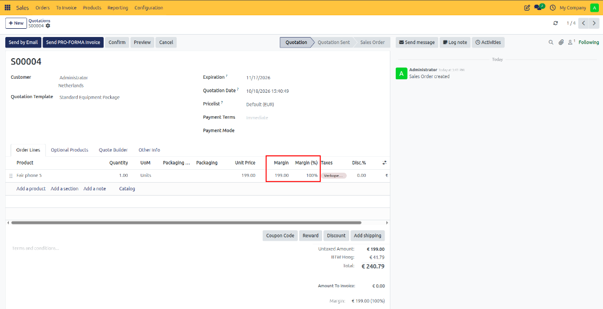
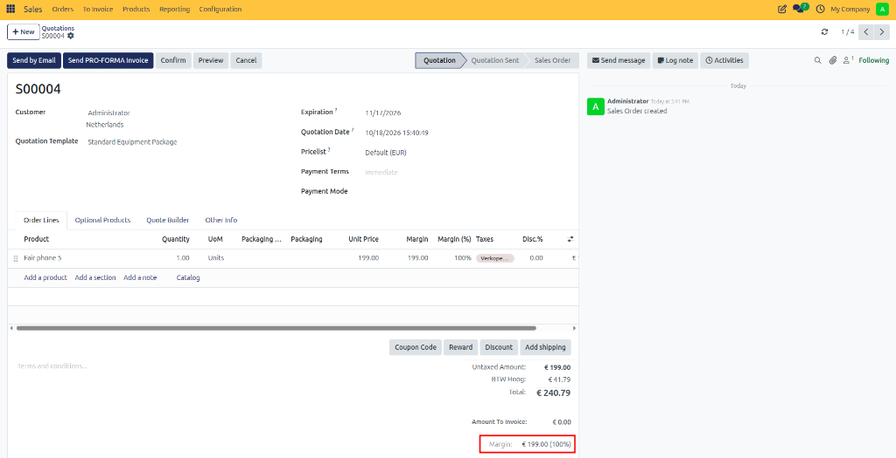
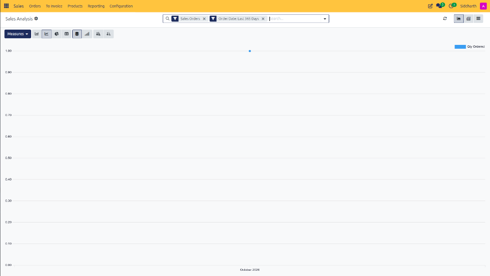
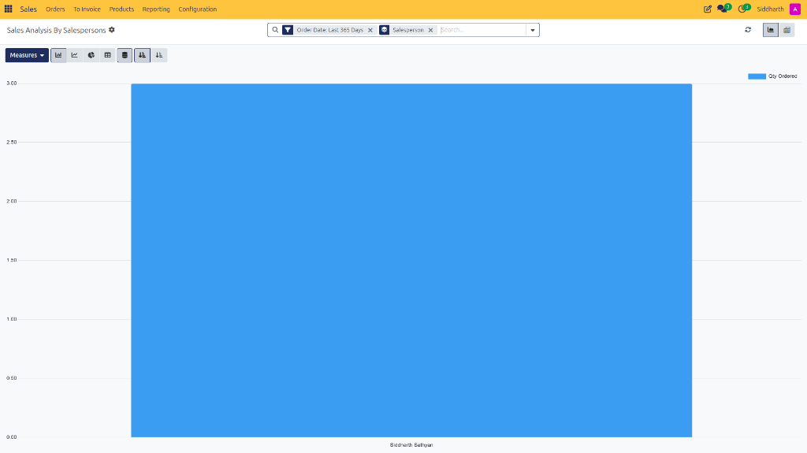
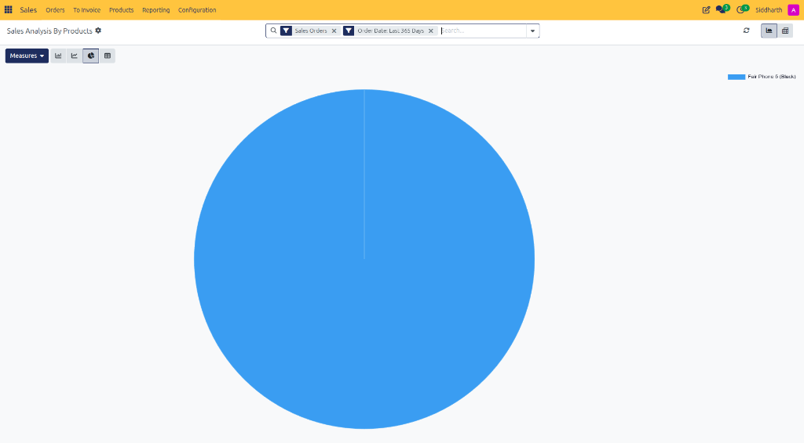
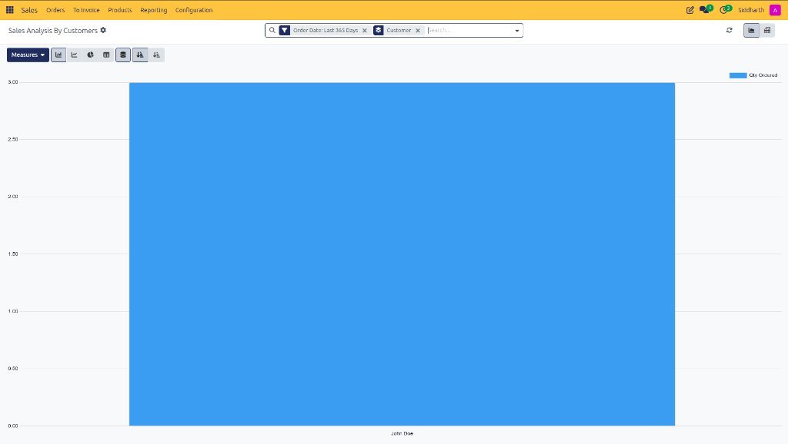

# How-To: Track Sales Margins and Reports

Enable real-time margin tracking, monitor line-item and order-level profitability, evaluate baseline product and variant costs, configure sales analysis graph views, and build dynamic multi-dimensional Pivot tables in CURQ 18 Sales.

---

### Prerequisites
* Enable **Margins** in **Sales > Configuration > Settings**:

   

* Ensure products have an accurate **Cost** defined under their **General Information** or individual variant forms.
* Active sales orders and customer invoices in the database.

---

### Task 1: Display and Monitor Margin Columns on Quotations

1. Open any quotation in **Sales > Orders > Quotations** *(e.g., `S00004`)*.
2. Under the **Order Lines** tab, locate the small column-selection toggle icon at the far right of the table header:

   

3. Check the boxes for:
   * **Margin**: The gross profit amount per line.
   * **Margin (%)**: The profit percentage relative to unit price.
   * *(Optional)* **Cost**: The unit purchase or manufacturing cost.
4. The columns appear instantly in your order lines table:

   

5. Observe real-time line-level profitability calculations:

| Product Line | Quantity | Unit Price | Unit Cost | Line Margin | Margin (%) | Calculation |
| :--- | :--- | :--- | :--- | :--- | :--- | :--- |
| **Fair phone 5** | `1.00` | `€ 199.00` | `€ 0.00` | `€ 199.00` | `100%` | `€ 199.00 - € 0.00` |
| **Order Total** | `1.00` | `€ 199.00` | `€ 0.00` | **`€ 199.00`** | **`100%`** | `€ 199.00 / € 199.00` |

---

### Task 2: Review Order Total Margins

At the bottom right of the quotation form, below the untaxed subtotal and tax calculations, CURQ renders the consolidated order margin summary:

1. **Untaxed Amount**: Consolidated order revenue excluding sales taxes *(e.g., `€ 199.00`)*.
2. **Margin**: Consolidated gross profit ($\text{Order Revenue} - \text{Total Cost}$, e.g., `€ 199.00`)*.
3. **Margin (%)**: Overall profitability percentage ($\frac{\text{Margin}}{\text{Untaxed Amount}} \times 100$, e.g., `100%`)*.
4. Sales representatives and managers can immediately verify whether the deal satisfies corporate gross margin hurdles before sending the proposal.

---

### Task 3: Maintain Accurate Baseline Product and Variant Costs

To ensure margin figures reflect real financial profitability:

1. **Standard Products**:
   * Open **Sales > Products > Products**.
   * Under **General Information**, enter the current replacement **Cost**.
2. **Multi-Variant Items**:
   * On products with size or color attributes *(e.g., `Fair Phone 3`)*, click the **Variants** stat button:

      

   * Review or enter the precise procurement **Cost** directly in the variants list view or on each specific variation card:

      

---

### Task 4: Access Sales Reporting and Configure Chart Views

In the top navigation bar, click **Reporting** to access analysis dimensions (**Sales**, **Salespersons**, **Products**, or **Customers**):

In the top right header, toggle chart presentation formats:

1. **Line Chart**: Track continuous monthly sales trajectory and order trends *(e.g., in **Sales** analysis)*:

   

2. **Bar Chart**: Compare discrete revenue totals or rep-by-rep sales performance *(e.g., in **Salespersons** analysis)*:

   

3. **Pie Chart**: Visualize product distribution and sales contribution *(e.g., in **Products** analysis)*:

   

4. **Customer Analysis**: Compare order volume and commercial activity across key accounts *(e.g., in **Customers** analysis)*:

   

5. **Stacked vs. Grouped**: Click the stacked bar icon to view category contributions within each month's total bar.

---

### Task 5: Build Dynamic Multi-Dimensional Pivot Tables

To perform deep financial analysis and cross-tabulate metrics:

1. In the top right view switcher, click the **Pivot** table icon (spreadsheet grid icon next to the graph icon).
2. Click the **Measures** dropdown at the top left of the pivot grid and select active metrics:
   * **Untaxed Amount**: Net commercial sales revenue.
   * **Margin**: Consolidated gross profit in company currency.
   * **Margin (%)**: Weighted average profit percentage.
   * **Qty Ordered / Qty Delivered / Qty Invoiced**: Operational fulfillment efficiency.

3. Group data along rows and columns:
   * Click the **+** icon next to **Total** in the rows column and select **Customer** or **Salesperson**.
   * Click the **+** icon in the column headers and select **Order Date > Month** or **Product Category**.
4. CURQ computes the matrix with real-time totals across both axes.

---

### Task 6: Filter by Team, Time Period, and Export Data

1. Click into the search bar at the top center.
2. Under **Filters**:
   * Select **Sales Orders** to exclude unconfirmed draft quotations.
   * Select **Order Date** to analyze a specific fiscal year, quarter, or rolling month.
3. Under **Group By**:
   * Group by **Sales Team** to benchmark team performance against monthly invoicing quotas.
4. **Exporting Data**: Click the **Download xlsx** button (spreadsheet icon) in the top right to export the live pivot grid into an Excel workbook for executive presentations.

---

### Edge Cases & Recovery Steps

* **Margin Displays 100% or Negative**: If an item shows a 100% margin, verify the product's **Cost** field. A cost of `$ 0.00` causes CURQ to treat the entire sales price as pure margin. Update the cost on the product record, then return to the quotation and click into the line to refresh the calculation.
* **Negative Margin Alert**: If heavy discounting results in a unit price below cost, the **Margin** column displays a negative figure. Set up pricelist formula rules with a minimum margin cap to systematically prevent loss-making quotes.
* **Draft Quotations Skewing Revenue Metrics**: If reporting totals seem unrealistically high, check the search filter bar. Ensure the **Sales Orders** filter is active so unconfirmed drafts and speculative quotes are excluded from realized revenue.
* **Missing Margin Column in Measures**: If Margin is not listed in the **Measures** dropdown, verify that **Margins** is enabled in **Sales > Configuration > Settings**.

---

### Related Documentation
* [How-To: Configure Pricelists and Pricing Rules](./08-configure-pricelists-and-pricing-rules.md)
* [How-To: Configure Sales Teams and Order Tags](./14-configure-sales-teams-and-tags.md)
* [Reference: Sales Configuration and Delivery Settings](../reference/03-sales-configuration-and-delivery-settings.md)
