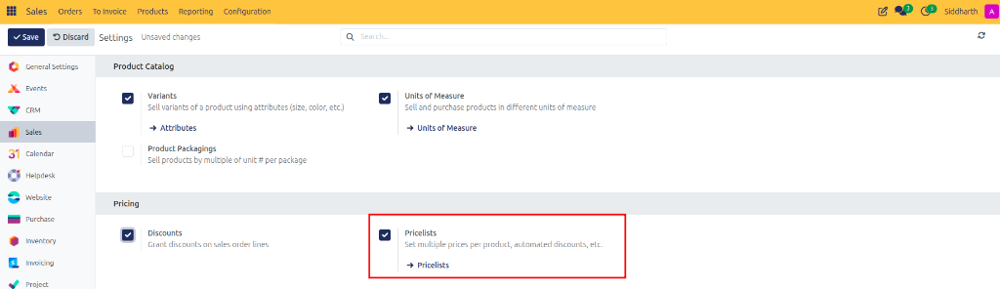
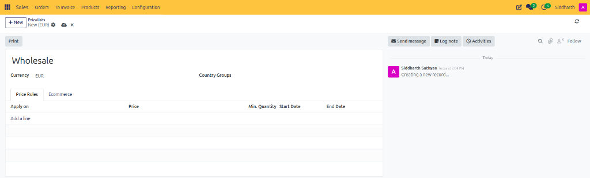
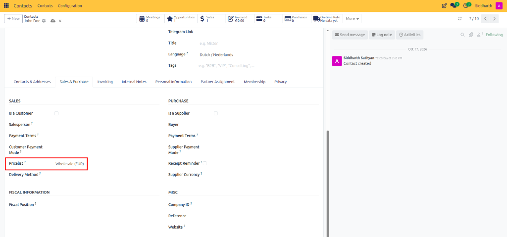
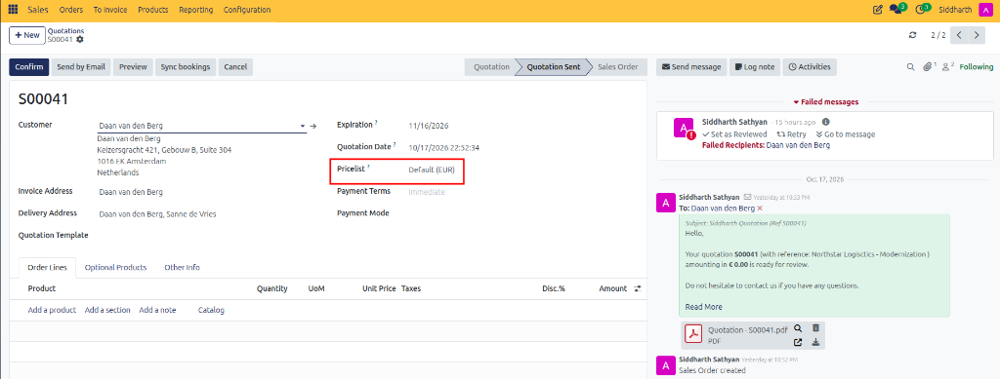

# Configure Pricelists and Pricing Rules

Establish multi-currency price lists, configure volume quantity tiers, and automate formula-based margin pricing rules in CURQ 18 Sales.

---

### Prerequisites
* Enable **Pricelists** in **Sales > Configuration > Settings**. Select **Advanced price rules (discounts, formulas)** to unlock volume breaks and margin controls.

   

---

### Task 1: Create a Customer Pricelist

1. Navigate to **Sales > Products > Pricelists**.

   

2. Click **+ New**.
3. In the top name field, enter a descriptive title *(e.g., `VIP Wholesale Tier` or `EUR Continental List`)*.

   

4. Configure pricelist parameters:
   * **Currency**: Select the operational currency for this price schedule.
   * **Company**: Restrict to a specific subsidiary in multi-company setups, or leave blank for all.
   * **Country Groups**: Automatically apply this pricelist to website and portal visitors from specific geographic trade zones.

---

### Task 2: Configure Rule Scopes and Volume Tiers

Under the **Price Rules** tab, click **Add a line** to open the **Create Pricelist Rules** modal:

1. Select the rule scope under **Apply On**:
   * **All Products**: Global store-wide discount or markup.
   * **Product Category**: Applies to all items in an internal category *(e.g., Office Furniture)*.

      

   * **Product**: Restricts the rule to a specific catalog item.
   * **Product Variant**: Targets an exact SKU or attribute combination.
2. In the **Min. Quantity** field, enter the volume threshold *(e.g., enter `20` for wholesale discounts)*.
3. In **Validity**, define start and end dates for seasonal promotions, or leave blank for permanent rules.

---

### Task 3: Select Computation Methods (Fixed, Discount, Formula)

Under the **Computation** section of the rule modal, choose your calculation logic:

1. **Fixed Price**: Overrides standard catalog prices with an absolute amount *(e.g., `$ 99.00` flat)*.
2. **Discount**: Deducts a percentage from the base catalog sales price *(e.g., enter `15 %`)*.
3. **Formula**: Dynamic calculation based on live catalog parameters:
   * **Based On**: Choose **Sales Price**, **Cost** (cost-plus pricing), or **Other Pricelist**.
   * **Discount**: Enter a percentage modifier *(e.g., `-20 %` for markup or `10 %` for discount)*.
   * **Surcharge**: Add a fixed surcharge *(e.g., `+ $ 5.00` handling fee)*.
   * **Min. Margin & Max. Margin**: Set profitability safeguards *(e.g., ensure at least `$ 10.00` margin over cost regardless of discount)*.
4. Click **Save & Close** (or **Save & New** to add additional quantity tiers).

---

### Task 4: Assign Pricelists to Customers or Quotations

1. **Assign to Customer Profile**:
   * Open the customer record from **Sales > Orders > Customers**.
   * In the **Sales & Purchase** tab, set the default **Pricelist**. Any quotation created for this contact will automatically apply their negotiated tier.

   

2. **Override on an Individual Quotation**:
   * On any draft quote, click the **Pricelist** dropdown and select a different list.
   * CURQ recomputes all order line prices in real time.

   

---

### Edge Cases & Recovery Steps

* **Conflicting Rules (Specific vs. Global)**: If multiple rules apply to the same item, CURQ's pricing engine prioritizes by specificity: `Product Variant Rule > Product Rule > Category Rule > Global Rule`. The most specific rule always takes precedence.
* **Volume Discount Not Triggering**: Verify that the sales order line quantity matches or exceeds the **Min. Quantity** defined in the rule. Also check if the rule has an expired date window under **Validity**.

---

### Related Documentation
* [Sales Reporting and Analytics](./13-sales-reporting-and-analytics.md)
* [Pricing, Pricelists, and Discount Specifications](../settings-and-fields/02-pricing-pricelists-and-discount-specifications.md)

