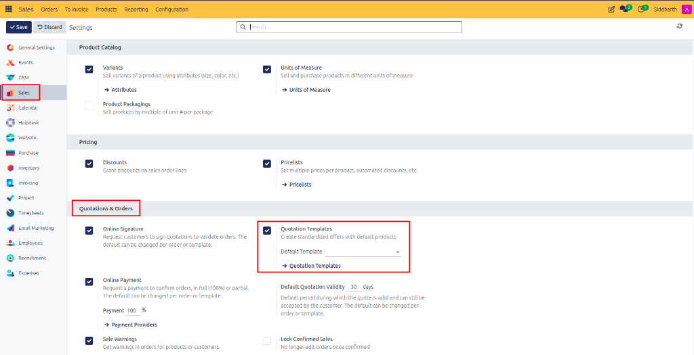
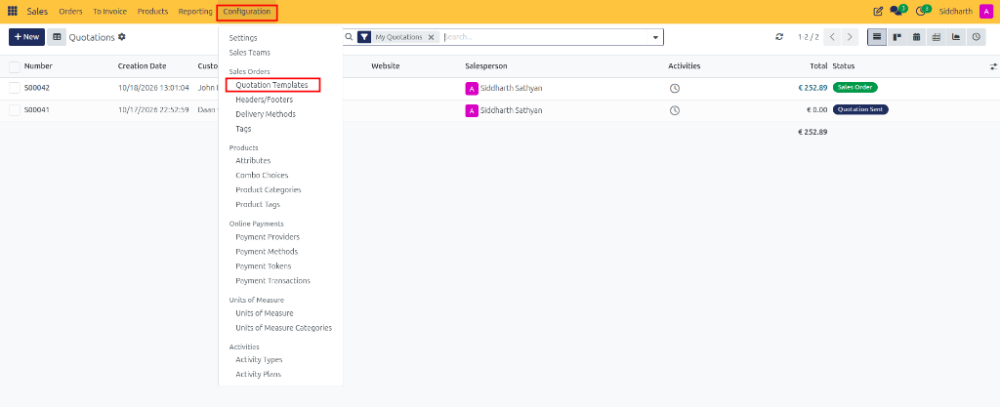
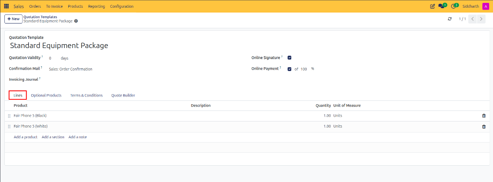
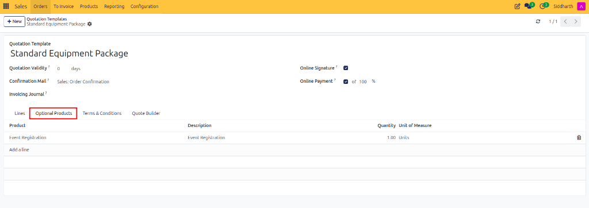
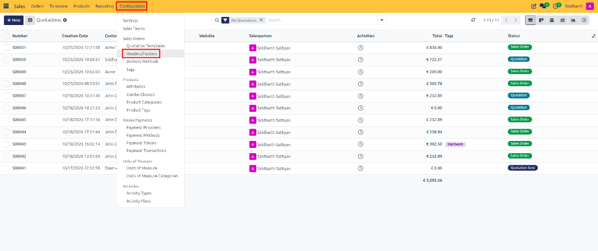
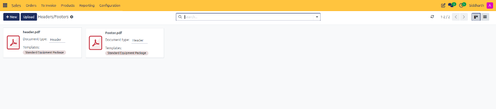
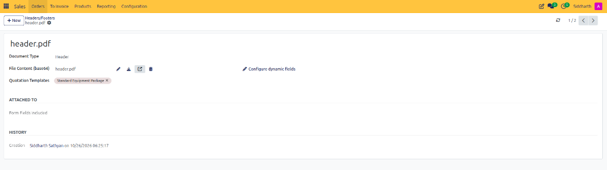
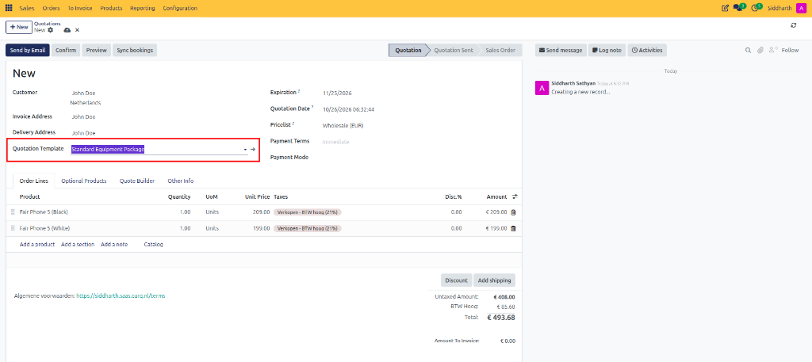
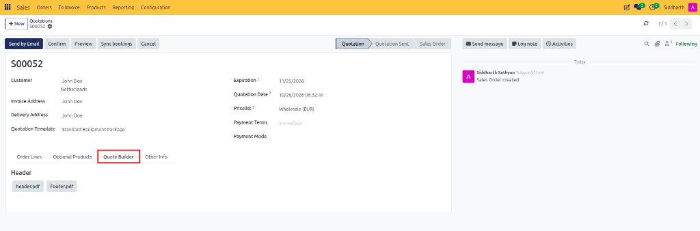

# Configure Quotation Templates and PDF Quote Builder

Create standardized quotation templates, configure default product bundles, and attach professional PDF Quote Builder header and footer cover pages in CURQ 18 Sales.

---

### Prerequisites
* Enable **Quotation Templates** in **Sales > Configuration > Settings**.

   

---

### Task 1: Create a Quotation Template

1. Navigate to **Sales > Configuration > Quotation Templates**:

   

   

2. Click **+ New**.
3. In the **Quotation Template** title field, type a clear template name *(e.g., `Standard Equipment Package`)*.
4. Configure baseline validity and terms:
   * **Quotation Validity**: Enter validity duration in days *(e.g., `30` days)*.
   * **Confirmation Mail**: Select automated confirmation email template *(e.g., `Sales: Order Confirmation`)*.
   * **Online Signature & Online Payment**: Set default customer approval toggles.

---

### Task 2: Populate Default Lines and Optional Items

1. Under the **Lines** tab, click **Add a product** to pre-populate default catalog items *(e.g., `Fair Phone 5 (Black)` and `Fair Phone 5 (White)`)*, standard quantities, and sections:

   

2. Under the **Optional Products** tab, click **Add a line** to specify recommended cross-sell add-ons *(e.g., `Event Registration`)* that sales reps can pitch alongside the core package:

   

3. Under the **Terms & Conditions** tab, enter default legal stipulations, warranty policies, and payment terms:

   

---

### Task 3: Attach PDF Quote Builder Headers and Footers

CURQ's PDF Quote Builder dynamically inserts polished cover pages, team introductions, and contract terms around your quotation PDF:

1. On the template form, click the **Quote Builder** tab:
2. Use **Upload** or **Add** to attach header and footer documents:
   * **Header**: Attach high-resolution PDF cover sheets, marketing portfolios, or executive letters.
   * **Footer**: Attach legal stipulations, SLA specifications, or return policy terms.

   

3. **Managing Global Headers & Footers**:
   * Navigate to **Sales > Configuration > Headers/Footers**:

      

   * Review uploaded PDF documents in Kanban view:

      

   * Open a document record *(e.g., `header.pdf`)* to assign quotation templates, download content, or click **Configure dynamic fields**:

      

   * Switch to List view and use drag handles to reorder execution priority:

      

4. Save the template.

---

### Task 4: Apply a Template to a Quotation

1. Open **Sales > Orders > Quotations** and click **+ New**.
2. Select your customer *(e.g., `John Doe`)*.
3. In the **Quotation Template** dropdown, select your configured template *(e.g., `Standard Equipment Package`)*.
4. CURQ automatically:
   * Populates all predefined order lines *(e.g., `Fair Phone 5 (Black)` and `Fair Phone 5 (White)`)*.
   * Calculates the expiration deadline based on the template's day duration *(e.g., `11/25/2026`)*.

   

5. Under the quotation's **Quote Builder** tab, you can inspect active headers and footers or customize dynamic PDF form values:

   

---

### Edge Cases & Recovery Steps

* **Modifying a Template Does Not Alter Existing Quotes**: Adjusting a quotation template only influences future quotes created from it. Any previously generated quotes maintain their original lines and terms.
* **Overriding Lines on an Individual Quote**: Sales representatives can freely add, remove, or discount individual lines on a quote without altering the master template.

---

### Related Documentation
* [Create and Manage Quotations](./01-create-and-send-quotations.md)
* [Send Quotations to Customers](./01-create-and-send-quotations.md)
* [Quotation and Sales Order Field Definitions](../settings-and-fields/01-quotation-and-sales-order-field-definitions.md)
