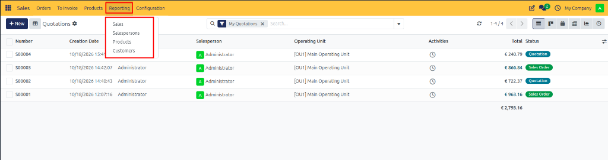
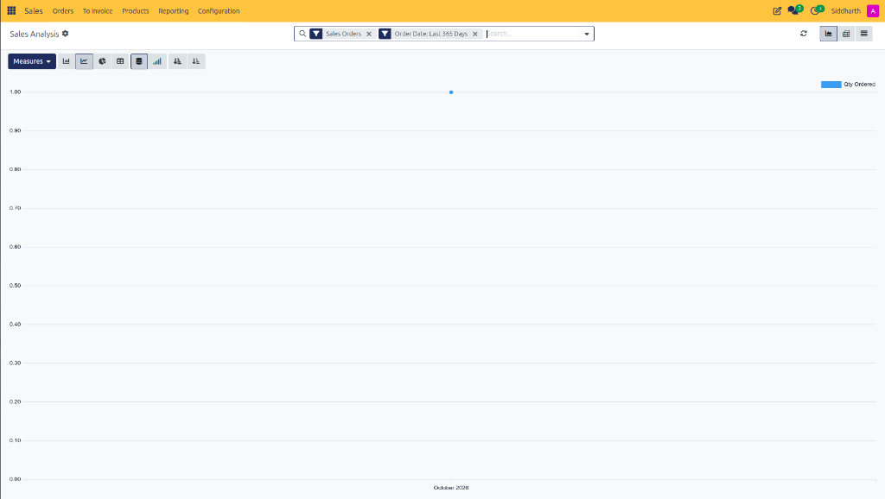
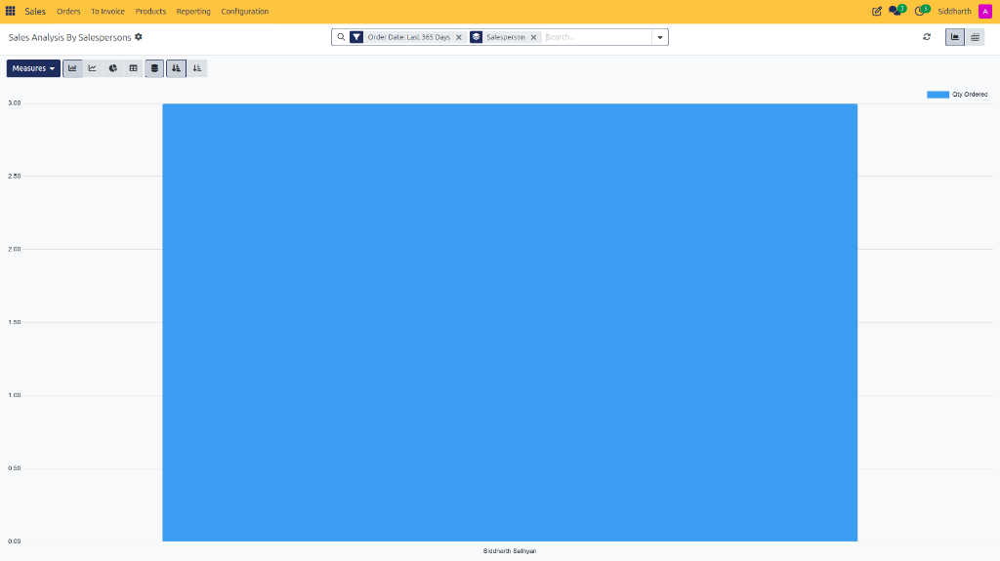
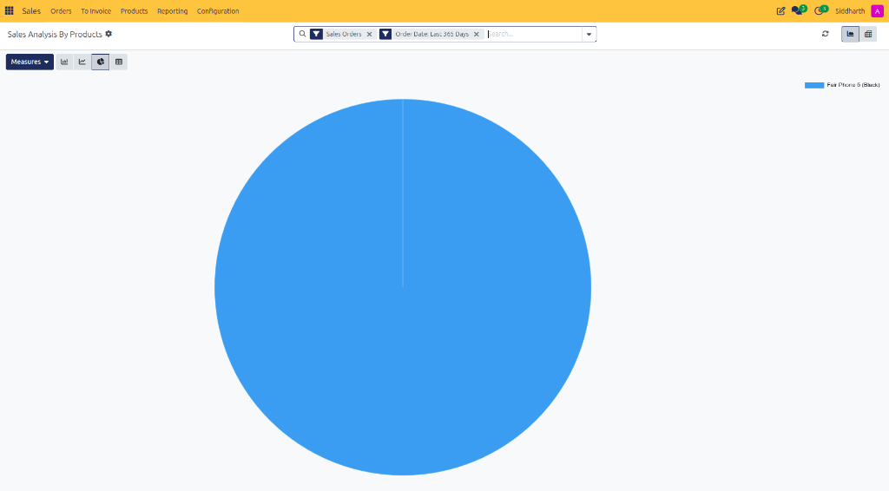
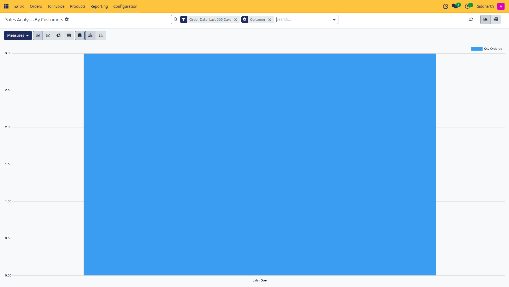

# Sales Reporting and Analytics

Configure sales analysis graph views, evaluate performance across sales teams, products, and customers, and build dynamic multi-dimensional Pivot tables in CURQ 18 Sales.

---

### Prerequisites
* Confirmed sales orders, quotations, and customer invoices in the database.
* Appropriate access rights to the **Reporting** menu (Sales User: Show all leads / Sales Administrator).

---

### Task 1: Access Sales Reporting and Configure Chart Views

In the top navigation bar, click **Reporting** to access analysis dimensions (**Sales**, **Salespersons**, **Products**, or **Customers**):

In the top right header, toggle chart presentation formats:

1. **Line Chart**: Track continuous monthly sales trajectory and order trends *(e.g., in **Sales** analysis)*:

   

2. **Bar Chart**: Compare discrete revenue totals or rep-by-rep sales performance *(e.g., in **Salespersons** analysis)*:

   

3. **Pie Chart**: Visualize product distribution and sales contribution *(e.g., in **Products** analysis)*:

   

4. **Customer Analysis**: Compare order volume and commercial activity across key accounts *(e.g., in **Customers** analysis)*:

   

5. **Stacked vs. Grouped**: Click the stacked bar icon to view category contributions within each month's total bar.

---

### Task 2: Build Dynamic Multi-Dimensional Pivot Tables

To perform deep operational and commercial analysis and cross-tabulate performance metrics:

1. In the top right view switcher, click the **Pivot** table icon (spreadsheet grid icon next to the graph icon).
2. Click the **Measures** dropdown at the top left of the pivot grid and select active metrics:
   * **Untaxed Amount**: Net commercial sales revenue.
   * **Qty Ordered / Qty Delivered / Qty Invoiced**: Operational fulfillment efficiency.
   * **Count**: Total number of sales orders.

3. Group data along rows and columns:
   * Click the **+** icon next to **Total** in the rows column and select **Customer** or **Salesperson**.
   * Click the **+** icon in the column headers and select **Order Date > Month** or **Product Category**.
4. CURQ computes the matrix with real-time totals across both axes.

---

### Task 3: Filter by Team, Time Period, and Export Data

1. Click into the search bar at the top center.
2. Under **Filters**:
   * Select **Sales Orders** to exclude unconfirmed draft quotations.
   * Select **Order Date** to analyze a specific fiscal year, quarter, or rolling month.
3. Under **Group By**:
   * Group by **Sales Team** to benchmark team performance against monthly invoicing quotas.
   * Group by **Customer** or **Salesperson** to drill down into portfolio concentration.
4. **Exporting Data**: Click the **Download xlsx** button (spreadsheet icon) in the top right to export the live pivot grid into an Excel workbook for executive presentations.

---

### Edge Cases & Recovery Steps

* **Draft Quotations Skewing Revenue Metrics**: If reporting totals seem unrealistically high, check the search filter bar. Ensure the **Sales Orders** filter is active so unconfirmed drafts and speculative quotes are excluded from realized revenue.
* **Empty or Incomplete Pivot Matrix**: If expected data rows do not populate after selecting a grouping dimension, verify that date filters encompass the order dates and that cancelled or quotation records have not been excluded by active filter criteria.
* **Discrepancies Between Invoiced and Ordered Amounts**: If invoiced revenue lags behind ordered untaxed totals, switch measures between **Qty Ordered** and **Qty Invoiced** to pinpoint pending deliveries or unissued customer invoices.

---

### Related Documentation
* [Configure Pricelists and Pricing Rules](./08-configure-pricelists-and-pricing-rules.md)
* [Configure Sales Teams and Order Tags](./12-configure-sales-teams-and-tags.md)
* [Sales Configuration and Delivery Settings](../settings-and-fields/03-sales-configuration-and-delivery-settings.md)

