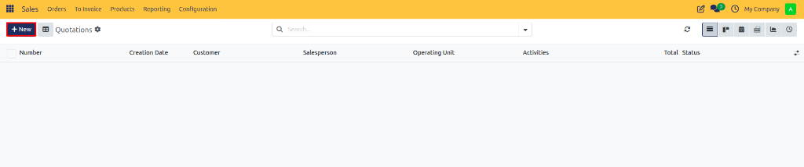
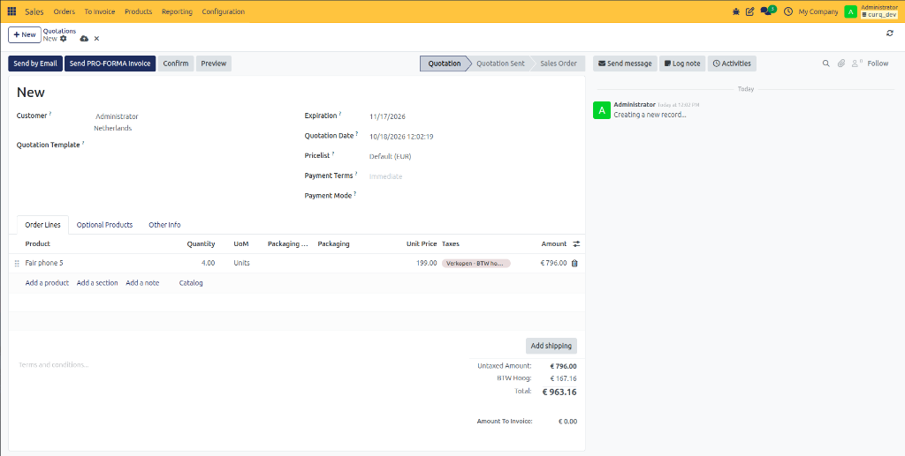
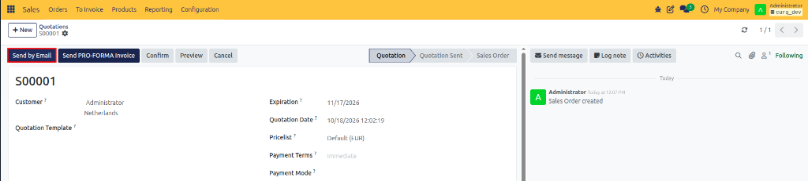
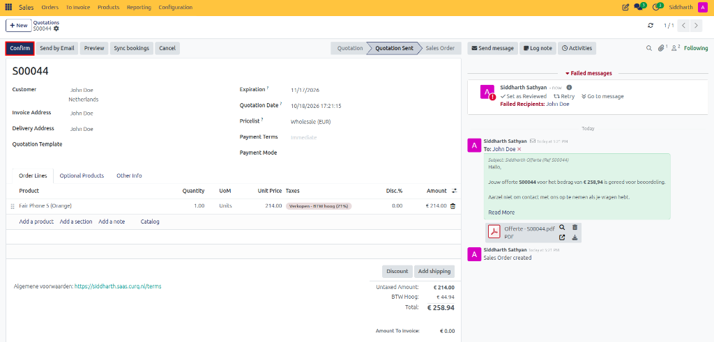

# Getting Started: Process Your First Sale from Quote to Invoice

Follow this hands-on introductory walkthrough to draft a customer quotation, confirm it into a binding sales order, generate an invoice, and record payment in CURQ 18 Sales.

---

## Scenario Overview

A prospective customer, **Deco Addict**, contacts your sales department requesting a quotation for standard office furniture:
* **Product**: `Acoustic Bloc Screens`
* **Quantity**: `2`
* **Price**: Default catalog price (`$ 297.00` each)

You will guide this transaction through the complete commercial sales cycle:

```
[ Draft Quote ] ────► [ Send Email ] ────► [ Confirm Order ] ────► [ Create Invoice ] ────► [ Paid ]
```

---

## Step 1: Create a Draft Quotation

1. Open the **Sales** app from your main CURQ dashboard.
2. In the top action bar, click **+ New** to open a blank quotation form.

   

3. In the **Customer** field, select `Deco Addict`. CURQ automatically populates default payment terms and customer address details.
4. Leave the **Expiration** date and default currency settings at their system defaults.

---

## Step 2: Add Products to the Order

1. Under the **Order Lines** tab, click **Add a product**.
2. In the **Product** column, select `Acoustic Bloc Screens`.
3. In the **Quantity** field, enter `2.00`.

   

4. Verify that CURQ calculates the line subtotal (`$ 594.00`) and adds the default tax rate automatically in the bottom-right summary.

---

## Step 3: Send the Quotation to the Customer

1. In the top-left action header, click **Send by Email**.

   

2. A pre-formatted email composition window appears with a PDF copy of the quotation attached.
3. Review the recipient email address and message template, then click **Send**.
4. Observe the order status in the upper right progress bar change from **Quotation** to **Quotation Sent**.

---

## Step 4: Confirm the Sales Order

When the customer agrees to the proposal:

1. On the quotation screen, click **Confirm** in the top action bar.

   

2. The status indicator advances to **Sales Order**, and CURQ automatically assigns an official sales order sequence number *(e.g., `S00042`)*.
3. A delivery order smart button appears in the upper right corner to notify warehouse personnel.

---

## Step 5: Create the Customer Invoice and Record Payment

1. With the order confirmed, click **Create Invoice** in the top action bar.
2. In the modal dialog, ensure **Regular invoice** is selected, then click **Create Draft Invoice**.

   

3. Review the generated customer invoice, then click **Confirm** to post it to the financial ledger.
4. Click **Register Payment**, verify the bank journal and payment amount, and click **Create Payment**.
5. The invoice status badge immediately displays a green **Paid** ribbon.

---

## What You Accomplished

You completed an end-to-end sales cycle in CURQ 18:
* Created and customized a professional customer offer.
* Dispatched the quote with an automated PDF attachment.
* Transitioned the prospect into a confirmed legal sales order.
* Generated the accounting invoice and collected payment.

---

## Next Steps
* To learn how to automate customer approvals with digital signatures and online credit card payments, see [Getting Started: Complete a Sale with Online Signature and Payment](./02-complete-a-sale-with-online-signature-and-payment.md).
* To configure custom pricing, discounts, and quantity breaks, see [How-To: Configure Pricelists and Pricing Rules](../how-to/08-configure-pricelists-and-pricing-rules.md).
* To explore all fields on the sales order form, see [Reference: Quotation and Sales Order Field Definitions](../reference/01-quotation-and-sales-order-field-definitions.md).
