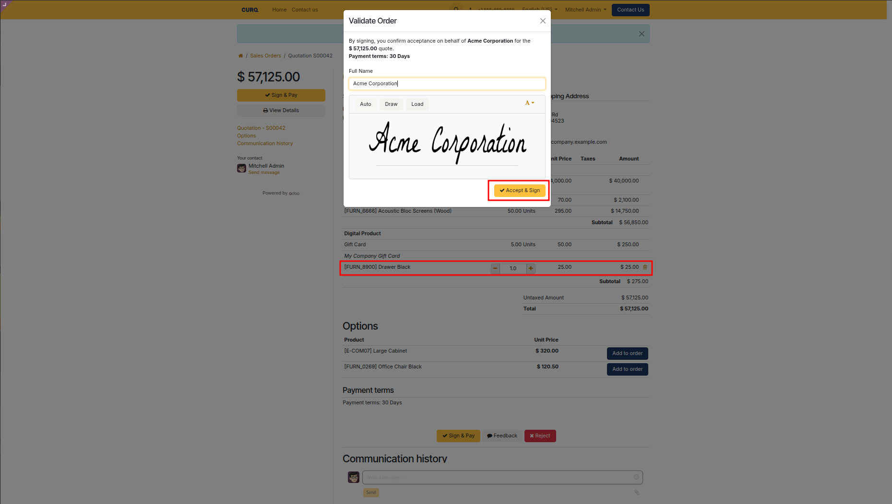
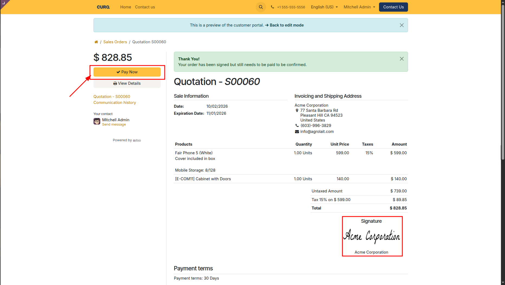
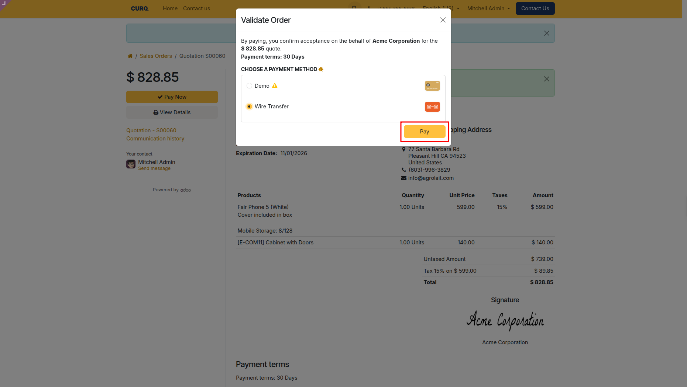
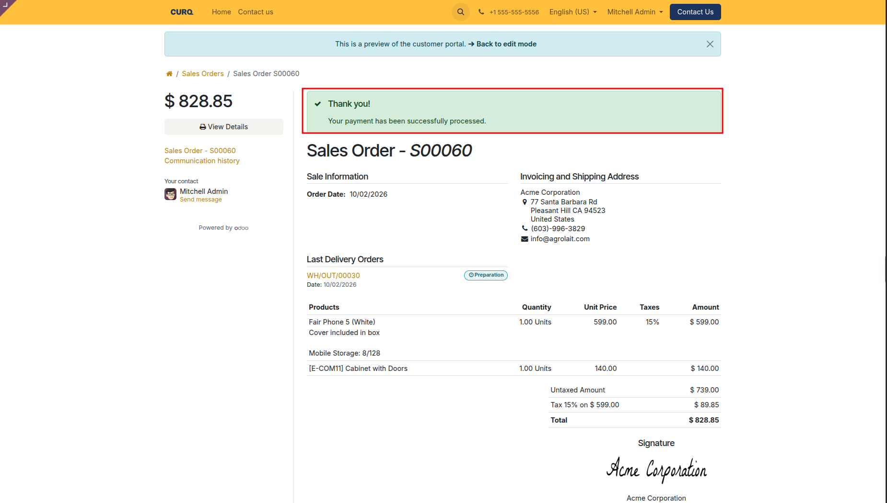

# Getting Started: Complete a Sale with Online Signature and Payment

Follow this walkthrough to experience how modern B2B transactions close in CURQ 18: requiring digital customer signatures and online prepayments to automate sales order confirmation and invoicing.

---

## Scenario Overview

Your company, **Apex Workspace Solutions**, prepares an equipment quote for **Acme Corporation**:
* **Customer Requirements**: Acme Corporation is outfitting a new regional office with Executive Desks, storage cabinets, Fair Phone 5 smartphones, and optional acoustic partitions and extended warranties.
* **Commercial Rules**: Apex Workspace Solutions enforces bulk pricing rules, maintains a strict minimum 15% profit margin hurdle on total order revenue, requires an online signature before dispatch, and demands 100% online prepayment.
* As soon as payment clears, CURQ automatically confirms the sales order, locks prices against tampering, reserves warehouse inventory, and generates the paid customer invoice.

```
┌─────────────────────────────────┐
│     Salesperson Sends Quote     │
│   (Online Sign & Pay Enabled)   │
└────────────────┬────────────────┘
                 │ Email Invitation Link
                 ▼
┌─────────────────────────────────┐
│     Customer Signs Online       │
│  (Draws Signature in Portal)    │
└────────────────┬────────────────┘
                 │
                 ▼
┌─────────────────────────────────┐
│     Customer Pays Online        │
│    (Credit Card / Gateway)      │
└────────────────┬────────────────┘
                 │ Payment Webhook Clears
                 ▼
┌─────────────────────────────────┐
│   CURQ Automates Confirmation   │
│  • Order Confirmed & Locked     │
│  • Delivery Slip Reserved       │
│  • Invoice Created & Paid       │
└─────────────────────────────────┘
```

---

## Step 1: Draft the Quotation with Online Terms

1. In the **Sales** app, click **+ New**.
2. In the **Customer** field, select `Acme Corporation`.
3. Under the **Order Lines** tab, click **Add a product** and select `Executive Desk`. Set the quantity to `1`.
4. Open the **Other Info** tab:
   * Under the **Quotations & Orders** column, check **Online Signature**.
   * Check **Online Payment** and confirm the deposit percentage is set to `100.00 %`.

   

5. In the top action bar, click the cloud icon (or press `Ctrl+S`) to save the quotation.

---

## Step 2: Preview the Customer Portal

To simulate the exact customer experience without leaving your desk:

1. In the top action bar of the quotation, click the **Customer Preview** button (looks like an external window icon).

   

2. CURQ opens the customer portal view in a browser tab.
3. Review how the customer sees the quotation lines, unit costs, untaxed subtotal, and tax computations in a clean, professional web layout.

---

## Step 3: Draw the Electronic Signature

1. On the portal page, locate the action buttons at the bottom right and click **Sign & Pay**.
2. The **Validate Order** modal dialog opens:

   

3. Review the legal confirmation prompt. In the signature box, draw a signature with your mouse or trackpad, or select **Type** to generate a styled script signature.
4. Click **Accept & Sign**.
5. CURQ logs the signature along with a cryptographic audit trail (timestamp and client IP address).

---

## Step 4: Submit Online Prepayment

Immediately after signature submission, a notification banner appears:
*"Thank You! Your order has been signed but still needs to be paid to be confirmed."*

1. Click the yellow **Pay Now** banner button.

   

2. The **Payment Methods** modal displays the active gateway options:

   

3. Select your test payment method *(such as Test Gateway or Wire Transfer)* and click **Pay**.
4. Upon processing, the portal reloads displaying a green confirmation banner:
   *"Thank you! Your payment has been successfully processed."*

   

---

## Step 5: Verify Automated Backend Execution

Return to the backend sales interface (or close the preview tab):

1. Refresh the quotation record.
2. Observe the state transformation:
   * The status bar has moved automatically to **Sales Order**.
   * The order is marked with a **Locked** badge, preventing accidental line alterations.
   * In the **Chatter** timeline on the right, CURQ has archived the signed PDF agreement, logged the transaction reference, and posted the payment receipt.
   * Smart buttons show both the reserved **Delivery Order** and the **Paid Invoice** ready for accounting reconciliation.

---

## What You Accomplished

You executed a zero-friction, automated commercial agreement:
* Eliminated paper scanning and physical contract mailing.
* Guaranteed cash collection upfront before releasing inventory reserves.
* Automated the handoff between sales, warehouse fulfillment, and finance.

---

## Next Steps
* To configure global payment providers and gateway credentials, see [How-To: Manage Customer Approvals and Online Payments](../how-to/05-manage-customer-approvals-and-payments.md).
* To understand legal locking mechanics and chatter compliance, see [Explanation: Understanding the Sales Order Lifecycle and State Machine](../explanation/01-understanding-the-sales-order-lifecycle.md).
* To configure standardized quotation templates with PDF cover letters, see [How-To: Configure Quotation Templates and PDF Quote Builder](../how-to/10-configure-quotation-templates.md).
