# Configuring Time Off Types

Follow these steps to create and configure time off types in CURQ 18. Time off types define the different kinds of leave employees can request, such as paid leave, sick leave, unpaid leave, and compensatory days. Each type can have its own approval rules, allocation requirements, and display settings.

---

## 1. Open Time Off Types

1. Open the **Time Off** app.
2. Navigate to **Configuration → Time Off Types**.

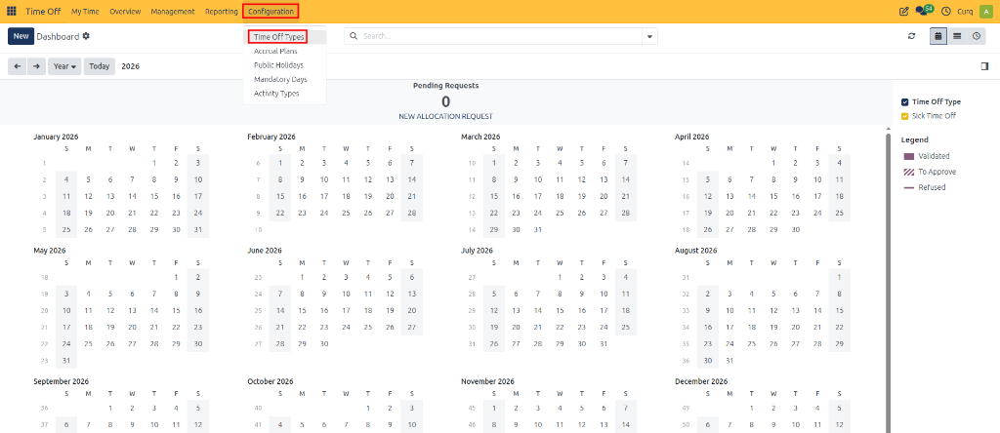

The page displays the existing time off types, including Paid Time Off, Sick Time Off, Unpaid, and Compensatory Days.

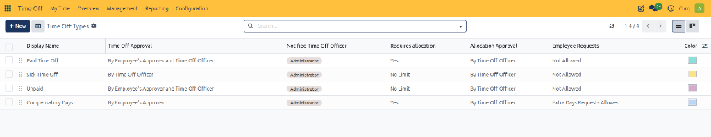

---

## 2. Create a Time Off Type

1. Click **New**.

   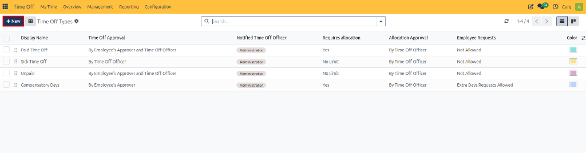

2. Enter a name for the time off type, such as `Annual Leave` or `Medical Leave`.
3. Configure the approval, allocation, and other settings described in the sections below.
4. Click **Save** to create the time off type.

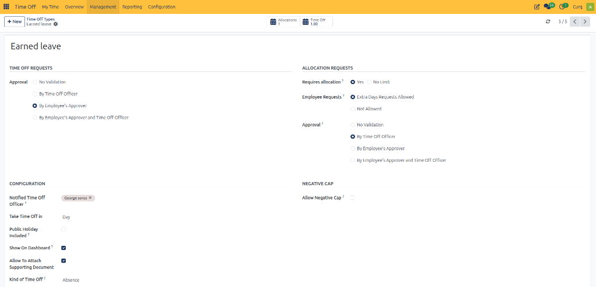

---

## 3. Explanation of All Fields

The following explanations describe the purpose and behavior of each field when configuring time off types in CURQ 18.

### A. Time Off Type Name

| Field | Description |
| :--- | :--- |
| **Name** | The name employees see when selecting a leave type in a time off request. |

---

### B. Time Off Requests

This section defines how an employee's leave request is approved.

| Field / Option | Description |
| :--- | :--- |
| **No Validation** | Requests are automatically approved without manual approval. |
| **By Time Off Officer** | The designated Time Off Officer approves the request. |
| **By Employee's Approver** | The employee's assigned approver, typically their manager, approves the request. |
| **By Employee's Approver and Time Off Officer** | Both the employee's approver and the Time Off Officer must approve the request. |

---

### C. Allocation Requests

An allocation is the amount of leave granted to an employee. For example, an employee might receive 12 days of annual leave for a year.

| Field / Option | Description |
| :--- | :--- |
| **Requires allocation? — Yes** | Employees must have leave allocated before using this leave type, subject to the configured rules. |
| **Requires allocation? — No Limit** | Employees can request this leave without a prior allocation. |
| **Extra Days Requests Allowed** | Employees can request more leave than their current allocation. The extra amount still needs to be granted through the applicable process. |
| **Not Allowed** | Employees cannot request additional leave beyond their allocation through the extra-days request mechanism. |
| **No Validation** | Additional allocation requests are automatically approved. |
| **By Time Off Officer** | The Time Off Officer approves allocation requests. |
| **By Employee's Approver** | The employee's assigned approver approves allocation requests. |
| **By Employee's Approver and Time Off Officer** | Both approvers must approve allocation requests. |

---

### D. Configuration

This section contains general settings that determine how the time off type behaves throughout CURQ.

| Field | Description |
| :--- | :--- |
| **Notified Time Off Officer** | Specifies the officer associated with this leave type who can receive notifications and handle relevant approval responsibilities. |
| **Take Time Off in — Day** | Leave is requested in full-day units. |
| **Take Time Off in — Half Day** | Leave is requested in half-day units. |
| **Take Time Off in — Hours** | Leave can be requested in hourly units. |
| **Public Holiday Included?** | Determines whether public holidays within the leave period are counted against the leave entitlement. |
| **Show On Dashboard?** | Controls whether this leave type is displayed as an option on the employee's Time Off dashboard. |
| **Allow To Attach Supporting Document** | Allows employees to attach documents to requests, such as medical certificates or other supporting evidence. |
| **Kind of Time Off — Absence** | The time off is treated as an absence for applicable worked-time and accrual calculations. |
| **Kind of Time Off — Worked Time** | The time off is treated as worked time for relevant accrual calculations. |
| **Company** | If CURQ is configured for multiple companies, select the company to which the time off type applies. Leaving it empty makes it available across all companies. |

*Note*: The **Public Holiday Included** option directly affects leave-duration calculation. For example, if a leave request covers five working days and one of those days is a configured public holiday, the holiday is excluded from the leave deduction when this option is disabled. The actual result depends on the working schedule and public holiday configuration.

---

### E. Negative Cap

The **Negative Cap** section controls whether employees can request leave beyond their available balance.

| Field | Description |
| :--- | :--- |
| **Allow Negative Cap?** | Allows employees to request more leave than their available balance, subject to a configured maximum excess amount. |
| **Maximum Excess Amount** | When enabled, defines the maximum permitted negative balance. |

---

### F. Timesheets

These fields connect time off with timesheet records when the relevant Timesheets integration is configured and developer mode or settings are active.

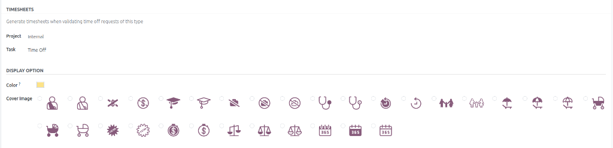

| Field | Description |
| :--- | :--- |
| **Generate timesheets when validating time off requests of this type** | Enables the time off type to be associated with automatic timesheet generation when the relevant integration is configured. |
| **Project** | Specifies the project under which generated time off entries are recorded. |
| **Task** | Specifies the task under which generated time off entries are recorded. |

---

### G. Display Option

The **Display Option** section controls how the time off type appears visually in the Time Off application.

| Field | Description |
| :--- | :--- |
| **Color** | Sets the color used to identify this leave type visually in the Time Off interface, calendar, and dashboard. |
| **Cover Image** | Selects the icon representing the leave type in dashboard displays. |

*Note*: The cover image choices include symbols for medical leave, money, education, family, vacation umbrellas, baby strollers, scales of justice, calendars, and other categories. Choose an icon that makes sense for the leave type; it does not determine approval behavior.

---

## 4. Save the Time Off Type

1. Review all configured settings.
2. Confirm that the request and allocation approval methods match your organization's policies.
3. Click **Save**.

The time off type is now available according to its configuration and the user's access rights.

---

## 5. Allocating Leaves to Employees via the Allocations Smart Button

After saving a time off type, administrators and HR officers can allocate leave directly to specific employees using the **Allocations** smart button on the record header.

1. On the saved time off type form, click the **Allocations** smart button in the top metric bar.

   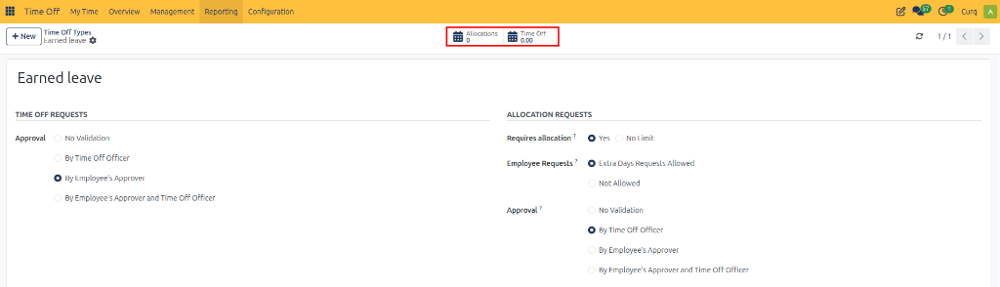

2. Click **New** to open a blank allocation form, then specify the allocation details:
   * **Time Off Type**: Inherited automatically from the active time off type *(e.g., `Earned leave`)*.
   * **Employee**: Select the employee who will receive the leave entitlement *(e.g., `Maffire`)*.
   * **Allocation Type**: Choose **Regular Allocation** for a fixed balance *(or Accrual Allocation for periodic earning)*.
   * **Validity Period**: Specify an effective date and optional expiration date *(or leave as `No Limit`)*.
   * **Allocation**: Enter the number of days or hours being allocated *(e.g., `6.00 Days`)*.

   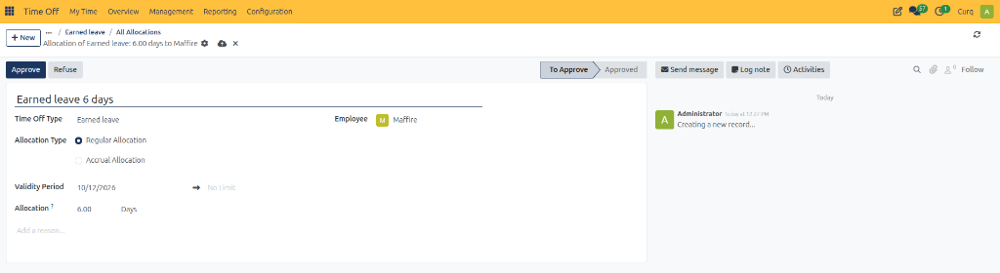

3. Click **Approve** in the top action bar to confirm the allocation.
   * The status updates from **To Approve** to **Approved**.
   * An automated confirmation note is logged in the record chatter, recording the approved allocation.

   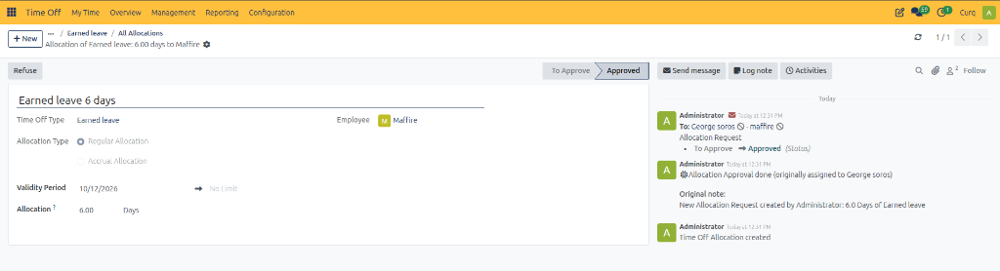

4. The approved balance reflects immediately on the employee's personal account. When the employee logs in, they can view their available balance card on their dashboard or navigate to **My Time → My Allocations**.

   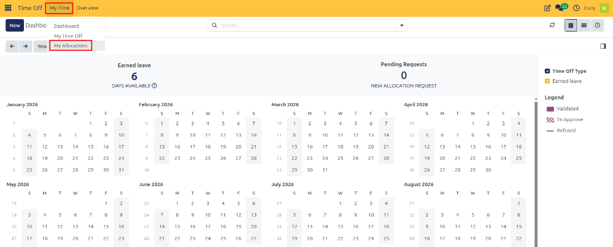

5. The employee can verify the approved allocation record in the **My Allocations** list view.

   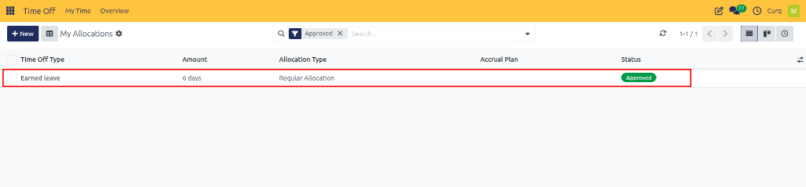

---

## 6. Tracking Requests via the Time Off Smart Button

When employees submit leave requests under a specific time off type:

1. The **Time Off** smart button on the top header of the time off type form updates dynamically to show the cumulative duration *(e.g., `1.00 Day`)* or total requests taken under this category.

   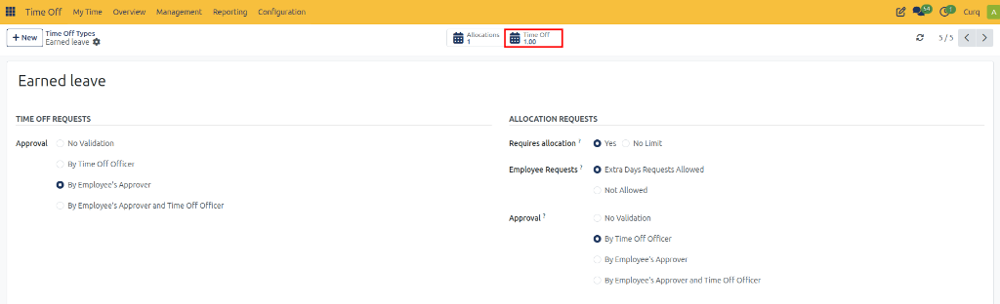

2. Clicking the **Time Off** smart button opens a dedicated list view displaying all employee leave requests submitted for this specific leave type.

   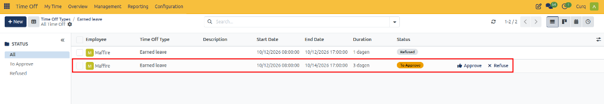

3. From this view, administrators and managers can filter, group, and audit historical or pending absences across the organization for that leave type, as well as directly approve or refuse pending requests.

