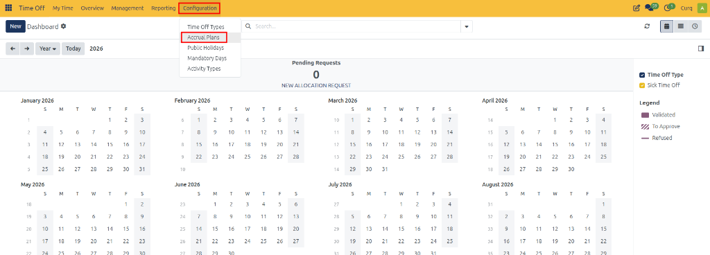
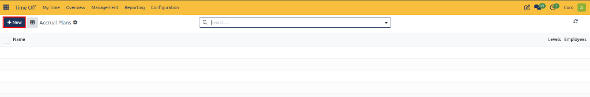
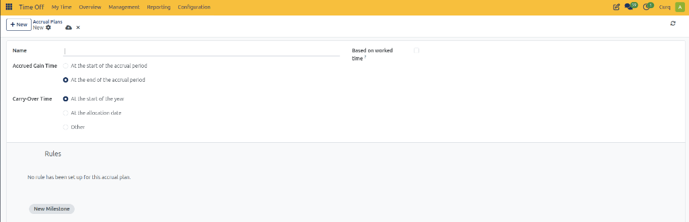
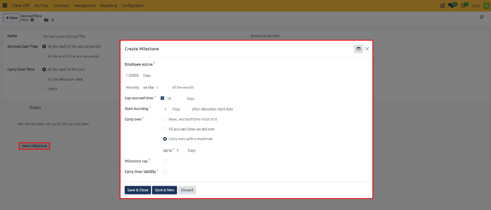
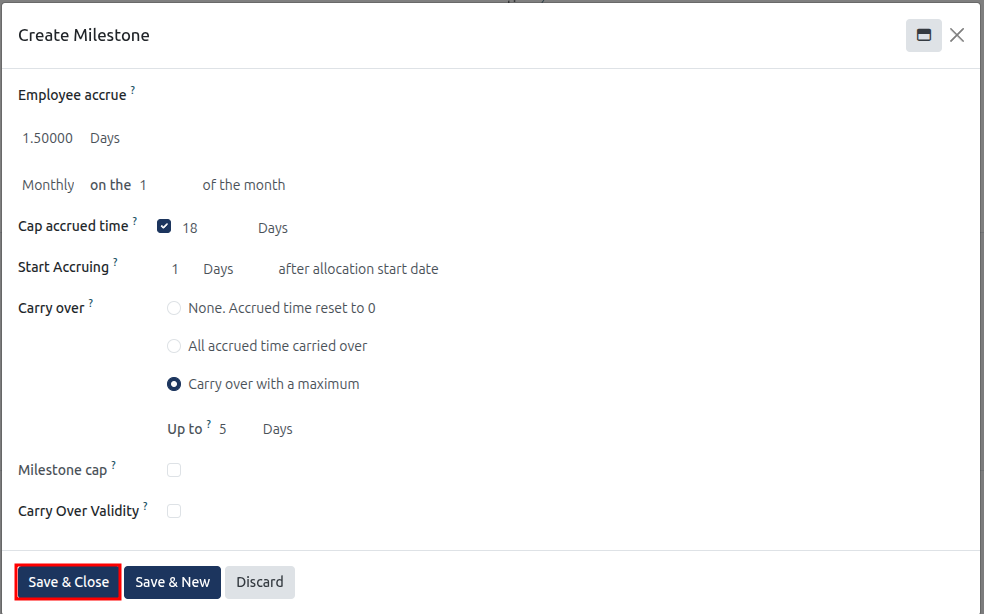
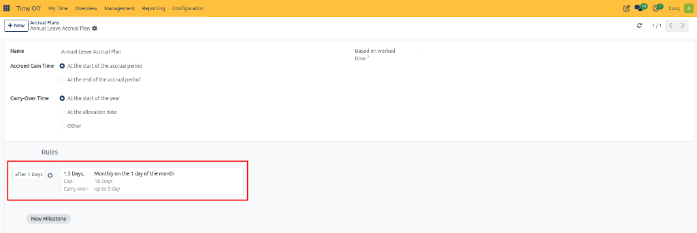

# Configuring Accrual Plans

Accrual plans in CURQ 18 allow employees to earn time off gradually over a specified period. Instead of allocating the entire leave balance in advance, organizations can define rules that grant leave based on a schedule, such as hourly, weekly, monthly, or yearly.

For example, a company may grant employees 1.5 days of paid leave every month. An accrual plan automates this process according to the configured rules and limits.

---

## Open Accrual Plans

1. Open the **Time Off** app.
2. Navigate to **Configuration → Accrual Plans**.

3. View the existing accrual plans or click **New** to create one.

   

---

## Create an Accrual Plan

Click **New** to open a blank accrual plan form.

### Basic Configuration

* **Name:** Enter a descriptive name for the accrual plan.
* **Accrued Gain Time:** Select when employees receive their accrued leave.
  * **At the start of the accrual period:** Leave is granted at the beginning of each accrual period.
  * **At the end of the accrual period:** Leave is granted after the accrual period has been completed.
* **Carry-Over Time:** Select when unused accrued leave is carried over.
  * **At the start of the year:** Unused leave is carried over at the beginning of the year.
  * **At the allocation date:** Carry-over is handled when the allocation begins.
  * **Other:** Specify a custom carry-over date when this option is available.
* **Based on worked time:** Enable this option if leave should accrue based on eligible working time. Time that does not qualify as worked time will not contribute to accrual.

---

## Configure Accrual Rules

The **Rules** section defines how much leave employees earn, how frequently they earn it, and what limits apply.

To create a rule, click **New Milestone**. The **Create Milestone** dialog opens.

### Employee Accrue

Specify the amount of leave an employee earns and the frequency at which it is granted.

* **Amount:** Enter the quantity of leave to accrue.
* **Unit:** Select **Days** or **Hours**.
* **Frequency:** Select how often the leave is accrued, such as daily, weekly, monthly, or yearly.

For example, you can configure employees to accrue 1.5 days of leave every month.

### Cap Accrued Time

Enable this option to set the maximum leave balance that can be accumulated under the rule.

Enter the maximum number of days or hours permitted.

For example, if the cap is set to 30 days, the employee cannot accrue beyond the configured limit under this rule.

### Start Accruing

Specify when the employee begins earning leave after the allocation start date.

Enter the required duration and select the unit, such as days, months, or years.

For example, setting this to one month delays the start of accrual until the configured waiting period has passed.

### Carry Over

Choose how unused accrued leave is handled at the carry-over point.

* **None. Accrued time reset to 0:** Unused accrued leave is not carried over.
* **All accrued time carried over:** All eligible unused accrued leave is carried forward.
* **Carry over with a maximum:** Only the specified maximum amount of unused leave is carried forward.

When using the maximum option, enter the permitted number of days or hours.

> **Important:** The carry-over rule configured on the milestone can override the carry-over setting on the main accrual plan. Review both settings to ensure they match your leave policy.

### Milestone Cap

Enable this option to limit the total amount of leave that can be accrued under the milestone over the applicable year.

Enter the maximum number of days or hours permitted.

This setting helps prevent the accrual balance from exceeding the organization's annual limit.

### Carry Over Validity

Enable this option to define how long carried-over leave remains available.

Specify the validity period using the available duration fields.

For example, an organization may allow employees to use carried-over leave within three months. Any unused carry-over may expire after the configured validity period.

---

## Save the Milestone

After entering the milestone details:

* Click **Save & Close** to save the milestone and return to the accrual plan.
* Click **Save & New** to save the milestone and create another one.
* Click **Discard** to cancel the current changes.

Add additional milestones when employees should receive different accrual amounts or follow different rules after reaching a particular stage of service.
