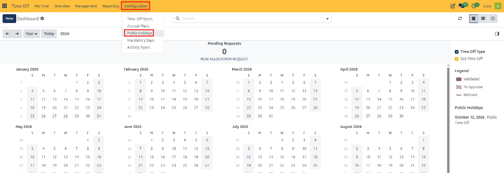
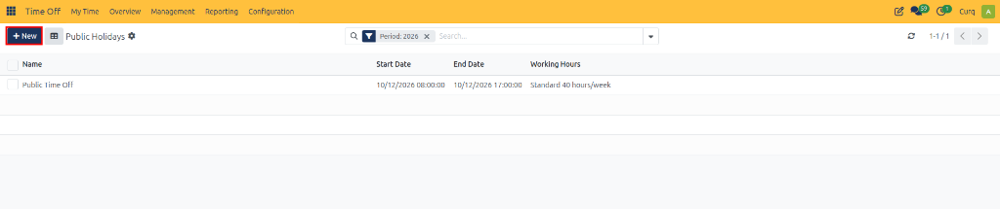
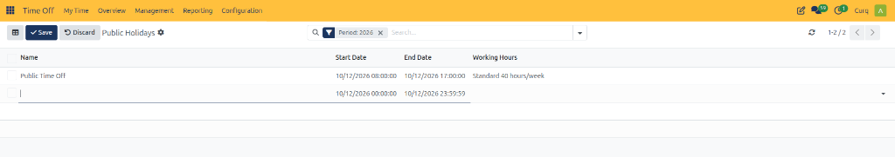

# Configuring Public Holidays

Public holidays in CURQ 18 allow organizations to define official holidays and non-working periods in their working schedules. Configuring public holidays helps ensure that employee leave requests, calendars, planning activities, and other applications that depend on working schedules account for these dates correctly.

Public holidays can be configured according to the organization's holiday calendar and working hours.

---

## Open Public Holidays

1. Open the **Time Off** app.
2. Navigate to **Configuration → Public Holidays**.

   

3. Review the list of existing public holidays.

The list displays the holiday name, start date, end date, and applicable working hours.

---

## Create a Public Holiday

1. Click **New**.

   

2. Enter the holiday name.
3. Configure the start date and end date.
4. Select the applicable working hours, if required.
5. Click **Save** to create the record.

   

---

## Configure Public Holiday Details

| Field | Description |
| :--- | :--- |
| **Name** | Enter a descriptive name for the holiday. |
| **Company** | In a multi-company environment, defines the company to which the public holiday applies. |
| **Start Date** | Select the date and time when the public holiday begins. |
| **End Date** | Select the date and time when the public holiday ends. |
| **Working Hours** | Select the working schedule to which the holiday applies. |
