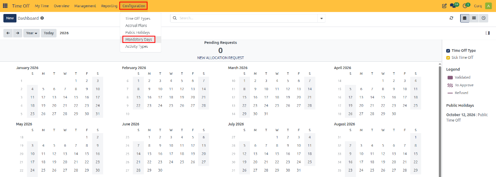
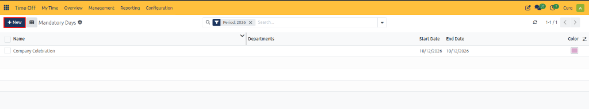

# Configuring Mandatory Days

Mandatory Days in CURQ 18 allow organizations to define specific dates when employees are required to be available for work and cannot request time off. These dates can apply to the entire company or to selected departments.

This feature is useful for company-wide events, important business activities, inventory audits, training sessions, and other occasions when employee attendance is required.

---

## Open Mandatory Days

1. Open the **Time Off** app.
2. Navigate to **Configuration → Mandatory Days**.

   

3. Review the list of existing mandatory days.

The list displays information such as the name, company, departments, start date, end date, and color assigned to each mandatory day.

---

## Create a Mandatory Day

1. Click **New**.

   

2. Enter a name for the mandatory day.
3. Select the company, if applicable.
4. Choose the departments to which the mandatory day applies, if required.
5. Set the start date and end date.
6. Select a color to identify the mandatory day on the calendar.
7. Click **Save** to create the record.

---

## Configure Mandatory Day Details

| Field | Description |
| :--- | :--- |
| **Name** | Enter a descriptive name for the mandatory day. |
| **Departments** | Select the departments whose employees must be available. If left blank, it applies to the entire company. |
| **Start Date** | Select the date on which the mandatory period begins. |
| **End Date** | Select the date on which the mandatory period ends. |
| **Color** | Select a color to distinguish the mandatory day on the calendar. |

---

## Manage Existing Mandatory Days

Open an existing record to review or update its details.

You can adjust the name, applicable company or departments, dates, and color according to your organization's requirements.

Review mandatory days regularly to ensure that the configured dates reflect current business activities.
