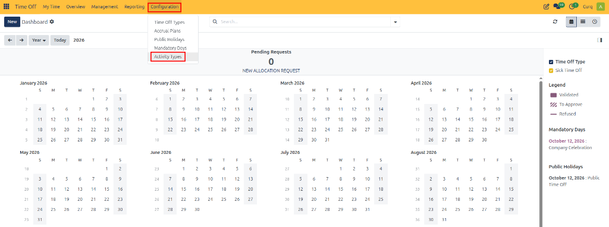
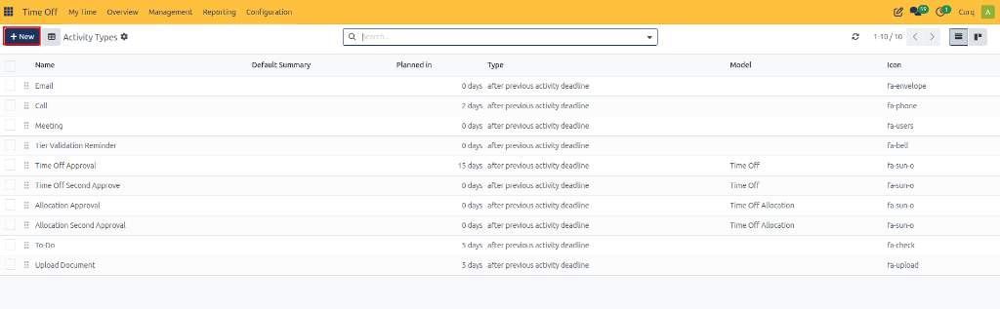
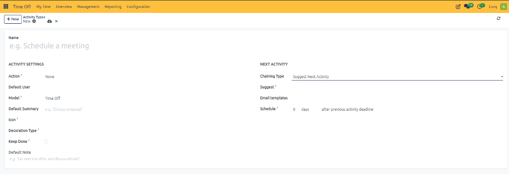

# Configuring Activity Types

Activity Types in CURQ 18 define the activities that users can schedule to organize and track their work. Examples include emails, calls, meetings, reminders, approval activities, and document uploads.

Configuring activity types allows organizations to standardize follow-up actions, set default descriptions, schedule deadlines, and suggest subsequent activities. In the Time Off module, activity types can also support leave request and allocation approval workflows.

---

## Open Activity Types

1. Open the **Time Off** app.
2. Navigate to **Configuration → Activity Types**.

   

3. Review the existing activity types.

   

The list displays information such as the activity name, default summary, scheduled deadline, activity type, associated model, and icon.

---

## Create an Activity Type

1. Click **New**.
2. Enter a name for the activity type.
3. Configure the settings under the **Activity Settings** section.
4. Set the options under the **Next Activity** section, if required.
5. Click **Save** to create the activity type.

---

## Configure Activity Settings

| Field | Description |
| :--- | :--- |
| **Name** | Enter a descriptive name for the activity type (e.g., `Follow-up Call`, `Time Off Approval`, or `Document Verification`). |
| **Action** | Select the action associated with the activity type, determining its specific behavior. |
| **Default User** | Select the user assigned responsibility for the activity by default. |
| **Model** | Select the business record model associated with the activity type (e.g., `Time Off` for leave requests, `Time Off Allocation` for allocation records). |
| **Default Summary** | Enter a predefined summary for the activity (e.g., `Review time off request`). |
| **Icon** | Select an icon to visually identify the activity type. |
| **Decoration Type** | Select a visual decoration style to distinguish the activity in the interface. |
| **Keep Done** | Enable this option if completed activities should remain visible instead of being removed from the active list. |
| **Default Note** | Enter default instructions or notes to include whenever this activity is scheduled. |

---

## Configure Next Activity

The **Next Activity** section determines what happens after the current activity and helps users plan follow-up actions.

| Field | Description |
| :--- | :--- |
| **Chaining Type** | Choose how the next activity should be handled (e.g., `Suggest Next Activity` to recommend a follow-up action upon completion). |
| **Suggest** | Select the activity type to suggest after the current activity is completed. |
| **Email templates** | Select an email template to use when the activity involves email communication. |
| **Schedule** | Configure when the next activity should be scheduled relative to the previous activity deadline. |
