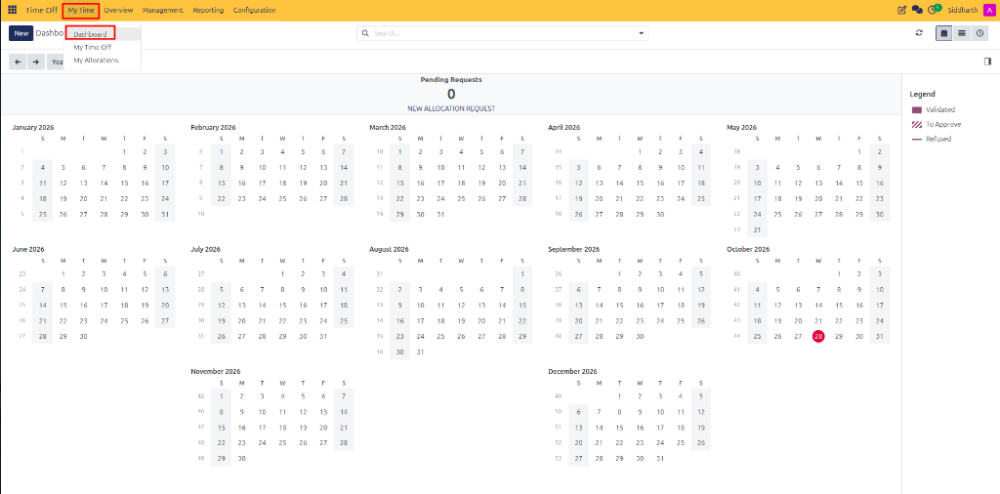
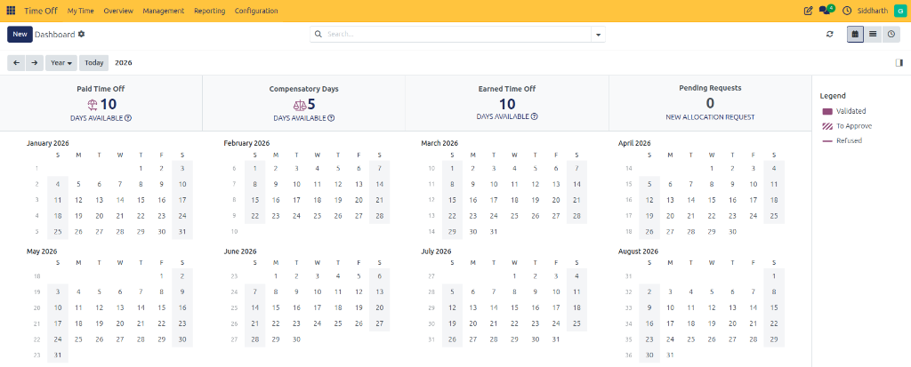
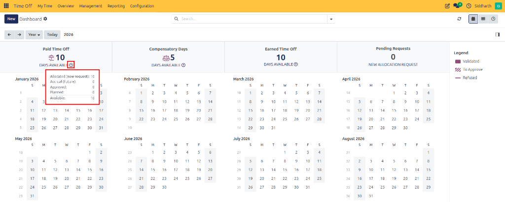
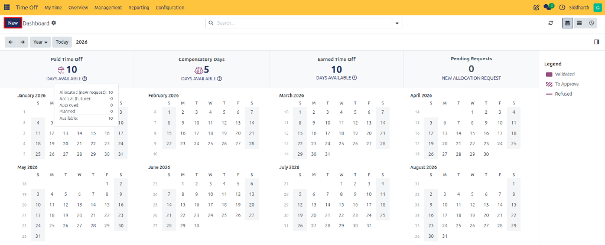
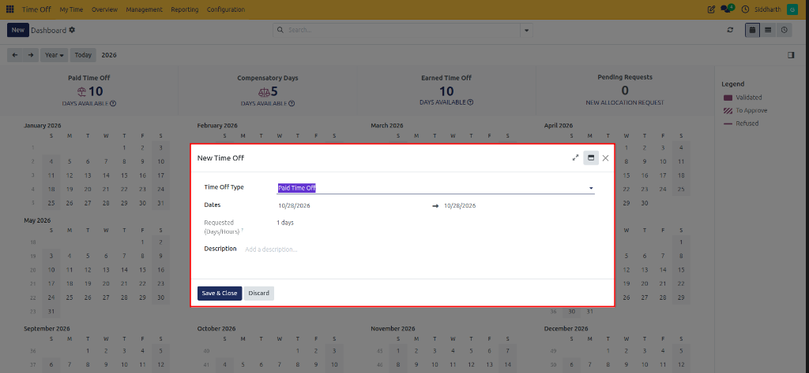
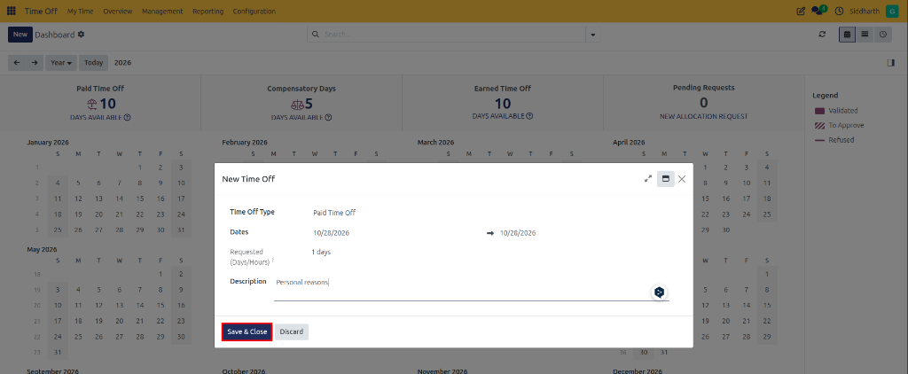
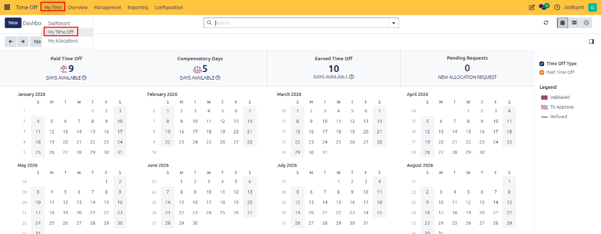
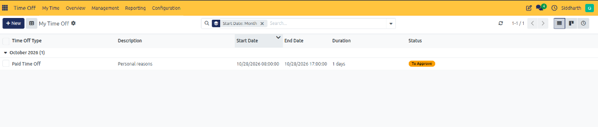

# Submit Your First Time Off Request

Welcome to CURQ Time Off. The **Time Off** application provides employees and managers with a centralized, transparent workspace to manage absences, monitor leave balances, and automate accrual entitlements. By integrating directly with company calendars, working schedules, and payroll systems, CURQ ensures accurate absence tracking without manual spreadsheet calculations.

In this tutorial, you will explore the employee self-service dashboard, check your available leave balances, submit a time-off request with custom durations, and track its approval progress in 5 steps.

```{mermaid}
flowchart LR
    A["`**Employee Request**
    Select Type & Dates`"] --> B["`**Balance Validation**
    Verify Entitlement & Caps`"]
    B --> C["`**Approval Workflow**
    Manager / HR Review`"]
    C --> D["`**Calendar & Timesheet**
    Auto-deduct & Schedule`"]
```

> **Prerequisites**
> * Access to a standard CURQ instance with the **Time Off** application installed.
> * An active employee profile associated with your user login.

---

## Open the Time Off Dashboard

Begin by navigating to the centralized employee leave workspace:

1. Click the main application menu at the top left of CURQ and select **Time Off**.
2. From the top navigation bar, click **My Time** and select **Dashboard**:

   

3. The centralized dashboard opens, displaying your leave balance cards across the top, an interactive yearly absence calendar, and upcoming public holidays:

   

---

## Check Available Leave Balances

Before submitting a request, verify your remaining entitlements to prevent scheduling conflicts or negative balance restrictions:

1. Review the headline cards at the top of the canvas *(such as **Paid Time Off**, **Compensatory Days**, and **Earned Time Off**)*.
2. Hover over or click the question-mark icon (`?`) on any leave card to view the balance breakdown:

   

3. Note the key metric figures:
   * **Allocated**: Total leave assigned to your profile.
   * **Accrual (Future)**: Leave scheduled to accrue over future pay periods.
   * **Approved**: Leave previously authorized and deducted.
   * **Planned**: Draft or pending requests awaiting validation.
   * **Available**: Net balance currently eligible for booking.

---

## Create a New Leave Request

When ready to book an absence, open the request dialog:

1. Click the **New** button located in the top-left action bar of the dashboard:

   

2. The **New Time Off** modal dialog opens directly over the calendar canvas:

   

3. In the **Time Off Type** dropdown, select the category for your request *(such as **Paid Time Off**, **Sick Time Off**, or **Compensatory Days**)*.

---

## Configure Dates, Duration, and Attachments

CURQ supports full-day absences, partial half-days, and hourly increments:

1. **Select Dates**: Click the **Dates** field to open the calendar picker. Choose your start date and end date, then click **Apply**.
2. **Handle Partial Days** *(Optional)*:
   * To take a half-day absence, check **Half Day** and choose either **Morning** or **Afternoon**.
   * To take specific hours off, check **Custom Hours** and specify the **From** and **To** times.
3. **Verify Duration**: Check the **Requested (Days/Hours)** field to confirm that CURQ has automatically calculated the duration against your active working schedule (excluding weekends and non-working hours).
4. **Add Description and Attachments**:
   * Enter a brief reason in the **Description** field *(e.g., `Personal reasons`)*.
   * If requesting medical leave or mandatory documentation, click **Attach File** under **Supporting Document** to upload verification.

---

## Submit and Track Request Status

Once all details are verified, finalize your submission:

1. Click **Save & Close** to submit the request:

   

2. Navigate to **My Time → My Time Off** to review your submitted absence requests:

   

3. Observe the request state:
   * **To Approve**: The request is routed to your manager or designated HR officer:

   

   * **Approved**: Once authorized, the status updates to **Approved** and your dashboard balance updates immediately:

   

---

## Summary of Achievements

In this tutorial, you learned to:
* Navigate to the personal **Time Off Dashboard** and inspect leave balance cards.
* Interpret allocated, accrued, planned, and available leave metrics.
* Create a leave request with custom date ranges, half-day, or hourly options.
* Attach supporting documents and submit requests for manager approval.
* Track submitted leave from pending review through final approval.

---

## Related Documentation

* [Set Up Your First Leave Allocation](./02-set-up-your-first-leave-allocation.md)
* [Request Time Off and Manage Leave](../task-guides/01-request-time-off-and-manage-leave.md)
* [Understanding Time Off Types and Accrual Architecture](../core-concepts/01-understanding-time-off-types-and-accrual-architecture.md)
