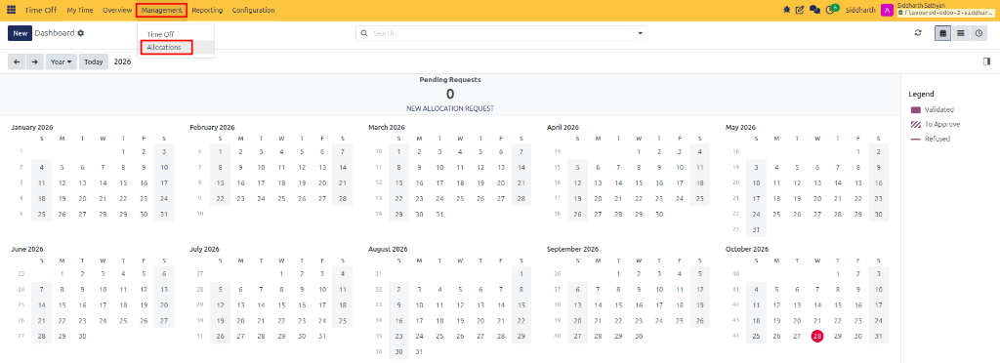
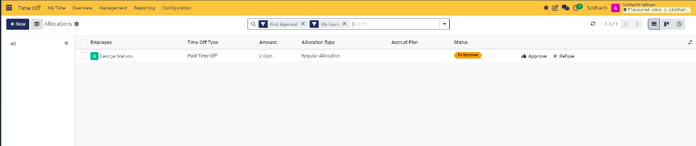
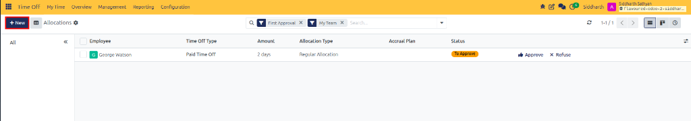
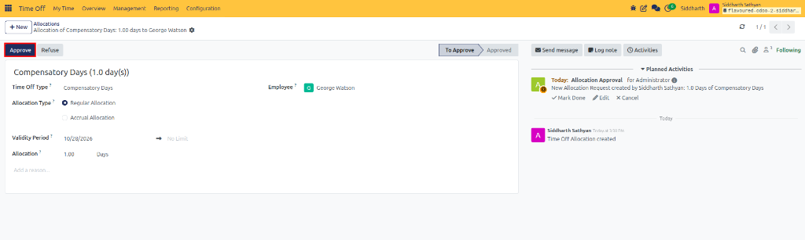
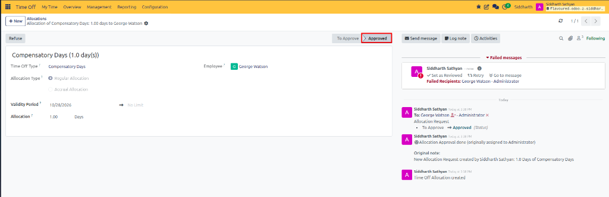
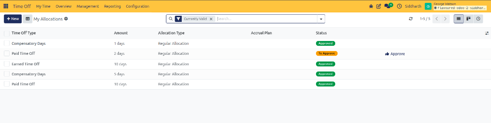

# Set Up Your First Leave Allocation

While employees submit absence requests against existing balances, HR Officers and Team Managers use **Allocations** to grant leave entitlements. Allocations define how many days or hours an employee is authorized to take for a specific leave category—such as annual vacation days, compensatory leave, or special service allowances.

In this tutorial, you will navigate the management workspace, configure a regular employee leave allocation, execute the approval workflow, and verify the updated entitlement in 5 steps.

```{mermaid}
flowchart LR
    A["`**HR Officer**
    Create Allocation Request`"] --> B["`**Entitlement Definition**
    Set Type, Days & Period`"]
    B --> C["`**Approval Action**
    Validate & Confirm`"]
    C --> D["`**Employee Profile**
    Live Balance Credited`"]
```

> **Prerequisites**
> * Access to a CURQ instance with **Time Off Officer** or **Administrator** privileges.
> * At least one employee profile created in **Employees**.
> * Pre-configured time-off types requiring allocation *(such as Paid Time Off or Earned Leave)*.

---

## Open the Allocations Management View

Access the centralized administrative interface for granting and auditing leave entitlements:

1. Open the **Time Off** application from the main navigation menu.
2. In the top navigation bar, click **Management** and select **Allocations**:

   

3. The **Allocations** list view displays all team allocation records. By default, the view applies the **First Approval** and **My Team** filters to highlight requests requiring immediate administrative review:

   

---

## Create a New Allocation Record

Initialize a blank allocation form to grant a new leave entitlement:

1. In the top-left action bar, click **New**:

   

2. A blank allocation form view opens in **Draft / To Approve** state.
3. In the **Name** field, enter a clear, descriptive label for the allocation *(for example, `Annual Vacation - 2026` or `Compensatory Days - Event Support`)*.

---

## Configure Allocation Details and Validity

Specify the employee recipient, time-off category, entitlement quantity, and validity window:

1. **Select Time Off Type**: In the **Time Off Type** dropdown, select the leave category you wish to grant *(such as **Compensatory Days** or **Paid Time Off**)*.
2. **Select Allocation Type**: Choose **Regular Allocation** to grant a fixed balance immediately *(choose Accrual Allocation if leave is earned progressively over time)*.
3. **Set Validity Period**:
   * Specify the start date when the entitlement becomes valid *(e.g., `10/28/2026`)*.
   * *(Optional)* Set an expiration date if the leave expires at the end of the calendar year or fiscal cycle, or leave as **No Limit**.
4. **Enter Allocation Quantity**: In the **Allocation** field, enter the total number of days or hours being granted *(e.g., `1.00 Days`)*.
5. **Assign the Employee**: In the **Employee** field, select the target team member *(e.g., `George Watson`)*.
6. **Add an Operational Reason**: Enter explanatory context in the **Add a reason...** note area.

---

## Approve and Validate the Allocation

Submit and authorize the allocation to finalize the employee's entitlement:

1. Review all form fields to ensure the entitlement quantity and recipient are correct.
2. In the top-left action bar, click **Approve**:

   

3. CURQ transitions the record status to **Approved**:

   

4. The record chatter logs the approval timestamp, authorizer name, and allocated balance for organizational compliance.

---

## Verify Updated Balances on Employee Profile

Confirm that the newly approved allocation is immediately available for employee booking:

1. Navigate to **Time Off → My Time → My Allocations** (or open the employee's profile as an administrator):

   

2. Verify that the new allocation appears in the list with the status **Approved** and shows the exact granted balance *(such as the `Compensatory Days` allocation of `1 days`)*.
3. When the employee accesses their **Dashboard**, the corresponding leave balance card updates in real time, enabling immediate time-off booking.

---

## Summary of Achievements

In this tutorial, you learned to:
* Access the **Management → Allocations** interface.
* Configure a regular leave allocation with custom labels, dates, and units.
* Approve allocations to activate employee entitlements.
* Audit allocation approvals through the automated chatter history.
* Verify balance updates across the employee self-service dashboard.

---

## Related Documentation

* [Submit Your First Time Off Request](./01-submit-your-first-time-off-request.md)
* [Grant and Validate Employee Allocations](../task-guides/05-grant-and-validate-employee-allocations.md)
* [Understanding Multi-Tier Approvals and Allocation Mechanisms](../core-concepts/02-understanding-multi-tier-approvals-and-allocation-mechanisms.md)
