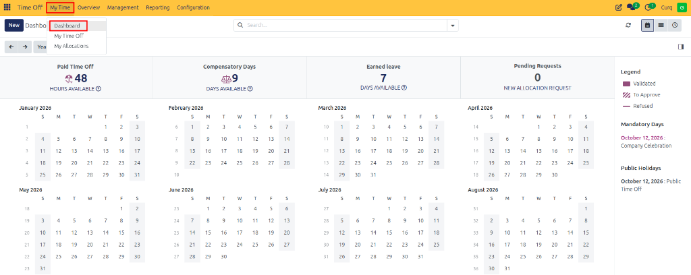
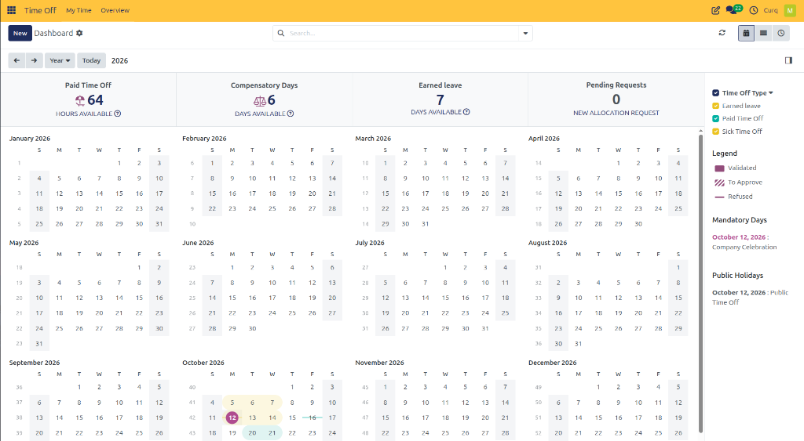
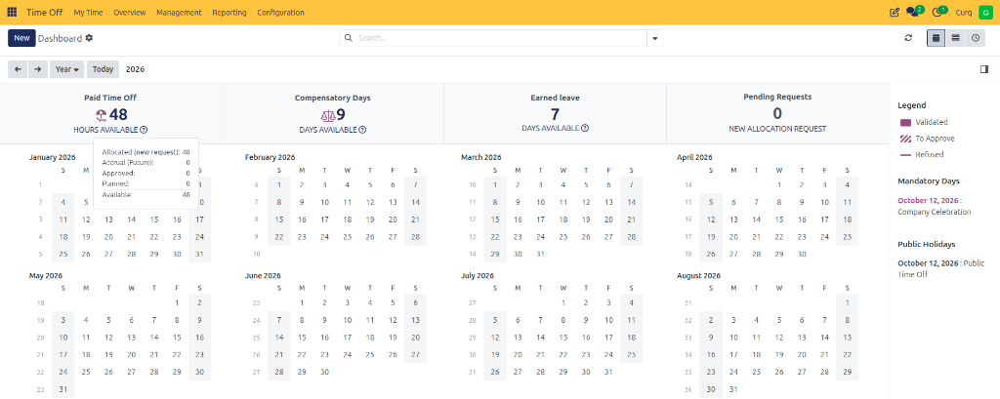
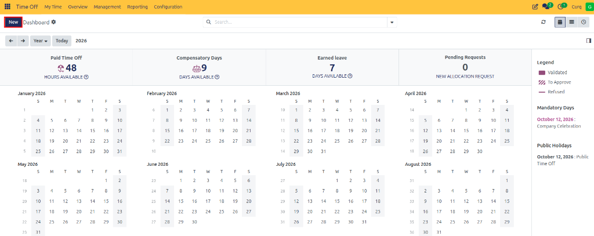
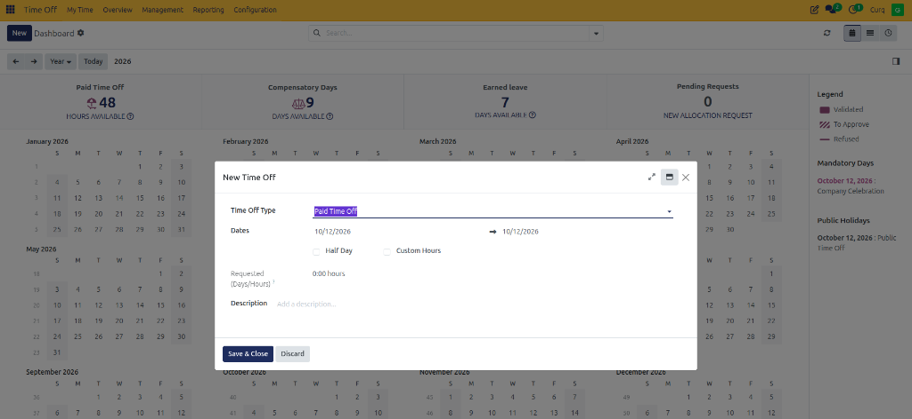

# Time Off Dashboard

## 1. Overview

The Time Off Dashboard provides employees with a centralized view of their leave balances, time-off requests, and the yearly leave calendar. It also displays configured time-off types, their status indicators, mandatory days, and public holidays.

The dashboard helps employees monitor their available leave, view approved and pending requests, and plan time off throughout the year.

---

## 2. Accessing the Dashboard

Navigate to:

**Time Off → My Time → Dashboard**

The dashboard is the main view for reviewing leave balances and the time-off calendar.

---

## 3. Dashboard Summary Cards

The top section displays summary cards for different leave categories and allocation requests.

### 3.1 Paid Time Off

Displays the available balance for paid leave.

* Shows the leave type and its icon.
* Displays the remaining balance, in hours or days depending on the configured leave type.
* The question-mark icon provides additional information about the leave balance.

### 3.2 Compensatory Days

Displays the available compensatory leave balance.

Employees can use this information to understand how many compensatory days remain available for use.

### 3.3 Earned Leave

Displays the available earned leave balance.

The balance depends on the employee's allocation and, where applicable, the configured accrual plan.

### 3.4 Pending Requests

Displays the number of new allocation requests.

Employees can use the **New Allocation Request** option to request additional leave allocation when permitted by the system configuration.

> **Note:** The summary cards and leave categories displayed depend on the time-off configuration and the employee's entitlements.

---

## 4. Understanding Leave Balances

Select the question-mark icon next to a leave balance to view additional details.

The balance information can include:

* **Allocated:** Total leave allocated to the employee.
* **Accrual (Future):** Leave expected to accrue in the future according to the accrual plan.
* **Approved:** Leave associated with approved requests.
* **Planned:** Leave associated with planned or pending requests, as indicated by the system.
* **Available:** Leave remaining for use.

The exact information displayed depends on the leave type and its configuration.

### 4.1 Balance at a Specific Date

For leave types using an accrual plan, the dashboard may provide a **Balance at the (date)** option.

1. Select the date field.
2. Choose the date for which you want to calculate the leave balance.
3. Review the estimated balance.
4. Select **Today** to return to the current date.

This feature helps employees estimate their future leave balance when planning time off.

---

## 5. Time-Off Calendar

The calendar displays leave information throughout the year.

### 5.1 Calendar Views

The calendar provides the following views:

* **Day:** View time-off information for a single day.
* **Week:** View time-off information for a week.
* **Month:** View time-off information for a month.
* **Year:** View time-off information for the year.

Use the left and right arrow buttons to navigate between periods. Select **Today** to return to the current date or period.

### 5.2 Calendar Indicators

The calendar uses different visual indicators to represent the status of time-off requests.

| Indicator | Meaning |
| :--- | :--- |
| **Solid colored indicator** | Validated or approved time off |
| **Diagonal stripes** | Time off waiting for approval |
| **Strikethrough** | Refused time off |

The color of a calendar entry corresponds to the configured time-off type.

These indicators help employees distinguish approved leave from requests that still require approval or have been refused.

---

## 6. Time-Off Type Filters

The right-hand panel contains a **Time Off Type** filter.

The dashboard may display types such as:

* Earned Leave
* Paid Time Off
* Sick Time Off

Use the checkboxes to select or deselect the types you want to view on the calendar.

This helps employees focus on particular categories of leave without displaying every type simultaneously.

The available filters depend on the time-off types configured in CURQ.

---

## 7. Mandatory Days

The **Mandatory Days** section displays dates on which employees are required to take time off or be present, according to the company's configuration.

For example:

* **Date:** October 12, 2026
* **Description:** Company Celebration

This section helps employees identify company-designated dates that may affect their leave planning.

The dates and descriptions displayed depend on the mandatory days configured by the organization.

---

## 8. Public Holidays

The **Public Holidays** section displays configured public holidays.

For example:

* **Date:** October 12, 2026
* **Description:** Public Time Off

Employees can use this section to identify public holidays when planning their leave.

The displayed holidays depend on the public holiday configuration used by the organization.

---

## 9. Creating a Time-Off Request

Employees can create a leave request directly from the dashboard.

1. Select **New**.

   

2. Choose the appropriate time-off type.
3. Enter the start and end dates.
4. Specify the duration or half-day details, where applicable.
5. Add a description or reason.
6. Attach supporting documents if required.
7. Save or submit the request using the available form options.

The request is processed according to the approval rules configured for the selected time-off type.

---

## 10. Requesting a New Allocation

If additional leave allocation is required, employees can use the **New Allocation Request** option.

1. Open the allocation request form.
2. Select the required time-off type.
3. Enter the requested allocation amount.
4. Provide a reason for the request.
5. Submit the request.

The allocation request follows the organization's configured approval process. The requested allocation may need approval before it becomes available in the employee's leave balance.
