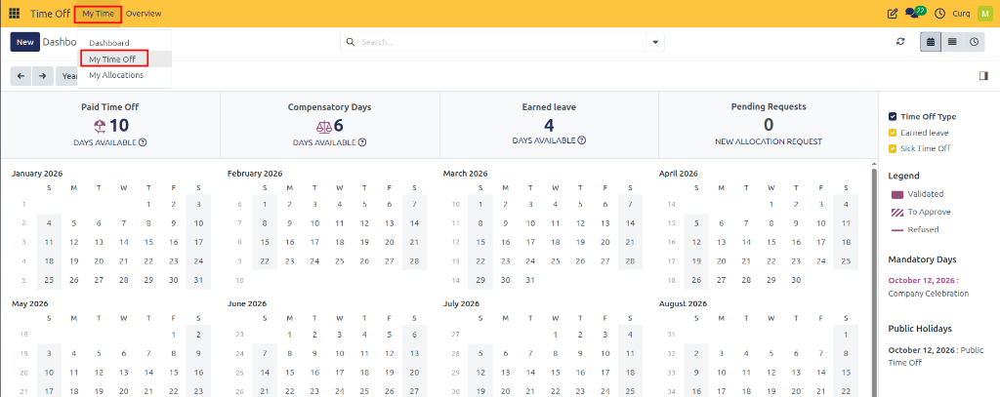
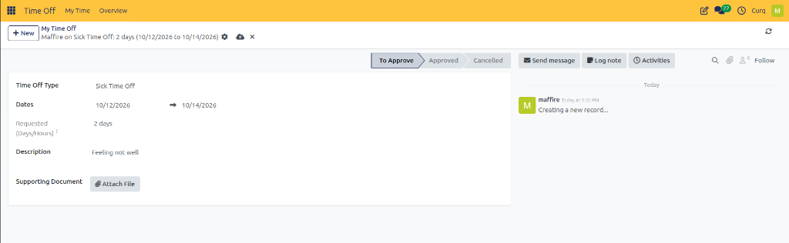
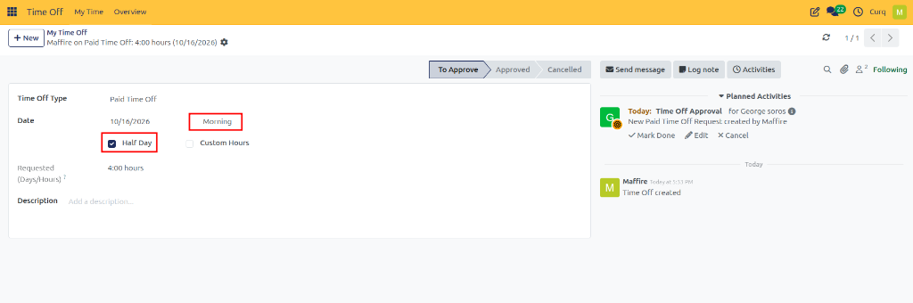
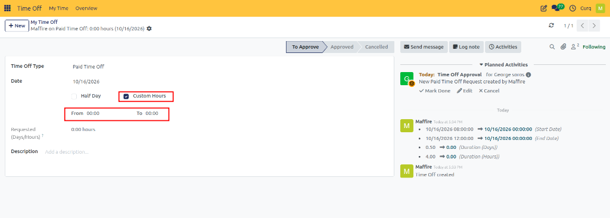
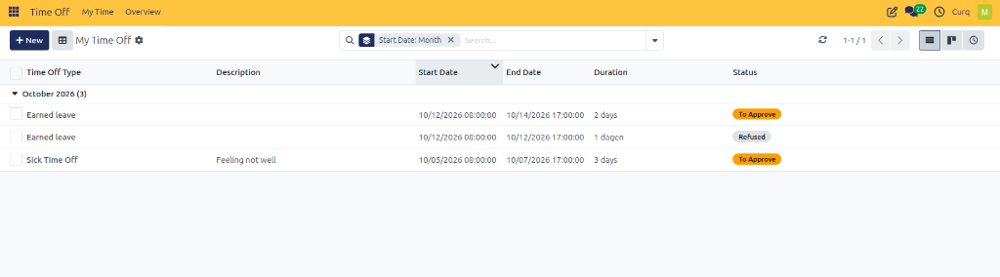
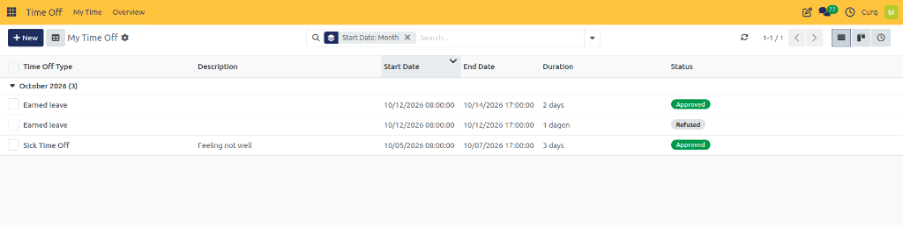

# Request Time Off

## Overview

The **Request Time Off** feature in CURQ 18 allows employees to submit leave requests for vacations, sick leave, unpaid leave, and other configured time off types. Employees can specify the leave period, review the requested duration, provide a description, and attach supporting documents when permitted.

Once submitted, the request is reviewed by the employee's approver or the designated Time Off Officer, depending on the approval rules configured for the selected time off type.

If the selected time off type does not require approval, the request is automatically approved.

---

## 1. Create a Time Off Request

Follow these steps to submit a new time off request.

### Steps

1. Open the **Time Off** app from the main dashboard.
2. Navigate to **My Time → My Time Off** and click **New**.

   

3. A **New Time Off** form appears.
4. Select the appropriate **Time Off Type**.
5. Specify the start and end dates for the requested leave.
6. Review the automatically calculated duration.
7. Enter a description explaining the reason for the leave.
8. Attach supporting documents if the selected time off type allows attachments.
9. Click **Save & Close** to submit the request.

---

## 2. Time Off Request Fields

The following fields are available when creating a time off request.

| Field | Description |
| :--- | :--- |
| **Time Off Type** | Select the category of leave, such as Paid Time Off, Sick Time Off, or Unpaid. The available options depend on the configured time off types. |
| **Dates** | Specify the start and end dates for the requested leave using the calendar. For a single-day request, select the same date as both the start and end date. |
| **Half Day** | Select this option when requesting a half-day absence. Choose Morning or Afternoon to indicate which half of the day is required. This option appears when applicable to the selected time off type. |
| **Custom Hours** | Select this option when requesting leave for a specific number of hours rather than a full or half day. Specify the start and end times using the From and To fields. |
| **Requested (Days/Hours)** | Displays the calculated duration of the requested leave. The value updates automatically when the dates or time selections change. The unit depends on the selected time off type. |
| **Description** | Enter the reason for the leave and any additional information that the approver may need to review the request. |
| **Supporting Document** | Attach relevant files when the selected time off type permits supporting documents. Multiple documents can be attached if necessary. |

---

## 3. Request a Full-Day or Multi-Day Leave

Use this procedure when an employee needs to take leave for one or more complete working days.

### Steps

1. Click **New** to open the time off request form.
2. Select the required time off type.
3. Open the date selector.
4. Choose the start date and end date.
5. Click **Apply** to confirm the selected dates.
6. Check the calculated duration in **Requested (Days/Hours)**.
7. Enter a description and attach supporting documents if required.
8. Click **Save & Close**.

### Example

An employee plans to take annual leave from 19 October to 21 October 2026. The employee selects Paid Time Off, specifies the date range, and provides a reason for the absence.

CURQ calculates the requested duration according to the employee's working schedule and the configuration of the selected time off type. The employee then submits the request for approval, if required.

---

## 4. Request a Half-Day Leave

Employees can request leave for either the morning or afternoon when the selected time off type supports half-day requests.

### Steps

1. Open the time off request form.
2. Select the appropriate time off type.
3. Enable **Half Day**.
4. Select either **Morning** or **Afternoon**.
5. Enter a description explaining the reason for the leave.
6. Click **Save & Close**.

### Example

An employee needs to attend a personal appointment in the morning. The employee selects Paid Time Off, enables Half Day, and chooses Morning before submitting the request.

---

## 5. Request Leave for Custom Hours

When an employee needs to be absent for a specific period during the day, the **Custom Hours** option can be used if supported by the selected time off type.

### Steps

1. Open the time off request form.
2. Select the appropriate time off type.
3. Enable **Custom Hours**.
4. Enter the required start time in the **From** field.
5. Enter the required end time in the **To** field.
6. Review the calculated requested duration.
7. Enter a description and submit the request.

### Example

An employee needs two hours away from work for a personal appointment. The employee selects a suitable time off type, enables Custom Hours, and enters the required time range.

CURQ calculates the duration based on the specified hours and the applicable working schedule.

---

## 6. Attach Supporting Documents

Some time off types require employees to provide supporting documents, such as medical certificates or other relevant records.

The **Supporting Document** field appears only when the selected time off type is configured to allow attachments.

### Steps

1. Select the appropriate time off type.
2. Click **Attach File** in the Supporting Document section.
3. Browse to the required file on your computer.
4. Select the file and click **Open**.
5. Verify that the attachment appears on the request form.
6. Add any additional documents if necessary.
7. Submit the request.

---

## 7. Time Off Approval Process

After an employee submits a request, CURQ processes it according to the approval configuration of the selected time off type.

The request initially appears in the **To Approve** status while awaiting manager or officer validation.

The request may require approval from the employee's approver, the designated Time Off Officer, or both. Once approved, the status is updated to **Approved**.

If the time off type is configured with **No Validation**, the request is automatically approved and does not require a separate review.

Employees should provide accurate dates, select the correct time off type, and include any required supporting information to help approvers review their requests efficiently.
