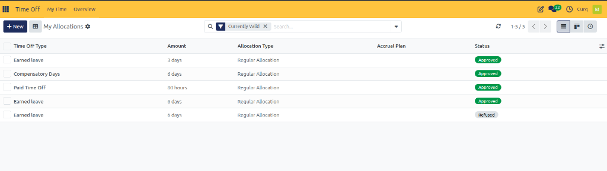
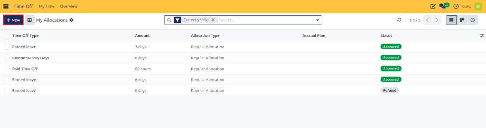
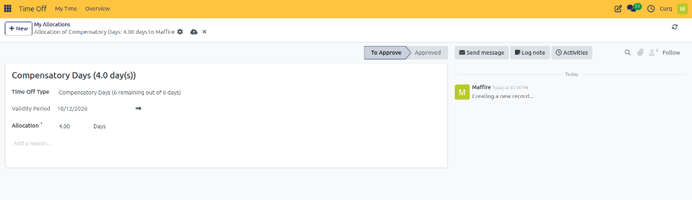

# Request Allocations

## 1. Overview

The **My Allocations** page allows employees to view their time-off allocations and allocation requests in one place. Employees can review the type of leave allocated, the amount, the allocation method, any associated accrual plan, and the current status.

Users with the appropriate access rights may also be able to approve allocation requests.

---

## 2. Accessing My Allocations

Navigate to:

**Time Off → My Time → My Allocations**

The page displays allocations in a list view. By default, the **Currently Valid** filter may be applied to show allocations that are currently valid.

---

## 3. Understanding the Allocations List

The list contains the following fields:

| Field | Description |
| :--- | :--- |
| **Time Off Type** | The type of leave associated with the allocation, such as Earned Leave, Compensatory Days, or Paid Time Off. |
| **Amount** | The number of days or hours allocated to the employee. |
| **Allocation Type** | Indicates the allocation method, such as Regular Allocation. |
| **Accrual Plan** | Displays the accrual plan associated with the allocation, if applicable. |
| **Status** | Indicates the current state of the allocation request, such as Approved or Refused. |

---

## 4. Filtering and Viewing Allocations

The search bar and filters help employees locate specific allocation records.

* **Currently Valid:** Filters the list to show currently valid allocations.
* **Search:** Search for allocation records using available search fields.
* **List View:** Displays allocation details in rows.
* **Other View Options:** Use the available view controls to switch views where supported.

The pagination controls allow users to navigate through the records when multiple allocations are available.

---

## 5. Creating a New Allocation Request

Employees can request an additional time-off allocation directly from this page.

1. Open **Time Off → My Time → My Allocations**.
2. Click **New**.

   

3. Select the required time-off type.
4. Enter the requested allocation amount.
5. Provide any other required details, such as the reason for the request.
6. Submit the request using the available form options.

The request is then handled according to the organization's allocation approval rules.

---

## 6. Approving Allocation Requests

Users with the appropriate access rights may be able to approve allocation requests.

The available approval actions depend on the user's permissions and the allocation's current status. Approved allocations can become available for use according to the configured leave rules, while refused requests do not provide the requested allocation.
