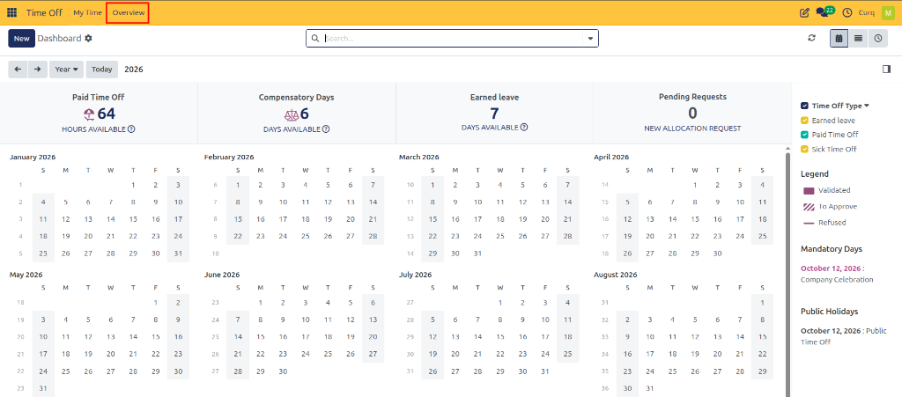
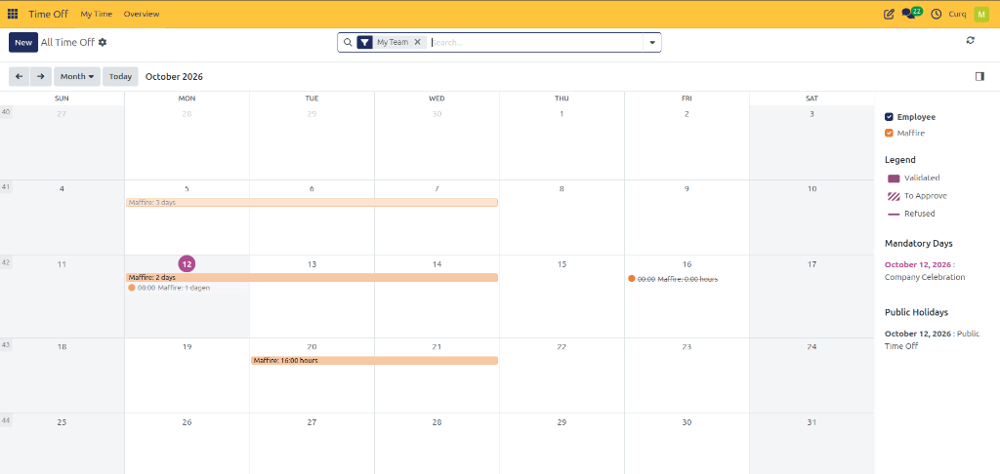

# All Time Off Overview

## 1. Overview

The **All Time Off Overview** page provides managers with a calendar-based view of employee time-off requests. It helps users visualize when employees are scheduled to be absent, review leave request statuses, and identify mandatory days and public holidays.

This view is particularly useful for workforce planning, as managers can see employee absences across a selected period and identify potential scheduling conflicts.

---

## 2. Accessing the Overview

Navigate to:

**Time Off → Overview**

The page displays employee time-off requests in a calendar view.

The records visible depend on the user's access rights and the filters applied to the page.

---

## 3. Understanding the Calendar

The calendar displays employee leave requests according to their scheduled dates.

### 3.1 Calendar Navigation

The calendar provides the following controls:

* **Previous / Next:** Navigate to the previous or next period.
* **Month:** Select the calendar view, such as Day, Week, Month, or Year, where available.
* **Today:** Return to the current date or period.
* **Search Bar:** Search or filter the displayed records using the available options.

The calendar header indicates the currently selected period, such as October 2026.

### 3.2 Employee Filter

The right-hand panel contains an Employee filter.

Select or deselect employees to control whose time-off requests appear on the calendar.

For example, selecting an employee named Maffire displays that employee's scheduled leave entries. This allows managers to focus on an individual employee or review multiple employees together.

---

## 4. Understanding Calendar Entries

Time-off requests appear as entries spanning the dates associated with each request.

An entry may display:

* Employee name
* Duration of leave
* Number of days or hours requested
* Scheduled date or date range

For example, the calendar may display an entry such as `Maffire: 3 days`, indicating a three-day time-off request for that employee.

Some entries may display hours rather than full days, depending on the request duration.

---

## 5. Understanding the Legend

The legend on the right-hand side explains the visual indicators used for time-off requests.

| Indicator | Meaning |
| :--- | :--- |
| **Solid colored indicator** | Validated or approved time off |
| **Diagonal stripes** | Request waiting for approval |
| **Strikethrough** | Refused time off |

These indicators help managers distinguish approved leave from requests that are awaiting approval or have been refused.

The colors of individual calendar entries may correspond to the employee or configured time-off type, depending on the displayed view.

---

## 6. Mandatory Days

The **Mandatory Days** section displays company-designated dates that affect employee scheduling.

For example, the screenshot shows:

* **Date:** October 12, 2026
* **Description:** Company Celebration

Managers can use this information when reviewing employee availability and planning work schedules around company-designated dates.

---

## 7. Public Holidays

The **Public Holidays** section displays configured public holidays.

For example, the screenshot shows:

* **Date:** October 12, 2026
* **Description:** Public Time Off

These dates help managers identify holidays that may affect staffing and leave planning.

The mandatory days and public holidays shown depend on the organization's configuration.

---

## 8. Creating a Time-Off Request

The **New** button allows users to start creating a time-off request from the overview page.

1. Click **New**.
2. Select the employee and time-off type, where the form requires them.
3. Enter the requested dates and duration.
4. Complete any additional required information.
5. Save or submit the request using the available form options.

The fields and available actions depend on the user's permissions and the configured approval workflow.
