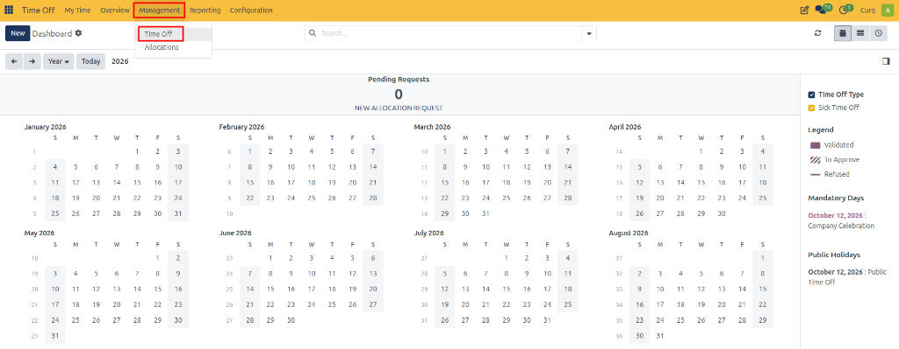
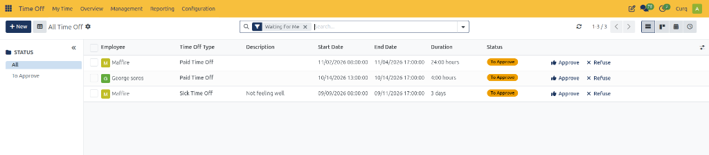
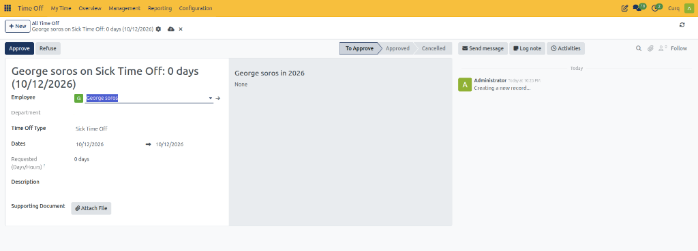
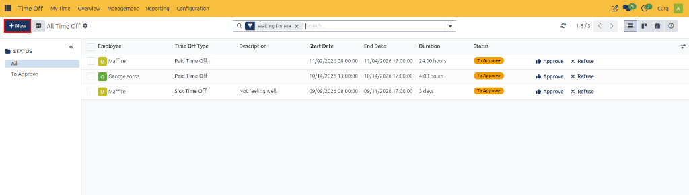

# Managing Time Off

## 1. Overview

The **Time Off** management page allows authorized users to review, approve, validate, and refuse employee time-off requests across their team or organization.

Depending on the configuration of a time-off type, a request may require one approval, two approvals, or no approval.

Only users with the appropriate permissions (such as Time Off Officers or Administrators) can access this section to approve or manage employee leave requests.

---

## 2. Accessing Time-Off Requests

Navigate to:

**Time Off → Management → Time Off**

The **All Time Off** page displays time-off requests for employees within the scope of the user's Time Off Officer or Administrator access rights.

By default, the **Waiting For Me** filter is applied. It displays requests awaiting the user's approval, including requests with the statuses **To Approve** and **Second Approval**.

---

## 3. Understanding the Request List

The page provides tools to filter and organize time-off requests.

### 3.1 Status Filters

The available status groupings are:

* **All:** Displays requests matching the other active filters, regardless of approval status.
* **To Approve:** Displays requests awaiting the first approval.
* **Second Approval:** Displays requests awaiting the second approval.

### 3.2 Department Filters

Departments associated with employees the user manages may appear on the left side of the page. Select a department to display requests for employees in that department.

A status or department only appears in the grouping panel when matching requests exist under the active filters.

---

## 4. Creating a Time-Off Request for an Employee

Authorized users (Time Off Officers and Administrators) can submit a time-off request on behalf of an employee directly from the management list view.

1. Navigate to **Time Off → Management → Time Off**.
2. Click **New** in the top-left corner of the page.

   

3. Complete the request form fields:
   * Select the **Employee** for whom the leave is being requested.
   * Select the **Time Off Type** (such as *Paid Time Off* or *Sick Time Off*).
   * Specify the **Dates** (start date and end date) or time duration.
   * Enter a **Description** if needed.
   * Attach a **Supporting Document** if required.
4. Review the details. The request is created in the **To Approve** stage and can be approved or managed directly.

### Field Descriptions

| Field | Description |
| :--- | :--- |
| **Employee** | Select the employee for whom the time-off request is being submitted. |
| **Department** | Displays the department associated with the selected employee. |
| **Time Off Type** | Select the type of time off requested (such as Paid Time Off or Sick Time Off). |
| **Dates** | Specify the start and end dates of the requested leave period. |
| **Requested (Days/Hours)** | Displays the calculated total duration of requested time off based on the employee's working schedule and selected dates. |
| **Description** | Optional note or explanation describing the reason for the time-off request. |
| **Supporting Document** | Attach any relevant supporting files, such as a medical certificate. |

---

## 5. Approval Actions

Authorized users can process requests directly from the list view using inline action buttons or from within the request form view.

### 5.1 Approving a Time-Off Request

To approve a request from the list view:

1. Open **Time Off → Management → Time Off**.
2. Locate the request with the **To Approve** status.
3. Click **Approve** at the end of the corresponding row.

The request proceeds through the approval workflow configured for the selected time-off type.

### 5.2 Validating a Request Requiring Second Approval

Some time-off types require two approvals.

1. Locate a request with the **Second Approval** status.
2. Review the request details.
3. Click **Validate** at the end of the row to complete the second approval.

The request is validated according to the configured approval process.

### 5.3 Refusing a Time-Off Request

To refuse a request from the list view:

1. Locate the required time-off request.
2. Review the request details.
3. Click **Refuse** at the end of the row.

The request status changes to **Refused**.

---

## 6. Viewing and Managing Request Details

To open a specific request, click anywhere on its row in the list view, avoiding the inline **Approve**, **Validate**, and **Refuse** buttons.

The time-off request form view opens:

From the form view, authorized users can:

* **Review Request Information:** Verify the employee, department, time-off type, start and end dates, requested duration, and any attached supporting documents.
* **Inspect Allocation Balances:** View the employee's current year allocation status and leave balance in the right-side summary.
* **Execute Approval Actions:** Process the request by clicking **Approve** or **Refuse** directly from the top control bar.
* **Track Activities and Notes:** Use the chatter panel on the right to log internal notes, schedule activities, or send messages to the employee.
* **Edit Request Details:** Depending on user permissions and the current stage, modify dates, time-off types, or descriptions directly. Changes are saved automatically.

---

## 7. Managing Filters

The Time Off management page uses filters to control which records appear.

* Review the active filters in the search bar.
* Remove a filter using its remove icon when additional records need to be displayed.
* Use status groupings to find requests requiring action.
* Use department groupings to narrow the list to a specific department.
* Remember that removing one filter does not necessarily remove other active filters.
