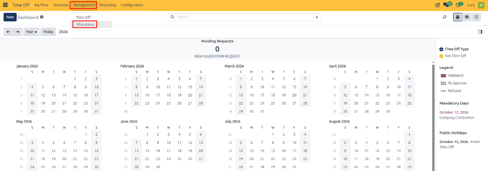
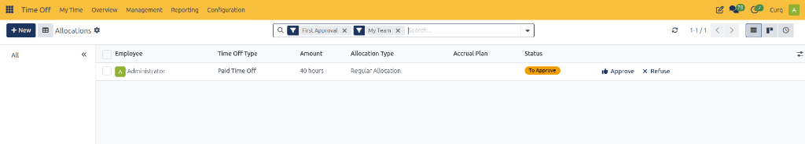
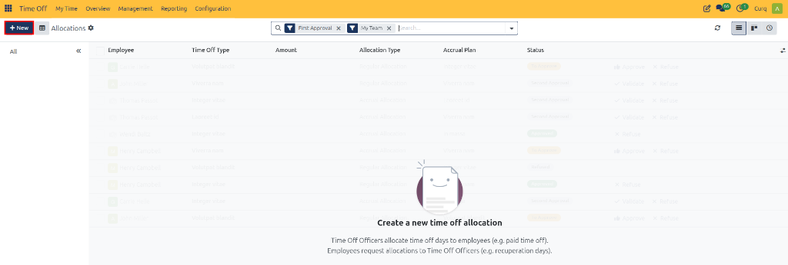
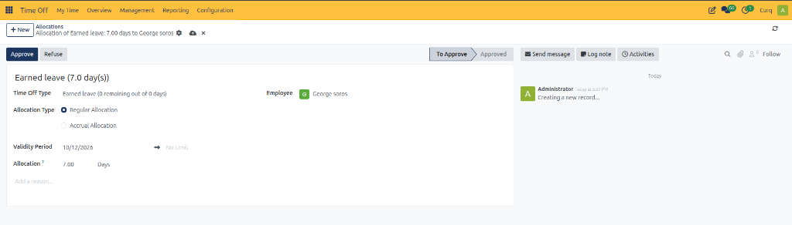
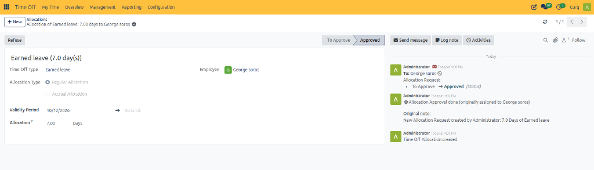
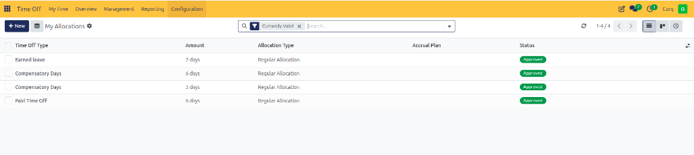
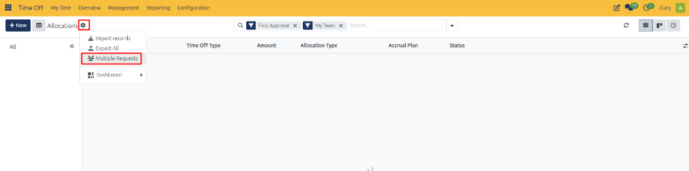
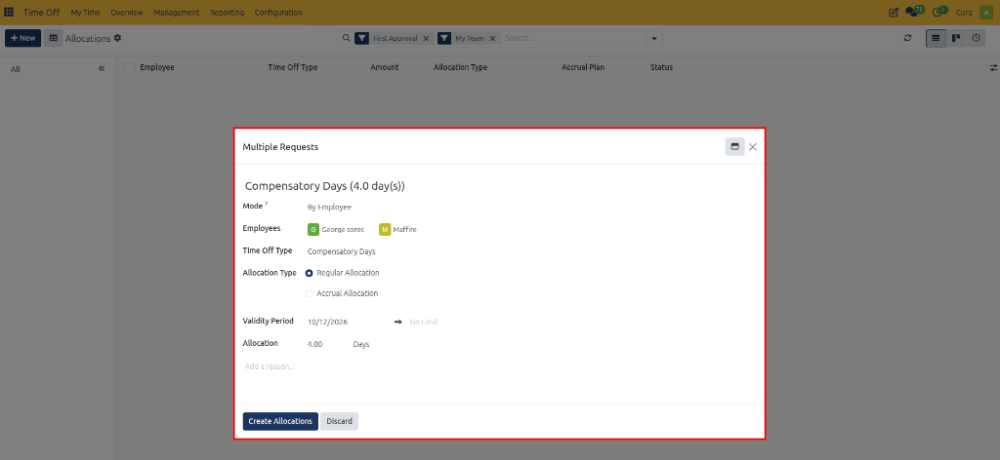
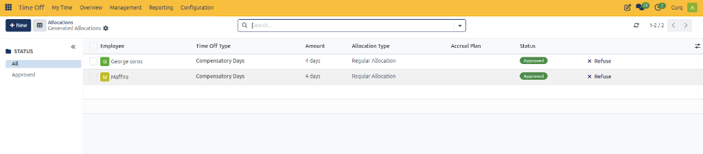

# Managing Allocations

## Overview

The **Allocations** feature in CURQ 18 allows Time Off Officers and administrators to assign, manage, and approve time off entitlements for employees. These allocations determine how much time off an employee can use for a particular time off type, such as annual leave or compensatory days.

Allocations can be granted directly through a regular allocation or earned gradually through an accrual plan. They can be assigned to individual employees or distributed to multiple employees based on specific selection criteria, such as company, department, or employee tags. In addition, authorized users can review, approve, or refuse employee allocation requests and monitor balances across teams.

The Allocations management feature supports the following operations:

* **Regular Allocation:** Grant a specified amount of time off to an employee immediately.
* **Accrual Allocation:** Allow employees to earn time off according to a configured accrual plan.
* **Multiple Requests:** Create allocations for several employees in a single batch operation.
* **Review & Approve Requests:** Review incoming employee allocation requests, validate entitlements, and approve or refuse requests.
* **Allocation Requests:** Allow employees to request additional time off when they need more than their current allocation.

**Access:** Open the **Time Off** app and navigate to **Management → Allocations**. This menu is available to users with the appropriate Time Off Officer or Administrator access rights.

---

## 1. Accessing and Navigating Allocations

Navigate to:

**Time Off → Management → Allocations**

The **Allocations** page displays allocation records and requests for employees within the scope of the user's Time Off Officer or Administrator access rights.

By default, the page applies the **First Approval** and **My Team** filters. These filters display allocation requests for employees the user manages that are awaiting their first approval. Approved and refused allocation requests are not displayed while the default first-approval filter remains active.

### 1.1 Status Filters

The page provides status groupings to help users locate allocation records:

* **All:** Displays requests of all statuses that match the remaining active filters.
* **To Approve:** Displays allocation requests awaiting approval.
* **Approved:** Displays approved allocation requests.
* **Refused:** Displays refused allocation requests.

Select a status from the grouping panel to filter the list accordingly.

### 1.2 Department Filters

Select a department from the left-side panel to display allocation records associated with that department.

The available groupings depend on the active filters. If no matching records exist for a status or department under the active criteria, that option may not appear or the resulting list may be empty.

---

## 2. Create an Allocation

Use this procedure to grant time off to an employee.

### Steps

1. Open the **Time Off** app.
2. Navigate to **Management → Allocations**.

   

3. Click **New** to open a blank allocation form.

   

4. Enter a name for the allocation.
5. Select the **Time Off Type** you want to allocate.
6. Choose the **Allocation Type**:
   * **Regular Allocation** to grant time off immediately.
   * **Accrual Allocation** to grant time off according to an accrual plan.
7. Configure the validity period or accrual dates, depending on the allocation type.
8. Enter the amount of time off to allocate, if applicable.
9. Select the employee who will receive the allocation.
10. Add a reason or description if necessary.
11. Click **Save** to create the record, then click **Approve** to validate the allocation.

    

    Once approved, the status transitions to **Approved** and the confirmation is logged in the chatter.

    

### Field Descriptions

| Field | Description |
| :--- | :--- |
| **Name** | Enter a descriptive name for the allocation, such as Annual Vacation – 2026. |
| **Time Off Type** | Select the leave category being allocated, such as Paid Time Off or Compensatory Days. |
| **Allocation Type** | Determines whether the entitlement is granted immediately or earned through an accrual plan. |
| **Accrual Plan** | Select the applicable accrual plan when Accrual Allocation is selected. |
| **Validity Period** | For regular allocations, specifies when the allocation becomes valid and, optionally, when it expires. |
| **Start Date** | For accrual allocations, specifies the starting date for the accrual arrangement. |
| **Run Until** | Optionally specifies the end date for the accrual allocation. |
| **Allocation** | Enter the amount of time off to grant. The unit is displayed in days or hours according to the selected time off type. |
| **Employee** | Select the employee receiving the allocation. |
| **Add a reason…** | Enter additional information explaining why the allocation is being granted. |

### Example

A company grants each employee 15 days of annual leave for 2026. The Time Off Officer creates a regular allocation, selects Paid Time Off, enters 15 days, specifies the validity period, and assigns the allocation to the relevant employee.

Once approved, the allocation is immediately reflected in the employee's account under **My Time → My Allocations**.

The employee can then request time off against the available allocation, subject to the configured time off rules and approval requirements.

---

## 3. Regular Allocation and Accrual Allocation

CURQ 18 supports two allocation methods.

### Regular Allocation

A regular allocation grants a specified amount of time off directly to an employee.

**Use this option when:**

* Employees receive their leave entitlement at the beginning of a year.
* The company grants compensatory leave.
* An employee receives a one-time additional leave entitlement.

**Example:** An employee receives five days of compensatory leave for working during a company event. The Time Off Officer creates a regular allocation for five days.

### Accrual Allocation

An accrual allocation grants time off according to a configured accrual plan. The plan defines how and when employees earn time off.

When creating an accrual allocation:

1. Select **Accrual Allocation** as the allocation type.
2. Choose the configured **Accrual Plan**.
3. Set the **Start Date**.
4. Specify **Run Until**, if the accrual arrangement has an end date.
5. Select the employee and complete the remaining fields.

**Example:** A company provides annual leave that employees earn monthly. The Time Off Officer selects the applicable accrual plan and assigns it to the employee. The employee earns leave according to the plan's rules.

> **Important:** If the start date falls in the middle of an accrual period, the effective accrual start may be adjusted to the beginning or end of that period, depending on the accrual plan's **Accrued Gain Time** setting.

---

## 4. Allocate Time Off to Multiple Employees

The **Multiple Requests** feature allows Time Off Officers to create allocations for several employees in one operation. This is useful when an organization grants the same entitlement to an entire team or a selected group of employees.

### Steps

1. Navigate to **Time Off → Management → Allocations**.
2. Click the gear icon (**Actions**) next to the **Allocations** page title.
3. Select **Multiple Requests** from the menu.

   

4. Configure the allocation settings in the **Multiple Requests** window:
   * Choose a **Mode** to determine how employees are selected.
   * Select the relevant employees or employee group.
   * Choose the **Time Off Type**.
   * Select the **Allocation Type** (*Regular Allocation* or *Accrual Allocation*).
   * Specify the validity period or accrual dates and enter the allocation amount.
   * Add an optional reason explaining the allocation.

   

5. Review the allocation details.
6. Click **Create Allocations**.

   The generated allocations are created with the status **Approved** and displayed in the **Generated Allocations** list view.

   

### Multiple Request Modes

| Mode | Description |
| :--- | :--- |
| **By Employee** | Select multiple individual employees. |
| **By Company** | Allocate time off to all employees in the selected company. |
| **By Department** | Allocate time off to all employees in the selected department. |
| **By Employee Tag** | Allocate time off to all employees associated with a selected employee tag. |

### Example

A company wants to grant one additional vacation day to employees who won a prize at the annual company event.

The Time Off Officer selects **Multiple Requests**, chooses **By Employee Tag**, and selects the tag assigned to the prize winners. The officer then selects the appropriate time off type, configures a regular allocation of one day, specifies the validity period, and clicks **Create Allocations**.

CURQ creates the allocations for the employees matching the selected tag.

---

## 5. Approving and Refusing Allocation Requests

Authorized users can review and action allocation requests directly from the list view or from the individual request form.

### 5.1 Approving an Allocation Request

To approve an allocation request:

1. Open **Time Off → Management → Allocations**.
2. Locate the required request awaiting approval.
3. Review the requested time-off type and allocation amount.
4. Click **Approve** at the end of the row.

The allocation request is approved, subject to the configured workflow and permissions. The allocated time off becomes available for the employee to use.

### 5.2 Refusing an Allocation Request

To refuse an allocation request:

1. Locate the required allocation request.
2. Review its details.
3. Click **Refuse** at the end of the row.

The request status changes to **Refused**.

### 5.3 Viewing and Editing Allocation Details

Click the allocation request row, avoiding the **Approve** and **Refuse** buttons, to open the allocation request form:

* Review the employee, time-off type, allocation amount, validity period, and requested reason.
* Depending on the user's permissions, the form allows the request details to be modified. Changes are saved automatically.
* Authorized users can also approve or refuse the request directly using the form action buttons.