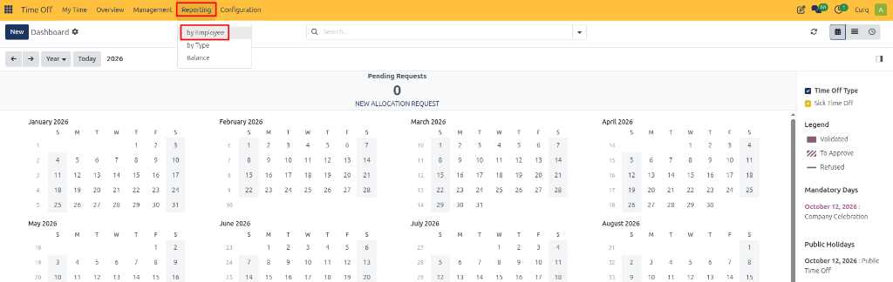
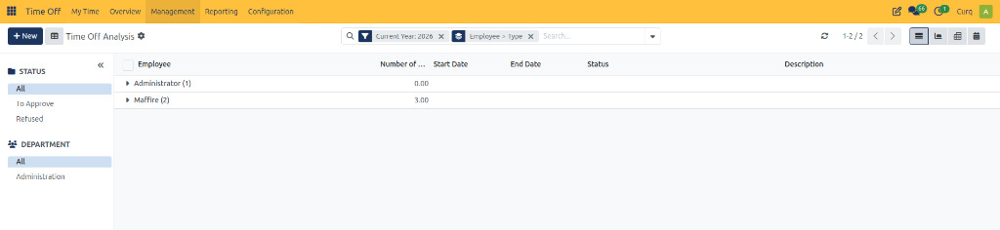
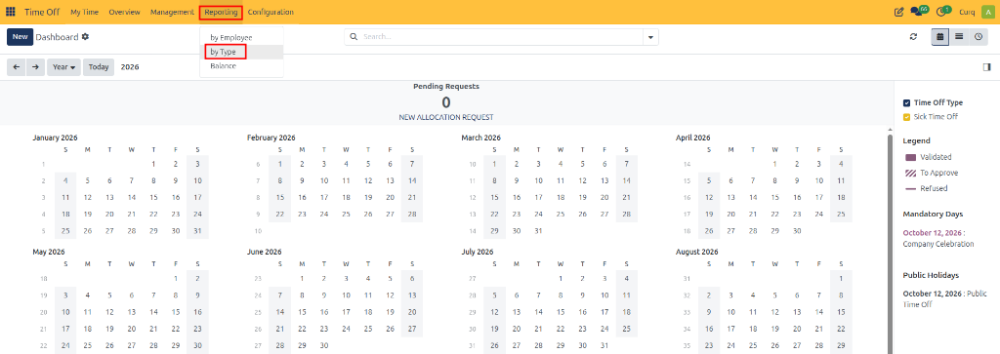
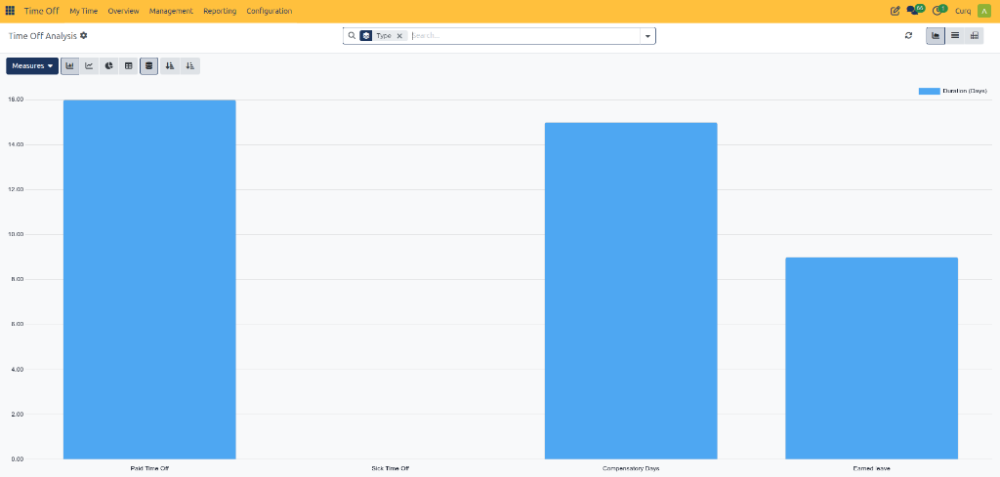
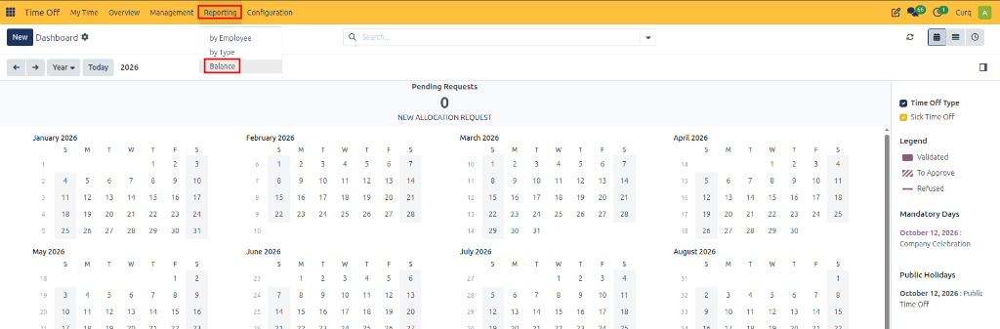

# Reporting

The **Reporting** feature in the CURQ 18 Time Off module helps managers and HR personnel analyze employee leave requests, monitor time off usage, and review remaining leave balances. It provides insights into employee absences, the popularity of different time off types, and the amount of leave employees have available or planned.

The reporting section includes three main views:

* **By Employee:** Review time off requests and usage for individual employees.
* **By Type:** Analyze time off usage across different leave types.
* **Balance:** Review the remaining and planned time off balances of employees.

These reports help organizations monitor leave patterns, plan workforce availability, and make informed decisions about employee leave management.

Reports can be viewed in different formats, including List, Graph, Pivot, and Calendar, depending on the report. Graph and Pivot views can also be added to a spreadsheet when the relevant integration is available. If the Documents module is installed, the report can be inserted into a spreadsheet; otherwise, it can be added to a dashboard.

---

## 1. Time Off by Employee

The **By Employee** report provides a detailed overview of time off requests grouped by employee. It helps managers understand how much leave each employee has requested or taken and review the details of individual requests.

### Access the Report

Navigate to **Time Off → Reporting → By Employee**.

The report displays employees in alphabetical order by default. Each employee's record can be expanded to view the associated time off types, and each type can be expanded further to display individual requests.

### Information Displayed

* **Employee:** The employee associated with the time off request.
* **Number of Days:** The duration of the requested time off.
* **Start Date:** The date on which the leave begins.
* **End Date:** The date on which the leave ends.
* **Status:** The current status of the request, such as awaiting approval or approved.
* **Description:** Additional information about the time off request.

### Available Views

The report can be displayed using the following views:

* **List:** Displays employees and their time off requests in a structured list.
* **Graph:** Visualizes time off data for easier comparison.
* **Pivot:** Summarizes time off information using rows, columns, and measures.
* **Calendar:** Displays time off requests according to their dates.

---

## 2. Time Off by Type

The **By Type** report helps managers analyze how different time off types are used across the organization. It provides a summarized view of leave duration by category, making it easier to identify usage patterns.

### Access the Report

Navigate to **Time Off → Reporting → By Type**.

The report opens in a bar chart by default, displaying time off categories and their corresponding durations.

---

## 3. Time Off Balance

The **Balance** report provides an overview of employee time off balances. It helps managers and HR personnel identify the amount of leave remaining, the leave already planned, and potential balances that may be subject to expiry or carry-over restrictions.

### Access the Report

Navigate to **Time Off → Reporting → Balance**.

The report opens in Pivot view by default, organizing employees into rows and time off types and their corresponding balance measures into columns.

### Information Displayed

* **Employee:** The employee whose balance is being reviewed.
* **Time Off Type:** The leave category to which the balance belongs.
* **Left:** The amount of time off remaining for the employee.
* **Planned:** The amount of time off allocated to future approved or scheduled absences, as represented in the report.
