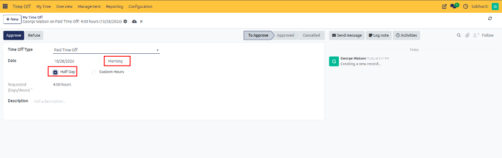
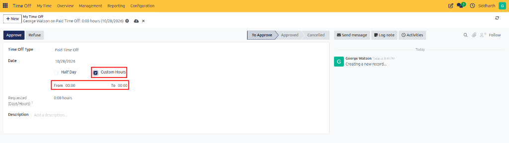

# Request Time Off and Manage Leave

The **Request Time Off** workflow allows employees to submit leave requests for planned vacations, illness, personal appointments, or unpaid absences. Employees can specify exact dates, select half-day or hourly durations, attach supporting verification documents, and monitor approval status in real time.

---

### Task 1: Create a Basic Time-Off Request

Employees can initiate a leave request from the dedicated self-service view:

1. Open the **Time Off** application from the main menu.
2. In the top navigation bar, click **My Time** and select **My Time Off**:

   

3. In the top-left action bar, click **New**.
4. The **New Time Off** form appears:

   

5. In the **Time Off Type** field, select the appropriate leave category *(such as **Paid Time Off**, **Sick Time Off**, or **Unpaid**)*.
6. Select your requested dates and duration.
7. Enter a brief description explaining the reason for your absence.
8. If the leave type requires verification *(such as a medical certificate)*, attach the necessary file under **Supporting Document**.
9. Click **Save & Close** to submit the request for approval.

---

### Task 2: Request Full-Day or Multi-Day Absences

For standard absences covering one or more complete working days:

1. Open the time-off request form.
2. Select your desired **Time Off Type**.
3. Click the **Dates** field to open the calendar date picker:
   * Select the start date and end date. For a single full day, select the same date for both start and end.
   * Click **Apply** to confirm the date range.
4. Review the auto-calculated duration in the **Requested (Days/Hours)** field. CURQ calculates this total against your working schedule, automatically excluding standard weekends and non-working hours.
5. Enter any operational context in the **Description** field and click **Save & Close**.

---

### Task 3: Request Half-Day Leaves

When an employee needs to take off only the morning or afternoon:

1. Open the time-off request form and select the leave type.
2. Check the **Half Day** checkbox:

   

3. Choose either **Morning** or **Afternoon**.
4. CURQ automatically sets the duration to half of your standard daily working hours *(e.g., 0.50 Days or 4.00 Hours)*.
5. Provide a description and submit the request.

---

### Task 4: Request Custom Hourly Absences

When an employee needs to step away for a specific window during the workday:

1. Open the time-off request form and select an hourly leave type.
2. Check the **Custom Hours** checkbox:

   

3. In the **From** field, enter the departure time *(e.g., `14:00`)*.
4. In the **To** field, enter the expected return time *(e.g., `16:00`)*.
5. CURQ calculates the exact duration *(e.g., `2.00 Hours`)* based on your scheduled shift.
6. Submit the form.

---

### Task 5: Attach Supporting Documents

Certain leave types—such as medical leave or bereavement—require supporting proof before validation:

1. On the request form, locate the **Supporting Document** section.
2. Click **Attach File** to browse your local computer.
3. Select the file *(PDF, PNG, JPG)* and click **Open**.
4. Confirm the file name appears attached to the record. Multiple documents can be attached if needed.
5. Submit the request. The document becomes visible to managers during the approval process.

---

### Task 6: Track Request Approval Lifecycle

Once submitted, monitor your request through its approval milestones in **My Time → My Time Off**:

* **To Approve**: The request has been submitted and is awaiting review by your team manager or designated HR officer:

  

* **Second Approval**: For leave types requiring dual authorization, the request has passed manager review and is pending final validation by an HR Officer.
* **Approved**: The request is fully validated:

  

  Your personal leave balance card on the dashboard reflects the deduction immediately.
* **Refused**: The request was rejected. Review the chatter notes on the request form to see manager feedback.

---

### Edge Cases & Recovery Steps

* **Supporting Document Required**: If submitting fails with a missing attachment prompt, ensure your medical certificate or proof document is attached under **Supporting Document** before saving.
* **Insufficient Leave Balance**: If an alert indicates the requested duration exceeds your remaining balance, verify whether the leave category allows negative caps or request an additional allowance via **My Time → My Allocations**.
* **Request Blocked by Mandatory Days**: If the selected dates overlap with an organization-wide blackout period, CURQ prevents submission. Consult the dashboard sidebar to verify mandatory blackout dates.

---

## Related Documentation

* [Submit Your First Time Off Request](../getting-started/01-submit-your-first-time-off-request.md)
* [Navigate Time Off Dashboard and Calendar](./03-navigate-time-off-dashboard-and-calendar.md)
* [Review, Approve, and Manage Team Time Off](./04-review-approve-and-manage-team-time-off.md)
