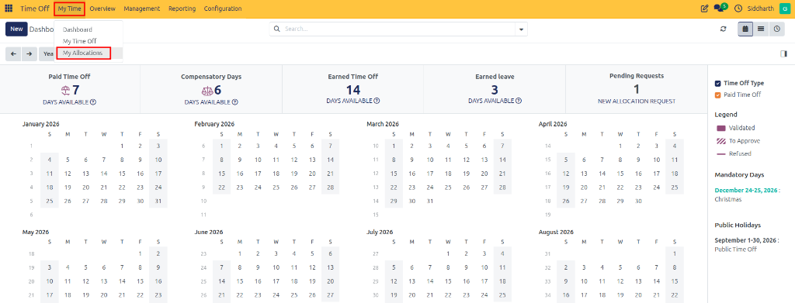
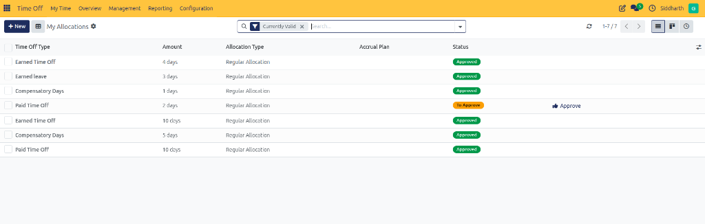
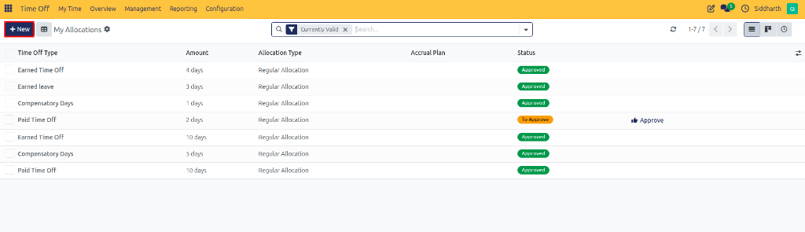
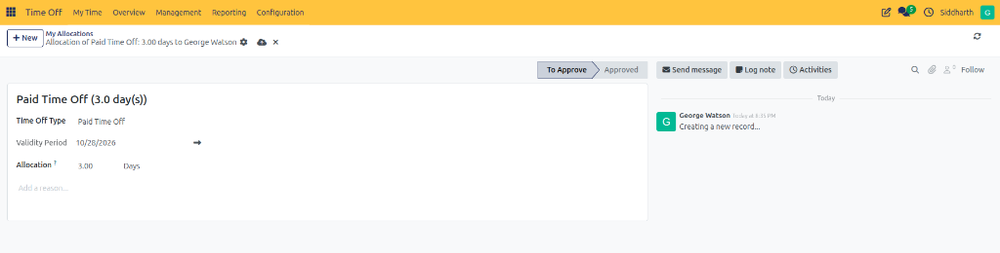

# Request and Manage Personal Allocations

The **My Allocations** view provides employees with a dedicated catalog of their active leave balances and pending allocation requests. When company policy permits, employees can request additional leave allocations—such as extra compensatory days or extended vacation allowances—directly from this interface.

---

### Task 1: Access the Personal Allocations Catalog

Review your allocated leave balances and their operational statuses:

1. Open the **Time Off** application from the main navigation menu.
2. In the top navigation bar, click **My Time** and select **My Allocations**:

   

3. The page displays your active allocations in a structured table. By default, the **Currently Valid** search filter is applied to display only active, unexpired allowances:

   

---

### Task 2: Interpret the Allocations Table

Each row in the allocations list details an entitlement record:

* **Time Off Type**: The leave category granted *(e.g., Earned Leave, Compensatory Days, Paid Time Off)*.
* **Amount**: The total number of days or hours granted under this specific allocation.
* **Allocation Type**: Identifies whether the entitlement is a one-time fixed balance (*Regular Allocation*) or accumulated incrementally (*Accrual Allocation*).
* **Accrual Plan**: Displays the linked accrual plan name when the allocation earns time dynamically.
* **Status**: Indicates the approval state:
  * **To Approve**: Waiting for manager or HR review.
  * **Approved**: Validated and currently available for leave booking.
  * **Refused**: Rejected by management.

---

### Task 3: Submit a Request for Additional Allocation

When an employee has completed overtime work, earned compensatory time, or requires extra leave allowance:

1. In the top action bar of **My Time → My Allocations**, click **New**:

   

2. Complete the allocation request form:
   * **Time Off Type**: Select the category for which you require additional balance *(such as **Paid Time Off**)*.
   * **Allocation**: Enter the requested quantity in days or hours *(e.g., `3.00 Days`)*.
   * **Add a reason...**: Provide a detailed explanation justifying the request.

   

3. Click **Save & Close** (or **Save**).
4. The request transitions to **To Approve** status and automatically alerts your manager or HR officer via the chatter activity feed.
5. Once your manager reviews and approves the request, your balance card on the **Dashboard** increases immediately.

---

### Task 4: Filter and Search Allocation Records

Locate specific allocation records across historical cycles:

* **Currently Valid Filter**: Click the clear (`x`) icon on the **Currently Valid** tag in the search bar to inspect expired, historical, or future-dated allocations.
* **Search Bar**: Search by time-off type name or description.
* **Group By**: Group records by **Time Off Type** or **Status** to analyze total historical grants across categories.

---

### Edge Cases & Recovery Steps

* **Allocation Balance Not Yet Credited**: Newly submitted allocation requests remain in **To Approve** status until authorized by your manager or HR officer. Check the status column before attempting to book leave against the new balance.
* **Cannot Locate Expired or Historical Grants**: The allocations catalog filters by **Currently Valid** by default. Click the (`x`) on the search bar tag to reveal previous years' expired or exhausted allocations.

---

## Related Documentation

* [Submit Your First Time Off Request](../getting-started/01-submit-your-first-time-off-request.md)
* [Set Up Your First Leave Allocation](../getting-started/02-set-up-your-first-leave-allocation.md)
* [Grant and Validate Employee Allocations](./05-grant-and-validate-employee-allocations.md)
