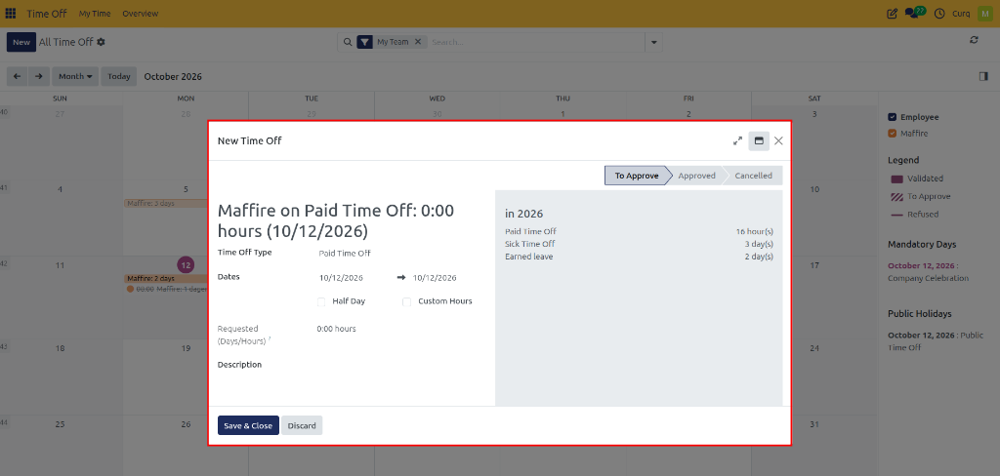

# Navigate Time Off Dashboard and Calendar

The **Time Off Dashboard** and **All Time Off Overview** provide employees and managers with dynamic calendar visualizers, real-time entitlement scorecards, and scheduling constraint indicators. This guide explains how to navigate calendar timeframes, calculate future leave balances, filter by leave types, and audit scheduled absences across teams.

---

### Task 1: Access the Personal Time Off Dashboard

Access your centralized self-service dashboard:

1. Open the **Time Off** application.
2. In the navigation bar, click **My Time** and select **Dashboard**:

   

3. The dashboard displays:
   * **Headline Balance Cards**: Real-time remaining balances across configured leave types *(Paid Time Off, Compensatory Days, Earned Leave)*.
   * **Absence Calendar Canvas**: Visual grid showing scheduled, approved, and pending absences.
   * **Right-Hand Sidebar**: Filter toggles for leave types, plus upcoming Mandatory Days and Public Holidays:

   

---

### Task 2: Create a Leave Request from the Dashboard

Employees can initiate a leave request directly from the dashboard:

1. Click the **New** button in the top-left corner:

   

2. The **New Time Off** modal form appears directly over the calendar canvas:

   

3. Configure your leave type, dates, and optional description, then click **Save & Close**.

---

### Task 3: Audit Leave Balances and Forecast Future Accruals

Inspect detailed balance metrics and calculate future accrual growth:

1. Click the question-mark (`?`) icon on any leave balance card:

   

2. Review the detailed metric components:
   * **Allocated**: Cumulative baseline entitlement granted.
   * **Accrual (Future)**: Forecasted leave units expected to accrue across future pay periods.
   * **Approved**: Days or hours deducted for confirmed, approved leave requests.
   * **Planned**: Days or hours held in reserve for pending or draft requests.
   * **Available**: Net balance eligible for immediate booking.
3. **Forecast Balance at a Future Date**:
   * For leave types using accrual plans, click the date field next to **Balance at the (date)**.
   * Select a future date *(e.g., December 31st)*.
   * CURQ calculates your projected leave balance based on active accrual milestones, helping you plan end-of-year holidays with confidence.
   * Click **Today** to reset the calculation to current date.

---

### Task 4: Switch Calendar Timeframes and Views

Adapt the calendar canvas to your analytical timeframe:

* **View Mode Selector**: In the top-right corner of the calendar, switch between:
  * **Day**: Inspect hourly absence blocks for single-day coverage.
  * **Week**: Review team shifts and absences for the active week.
  * **Month**: Standard monthly planning view.
  * **Year**: Full-year overview showing total annual leave distribution.
* **Period Navigation**: Use the left (`<`) and right (`>`) arrow buttons to navigate forward or backward through time. Click **Today** at any time to jump to the current date.

---

### Task 5: Interpret Calendar Visual Indicators

CURQ uses standardized patterns and color swatches to distinguish request statuses at a glance:

| Visual Style | Operational Status | System Meaning |
| :--- | :--- | :--- |
| **Solid Colored Block** | **Approved / Validated** | Leave request is fully authorized and deducted from balances. |
| **Diagonal Stripes** | **To Approve / Pending** | Leave request is submitted and awaiting manager review. |
| **Strikethrough Label** | **Refused** | Leave request was rejected by management; dates are not deducted. |

The background color of each entry corresponds to the configured color of the time-off type *(e.g., green for paid vacation, red for sick leave)*.

---

### Task 6: Filter Calendar by Time-Off Type

To isolate specific categories on the calendar without visual clutter:

1. In the right-hand panel under **Time Off Type**, review the available categories.
2. Check or uncheck specific boxes *(such as checking only **Sick Time Off** or only **Paid Time Off**)*.
3. The calendar updates instantly to display only entries matching the active selections.

---

### Task 7: Review Mandatory Days and Public Holidays

The right-hand panel spotlights key corporate dates:

* **Mandatory Days**: Company-designated dates requiring attendance *(such as annual inventory counts or executive summits)*. Time-off requests are locked and cannot be booked on these dates.
* **Public Holidays**: Official statutory holidays configured for your working calendar. Public holidays are automatically excluded from leave deductions when the time-off type is configured accordingly.

---

### Task 8: Use the Manager All Time Off Overview

Managers and HR officers can inspect leave schedules across their entire department or company:

1. In the top navigation bar, click **Overview**:

   

2. The **All Time Off** overview canvas loads, aggregating employee schedules side-by-side:

   

3. In the right-hand panel under **Employees**, select or deselect specific team members to filter the displayed schedule.
4. Click **New** directly from the calendar header to schedule an absence on behalf of any team member:

   

---

### Edge Cases & Recovery Steps

* **Overview Menu Missing**: The **Overview** menu is restricted to managers and HR officers. If it does not appear in your top navigation, your user account does not have management permissions.
* **Future Accrual Projections Show Zero**: If selecting a future date in the balance popover does not show incremental days, verify whether the leave category uses an active accrual plan or a fixed lump-sum allocation.
* **Absences Hidden After Filter Changes**: If the calendar appears empty, check the right-hand **Time Off Type** panel to ensure the relevant categories are checked.

---

## Related Documentation

* [Request Time Off and Manage Leave](./01-request-time-off-and-manage-leave.md)
* [Review, Approve, and Manage Team Time Off](./04-review-approve-and-manage-team-time-off.md)
* [Configure Public Holidays and Mandatory Days](./09-configure-public-holidays-and-mandatory-days.md)
