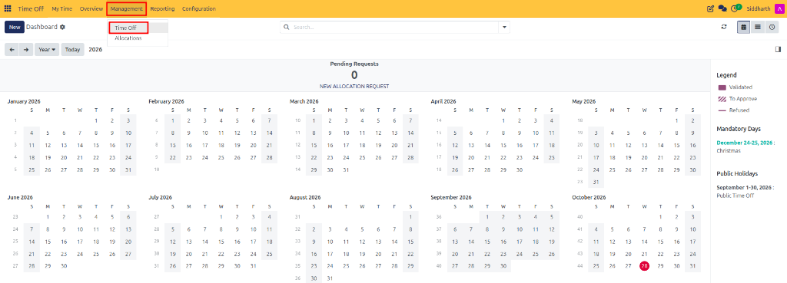
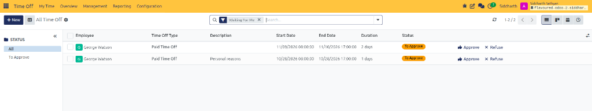
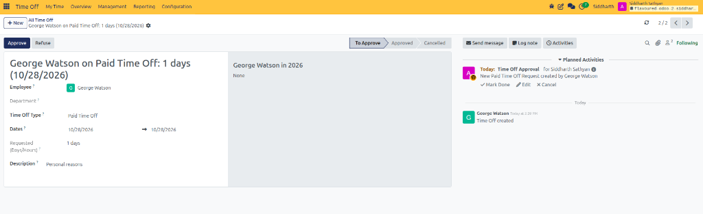
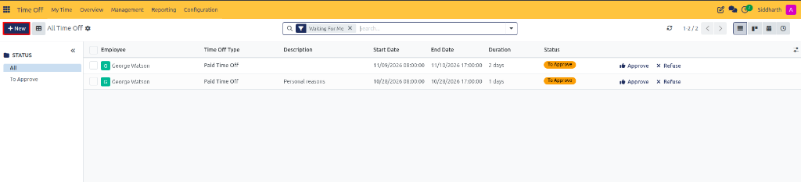
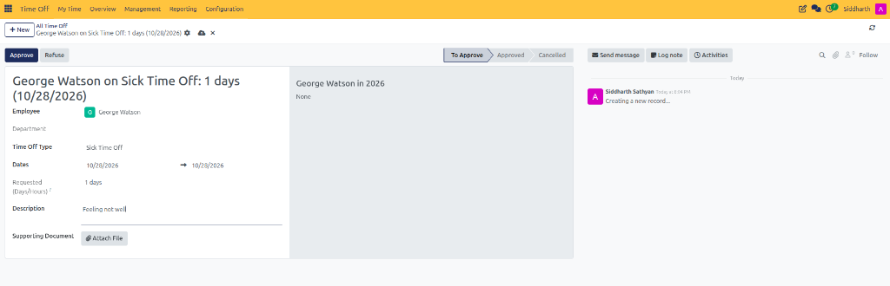

# Review, Approve, and Manage Team Time Off

The **Management → Time Off** workspace provides Team Managers, Time Off Officers, and HR Administrators with a centralized command center to review, validate, modify, or reject employee leave requests. Authorized users can execute quick one-click approvals from the list view or open detailed form views to verify remaining balances and attached supporting documents.

---

### Task 1: Access Pending Team Leave Requests

Access employee leave requests requiring administrative review:

1. Open the **Time Off** application.
2. In the top navigation bar, click **Management** and select **Time Off**:

   

3. The **All Time Off** management list view opens:

   

4. By default, the view applies the **Waiting For Me** filter. This automatically filters the list to show only requests awaiting your action—including requests in **To Approve** and **Second Approval** states.

---

### Task 2: Filter Requests by Status and Department

Organize large request backlogs using the left-hand grouping drawer:

* **Status Groups**:
  * **To Approve**: Requests awaiting initial manager authorization.
  * **All**: Displays all requests matching search criteria regardless of stage.
* **Department Filter**: Click any department name *(e.g., Sales, Administration, R&D)* to isolate requests from that specific operational unit.

---

### Task 3: Execute Inline Approval and Refusal Actions

Process standard requests rapidly directly from the table rows:

1. Locate the employee's request in the list view *(such as `George Watson` for `Paid Time Off`)*.
2. Review the **Employee**, **Time Off Type**, **Description**, **Start Date**, **End Date**, and **Duration**.
3. Choose the appropriate action button on the far right of the row:
   * **👍 Approve**: Authorizes the request. For single-approval leave types, status advances immediately to **Approved**.
   * **❌ Refuse**: Rejects the request. The status updates to **Refused** and any deducted days are restored to the employee's balance.

---

### Task 4: Review and Modify Requests in Form View

To verify supporting documents or inspect employee leave balances before deciding:

1. Click anywhere on the request row *(avoiding the inline action buttons)*.
2. The detailed request management form view opens:

   

3. Inspect key operational sections:
   * **Request Details**: Review the employee *(e.g., `George Watson`)*, leave type, exact date span *(e.g., `10/28/2026 -> 10/28/2026`)*, calculated duration *(e.g., `1 days`)*, and reason description *(e.g., `Personal reasons`)*.
   * **Stage Milestone Bar**: Monitor progress across **To Approve**, **Approved**, and **Cancelled**.
   * **Chatter History & Activities**: Review internal notes, automated timestamps, and scheduled tasks *(such as `Time Off Approval`)*. Mark activities done or log private team notes.
4. **Modify Details** *(Optional)*: If an employee requested incorrect dates or hours, authorized users can edit the dates directly on the form.
5. Click **Approve** or **Refuse** in the top action bar to finalize the decision.

---

### Task 5: Submit Leave Requests on Behalf of an Employee

Administrators and managers can record absences on behalf of team members who are unreachable or out of office:

1. In the top-left action bar of **Management → Time Off**, click **+ New** (highlighted in red):

   

2. The time-off creation form opens:

   

3. Configure the absence parameters:
   * **Employee**: Select the target team member *(e.g., `George Watson`)*. CURQ automatically retrieves their assigned department and working schedule.
   * **Time Off Type**: Select the requested leave category *(e.g., `Sick Time Off`)*.
   * **Dates**: Specify the start and end dates *(e.g., `10/28/2026 -> 10/28/2026`)*.
   * **Description**: Enter operational context explaining the reason for absence *(e.g., `Feeling not well` or `Logged per telephone notice`)*.
   * **Supporting Document**: If required by organizational policy, click **Attach File** to upload documentation *(such as a physician's note or medical certificate)*.
4. Click the cloud save icon or navigate away to persist the request. The request is submitted in **To Approve** stage and can be validated immediately by the manager or HR officer.

---

### Edge Cases & Recovery Steps

* **Approved Request Needs Cancellation**: If an employee's plans change after approval, open the request in form view and click **Refuse** or **Cancel**; deducted balances will be restored to the employee's account.
* **Pending Requests Not Appearing**: If expected team requests do not show up, check the active search filters to confirm you are not restricted by the **Waiting For Me** or **Department** filters.

---

## Related Documentation

* [Request Time Off and Manage Leave](./01-request-time-off-and-manage-leave.md)
* [Grant and Validate Employee Allocations](./05-grant-and-validate-employee-allocations.md)
* [Understanding Multi-Tier Approvals and Allocation Mechanisms](../core-concepts/02-understanding-multi-tier-approvals-and-allocation-mechanisms.md)
* [Configure Time Off Types](./07-configure-time-off-types.md)
