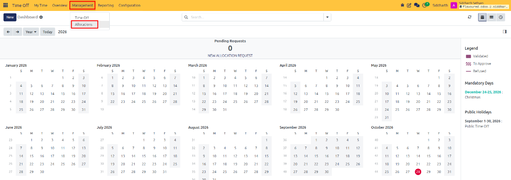
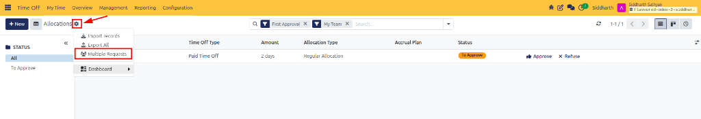
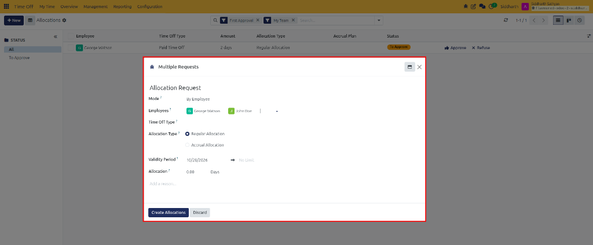
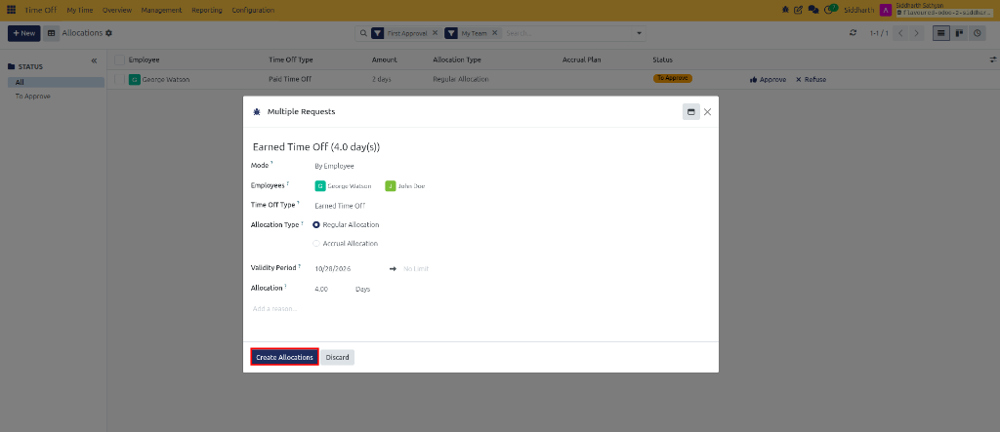
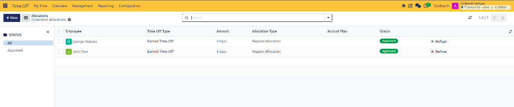

# Allocate Time Off to Multiple Employees

The **Multiple Requests** batch allocation tool enables Time Off Officers and HR Administrators to distribute leave allowances to dozens or hundreds of employees in a single administrative operation. Instead of generating individual allocation records one-by-one, administrators can target specific departments, legal company entities, or employee tags.

---

### Task 1: Open the Multiple Requests Batch Wizard

Access the batch distribution tool:

1. Open the **Time Off** application.
2. In the top navigation bar, click **Management** and select **Allocations**:

   

3. Locate the **Actions / Settings gear icon** (`⚙`) adjacent to the **Allocations** page title.
4. In the dropdown menu, select **Multiple Requests**:

   

5. The **Multiple Requests** batch modal window opens:

   

---

### Task 2: Select the Employee Distribution Mode

Choose how CURQ will identify the target group of recipients:

* **By Employee**: Allows manual multi-selection of individual employees across different teams *(such as `George Watson` and `John Doe`)*.
* **By Department**: Allocates leave to all active employees currently assigned to a chosen departmental unit *(e.g., Sales, Engineering)*.
* **By Company**: Grants uniform entitlements across an entire legal business entity in a multi-company instance.
* **By Employee Tag**: Selects all staff tagged with a specific analytical category *(e.g., `Shift Worker`, `Executive`, `Remote Employee`, or `Competition Winner`)*.

---

### Task 3: Configure Batch Allocation Parameters

Define the entitlement attributes that will apply across all generated records:

1. **Time Off Type**: Select the leave category to allocate *(such as `Earned Time Off`, `Paid Time Off`, or `Compensatory Days`)*.
2. **Allocation Type**:
   * Select **Regular Allocation** to grant a fixed one-time balance immediately.
   * Select **Accrual Allocation** to attach all recipients to an ongoing accrual plan.
3. **Allocation Quantity**: Enter the number of days or hours to grant *(such as `4.00 Days`)*.
4. **Validity Period**: For regular allocations, specify the effective start date and optional expiration deadline *(e.g., `10/28/2026 -> No Limit`)*.
5. **Add a reason...**: Enter an explanatory justification that will be recorded across all generated employee allocation records.
6. Click **Create Allocations** (highlighted in red) to execute the batch distribution:

   

---

### Task 4: Execute Batch Creation and Audit Generated Records

Generate and verify the batch records:

1. Once **Create Allocations** is confirmed, CURQ automatically generates individual allocation records for all matching employees, marks them with status **Approved**, and displays them in the **Generated Allocations** list view:

   

2. The list confirms the allocated leave for each employee *(such as `George Watson` and `John Doe` with `4 days` of `Earned Time Off`)*.
3. Each recipient's personal leave balance updates immediately across their self-service dashboard.

---

### Edge Cases & Recovery Steps

* **Accidental Batch Allocation**: If leave was granted to the wrong group of employees, select all generated records in the **Generated Allocations** list view, click the **Action** gear menu, and click **Refuse** or **Delete**.
* **Employees Missing from Department Batch**: If a staff member did not receive an allocation during a **By Department** batch, verify that the **Department** field on their employee profile is correctly populated.

---

## Related Documentation

* [Grant and Validate Employee Allocations](./05-grant-and-validate-employee-allocations.md)
* [Configure Time Off Types](./07-configure-time-off-types.md)
* [Accrual Plans and Milestone Specifications](../settings-and-fields/02-accrual-plans-and-milestone-specifications.md)
* [Configure Activity Types](./11-configure-activity-types.md)
