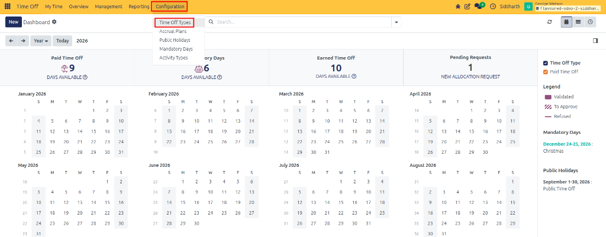
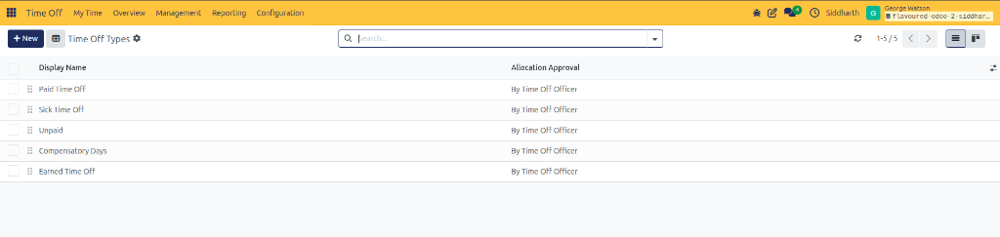
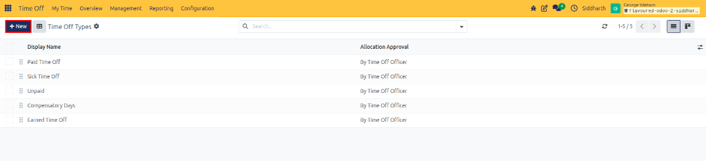
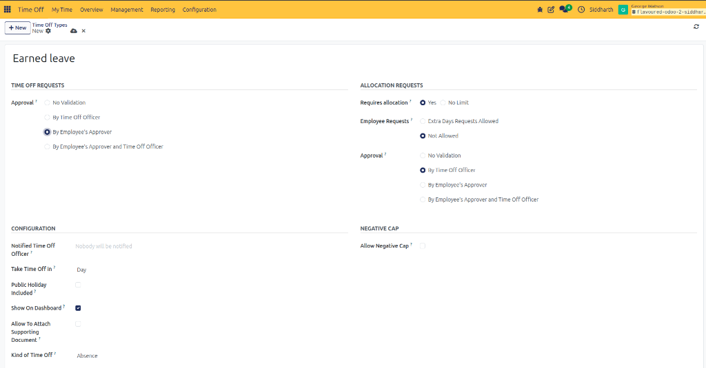
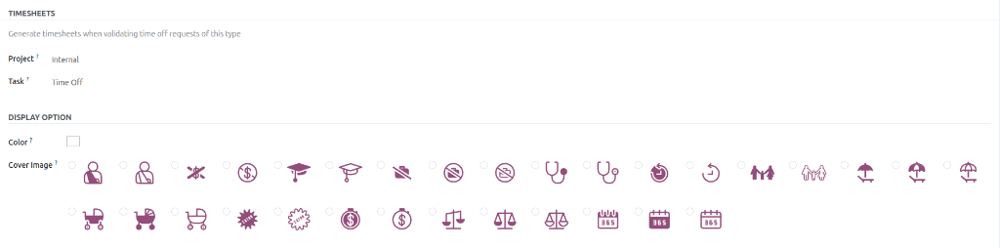
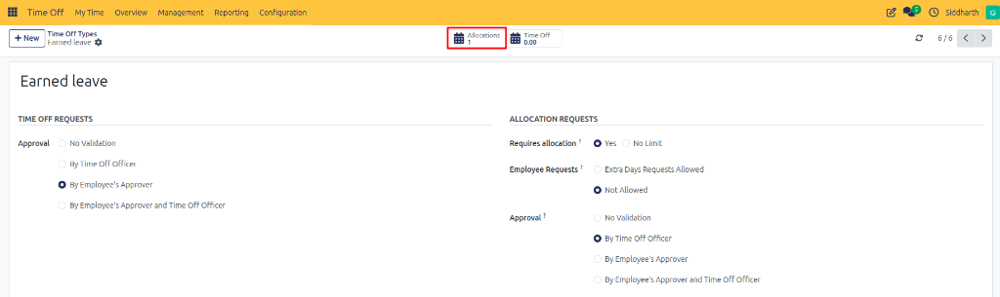
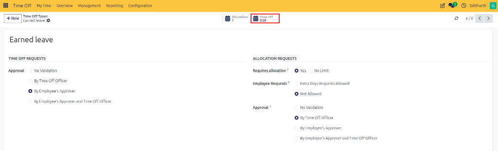

# Configure Time Off Types

Time Off Types define the leave categories employees can request—such as Paid Vacation, Sick Leave, Unpaid Leave, Compensatory Days, and Sabbatical. Each leave type governs its own approval workflows, allocation requirements, negative overdraft allowances, calendar color swatches, and timesheet integration rules.

---

### Task 1: Access the Time Off Types Catalog

Access the administrative leave type configuration workspace:

1. Open the **Time Off** application.
2. In the top navigation bar, click **Configuration** and select **Time Off Types**:

   

3. The **Time Off Types** list view displays all existing leave categories along with their allocation approval methods:

   

4. The catalog displays the **Display Name** *(such as Paid Time Off, Sick Time Off, Unpaid, Compensatory Days, and Earned Time Off)* alongside the designated **Allocation Approval** method *(such as `By Time Off Officer`)*.

---

### Task 2: Create a New Time Off Type

Initialize and configure a new leave category:

1. In the top action bar, click **+ New** (highlighted in red):

   

2. The leave type configuration form opens:

   

3. In the **Name** field, enter the client-facing title of the leave type *(for example, `Earned leave`, `Annual Vacation`, or `Medical Leave`)*.

---

### Task 3: Configure Leave Request Approval Rules

Under the **Time Off Requests** section, define who must authorize employee leave submissions:

* **No Validation**: Requests are automatically approved immediately upon submission without supervisor review. Best for informal notifications or unpaid leave.
* **By Employee's Approver**: Routed directly to the manager specified on the employee profile. Recommended for standard casual absences.
* **By Time Off Officer**: Routed directly to the human resources officer specified on this leave type. Best for statutory parental or military leaves.
* **By Employee's Approver and Time Off Officer**: Requires **Dual Validation**. The team manager approves first, followed by final HR Officer validation. Recommended for long-term vacation leaves (>10 days) or medical leaves.

---

### Task 4: Configure Allocation Governance Rules

Under the **Allocation Requests** section, specify how entitlements are provisioned:

* **Requires allocation?**:
  * **Yes**: Employees must hold an active, approved allocation before they can book leave under this category.
  * **No Limit**: Employees can request leave freely without an allocation pool *(ideal for Unpaid Leave or Compassionate Leave)*.
* **Employee Requests**:
  * **Extra Days Requests Allowed**: Employees who have consumed their quota can submit requests for additional allocation.
  * **Not Allowed**: Employees cannot request allocations independently; HR must provision them centrally.
* **Approval**: Choose the approval routing for allocation grants: **No Validation**, **By Time Off Officer**, **By Employee's Approver**, or **By Employee's Approver and Time Off Officer**.

---

### Task 5: Configure Operational Settings and Negative Cap

Under the **Configuration** and **Negative Cap** sections, establish operational parameters:

* **Notified Time Off Officer**: Select specific HR personnel to receive email notifications when leave is requested, or leave as `Nobody will be notified`.
* **Take Time Off in**: Choose the booking unit:
  * **Day**: Booked in full-day blocks.
  * **Half Day**: Supports morning or afternoon partial absences.
  * **Hours**: Supports granular hourly increments.
* **Public Holiday Included?**: When checked, public holidays that fall during the leave period are deducted from the employee's balance. When unchecked (default), public holidays are non-working days and are excluded from deductions.
* **Show On Dashboard?**: Controls whether this leave type displays a balance summary card on the employee dashboard.
* **Allow To Attach Supporting Document**: Toggles the file upload field on employee request forms *(such as a doctor's medical note)*.
* **Kind of Time Off**:
  * **Absence**: Standard non-working absence; does not count toward worked-time accrual formulas.
  * **Worked Time**: Paid absence that qualifies as worked time for payroll or bonus accrual plans.
* **Allow Negative Cap?**: When enabled, allows employees to borrow against future accruals up to a configured overdraft limit.

---

### Task 6: Configure Timesheet Integration and Visual Display

Connect leave booking with project accounting and customize dashboard presentation:

1. **Timesheets Integration**:
   * Check **Generate timesheets when validating time off requests of this type** to record absences automatically in the **Timesheets** app.
   * Specify the default **Project** *(e.g., `Internal`)* and **Task** *(e.g., `Time Off`)*.
2. **Display Option**:
   * **Color**: Select a color palette swatch to identify this leave type across the dashboard calendar.
   * **Cover Image**: Choose an illustrative icon *(e.g., umbrella, medical cross, stroller, dollar sign, graduation cap, scales, calendar)* displayed on the dashboard summary card.

---

### Task 7: Audit Allocations and Requests via Smart Buttons

Once saved, manage associated records directly from the form header:

* **Allocations Smart Button**: Click to view or create allocations specifically for this leave category:

  

* **Time Off Smart Button**: Displays the cumulative days taken across the enterprise under this type. Clicking opens an audit list view of all historical and pending leave requests:

  

---

### Edge Cases & Recovery Steps

* **Leave Requests Rejected for Insufficient Balance**: If employees cannot book leave under an unlimited policy (such as Unpaid Leave), verify that **Requires allocation** is set to **No Limit** rather than **Yes**.
* **Public Holidays Unexpectedly Deducted**: If employees report leave balances being deducted on national holidays, ensure that **Public Holiday Included** is unchecked on the leave type configuration.
* **Timesheet Lines Not Created**: If timesheet entries do not appear after leave approval, verify that **Generate timesheets when validating time off requests of this type** is checked and both **Project** and **Task** are properly assigned.

---

## Related Documentation

* [Configure Accrual Plans and Milestones](./08-configure-accrual-plans-and-milestones.md)
* [Configure Public Holidays and Mandatory Days](./09-configure-public-holidays-and-mandatory-days.md)
* [Time Off Types and Request Field Definitions](../settings-and-fields/01-time-off-types-and-request-field-definitions.md)
* [Configure Activity Types](./11-configure-activity-types.md)
