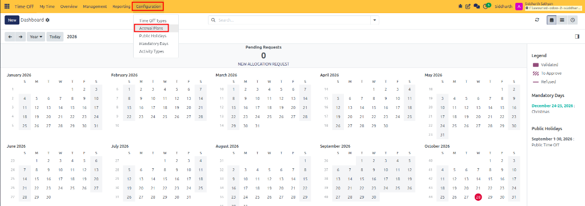
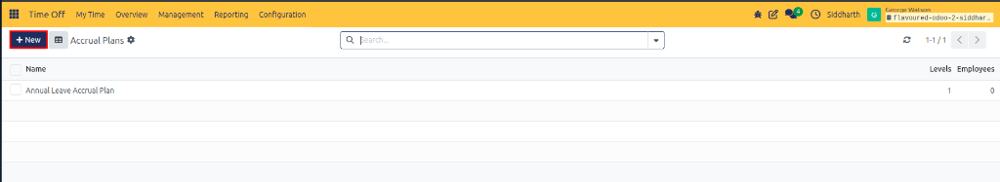
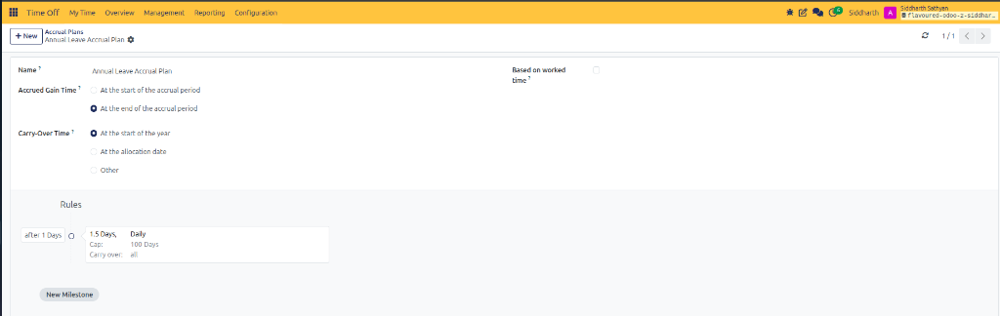
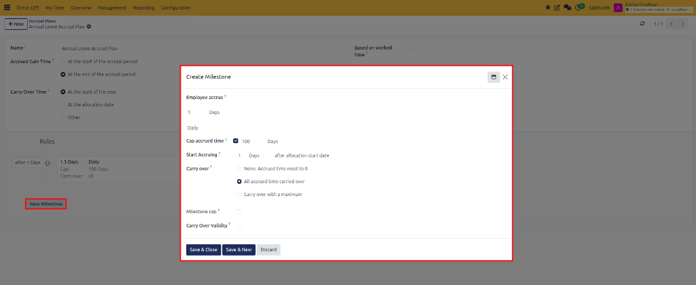
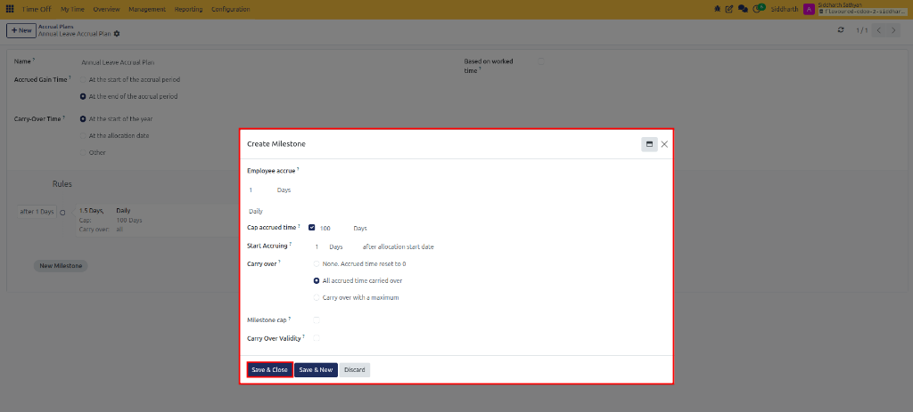

# Configure Accrual Plans and Milestones

Accrual plans automate progressive leave entitlement accumulation. Instead of crediting an entire annual leave quota at the start of the year, accrual plans calculate and award leave incrementally based on elapsed time, seniority milestones, or hours logged on timesheets.

---

### Task 1: Access the Accrual Plans Interface

Open the administrative accrual plan catalog:

1. Open the **Time Off** application.
2. In the top navigation bar, click **Configuration** and select **Accrual Plans**:

   

3. The **Accrual Plans** list view opens:

   

4. The catalog displays the plan **Name** *(such as `Annual Leave Accrual Plan`)*, the count of active milestone **Levels**, and assigned **Employees**.

---

### Task 2: Create a New Accrual Plan

Initialize a new accrual plan:

1. In the top-left action bar, click **+ New** (highlighted in red).
2. The accrual plan configuration form opens:

   

3. Configure the baseline plan parameters:
   * **Name**: Enter an organizational title *(such as `Annual Leave Accrual Plan`)*.
   * **Accrued Gain Time**:
     * **At the start of the accrual period**: Leave is awarded at the beginning of each cycle *(e.g., the 1st of each month)*.
     * **At the end of the accrual period**: Leave is awarded only after the cycle has elapsed *(e.g., the last day of each month)*.
   * **Carry-Over Time**: Select when unconsumed accrued days are evaluated for carry-over or forfeiture:
     * **At the start of the year**: Evaluates balances on January 1.
     * **At the allocation date**: Evaluates balances on the anniversary of the employee's allocation start date.
     * **Other**: Evaluates balances on a specific calendar day.
   * **Based on worked time**: Enable this toggle if leave accrues proportionally based on actual hours recorded on validated timesheets.

---

### Task 3: Add and Configure Accrual Milestones

Accrual rules dictate how much leave is earned, how frequently, and what caps apply:

1. In the **Rules** section, click **New Milestone** (highlighted in red):

   

2. The **Create Milestone** modal dialog opens:

   

3. Configure the milestone attributes:
   * **Employee Accrue**:
     * Enter the **Amount** *(e.g., `1` or `1.50`)*.
     * Select the **Unit** (*Days* or *Hours*).
     * Choose the **Frequency** (*Daily*, *Weekly*, *Monthly*, *Twice a month*, or *Yearly*).
   * **Cap Accrued Time**: Check this box to set a ceiling on total balance accumulation *(such as `100 Days`)*.
   * **Start Accruing**: Specify an initial waiting period before accrual begins *(such as `1 Days` or `3 Months` after allocation start date)*.
   * **Carry Over**:
     * **None. Accrued time reset to 0**: Forfeits all unused days at cycle end.
     * **All accrued time carried over**: Rolls forward the full unused balance into the new period.
     * **Carry over with a maximum**: Rolls forward up to a defined ceiling *(such as max `5.00 Days`)*.
   * **Milestone Cap**: Set an annual accumulation limit under this specific milestone tier.
   * **Carry Over Validity**: Define an expiration window for carried-over days *(such as valid for `90 Days` before lapsing)*.

---

### Task 4: Save and Chain Progressive Seniority Milestones

1. In the milestone dialog, click **Save & Close** (highlighted in red) to confirm the milestone (or **Save & New** to define additional seniority tiers).
2. The milestone appears on the visual **Rules** timeline:

   

3. Add subsequent milestones to reward employee tenure:
   * **Tier 1**: `after 1 Days` -> Accrue 1.5 Days Daily, capped at 100 Days.
   * **Tier 2**: `after 1 Years` -> Increase accrual rate for established staff.
   * **Tier 3**: `after 5 Years` -> Reward long-term seniority with enhanced leave entitlements.
4. Click the cloud save icon in the upper header or navigate away to persist the accrual plan.

---

### Edge Cases & Recovery Steps

* **Accruals Not Calculating on Timesheet Submissions**: If a plan set to **Based on worked time** does not award leave, ensure that timesheets are submitted and approved in the Timesheets application.
* **Unused Days Carried Over Beyond Policy Limit**: If an employee retained more leave than company policy allows, check the **Carry Over** rule on the active milestone to ensure either **Carry over with a maximum** or **None** is selected.

---

## Related Documentation

* [Configure Time Off Types](./07-configure-time-off-types.md)
* [Grant and Validate Employee Allocations](./05-grant-and-validate-employee-allocations.md)
* [Accrual Plans and Milestone Specifications](../settings-and-fields/02-accrual-plans-and-milestone-specifications.md)
* [Configure Public Holidays and Mandatory Days](./09-configure-public-holidays-and-mandatory-days.md)
