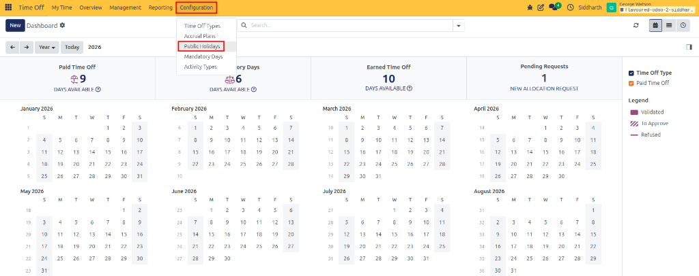
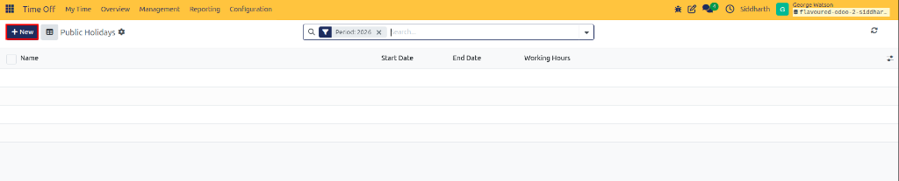
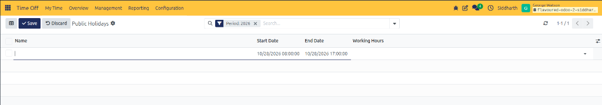
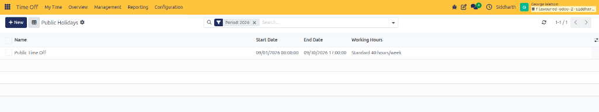
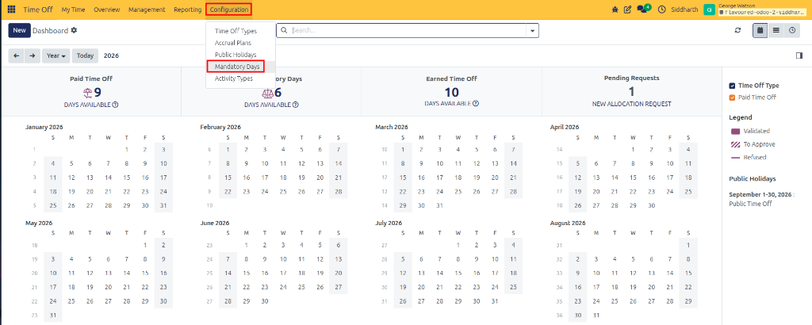
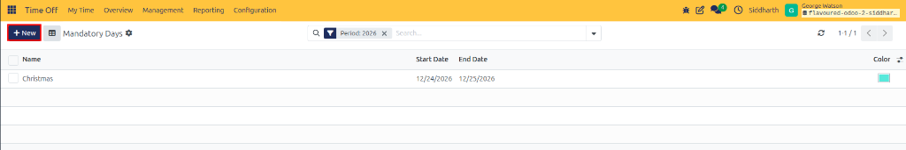
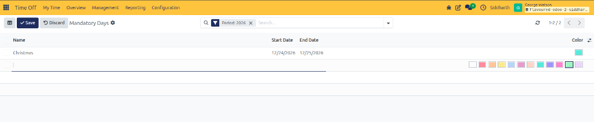

# Configure Public Holidays and Mandatory Days

CURQ Time Off integrates organizational calendars with working schedules to ensure statutory compliance and business coverage. Administrators can define **Public Holidays** that automatically deduct non-working days from leave calculations, and schedule **Mandatory Days** that lock calendar dates to prevent employee absence during critical operational events.

---

### Task 1: Access the Public Holidays Interface

Configure official national, regional, or corporate holidays:

1. Open the **Time Off** application.
2. In the top navigation bar, click **Configuration** and select **Public Holidays**:

   

3. The **Public Holidays** list view displays all configured corporate holidays along with their scheduled observation dates and working schedules:

   

---

### Task 2: Create and Configure a New Public Holiday

Add a statutory non-working day to the system:

1. In the top-left action bar, click **+ New** (highlighted in red) to open an inline creation row.
2. Complete the holiday parameters directly in the inline row:
   * **Name**: Enter the holiday title *(e.g., `Public Time Off`, `New Year's Day`, or `Independence Day`)*.
   * **Start Date & End Date**: Specify the exact date range and time when the holiday is observed *(e.g., `09/01/2026 08:00:00` to `09/30/2026 17:00:00`)*.
   * **Working Hours**: Link the holiday to a specific working schedule *(such as `Standard 40 hours/week`)*. Leave blank for company-wide application across all schedules.

   

3. Click **✔ Save** in the top action bar to confirm the holiday record. The new statutory holiday appears in the list view:

   

4. When employees request time off spanning this date, CURQ automatically skips the holiday from deducted leave totals (provided **Public Holiday Included** is disabled on the leave type).

---

### Task 3: Access the Mandatory Days Interface

Define dates on which employees must be present and cannot take leave:

1. In the top navigation bar, click **Configuration** and select **Mandatory Days**:

   

2. The **Mandatory Days** list view displays all active attendance lockouts, their observation date ranges, and assigned display colors *(such as `Christmas` from `12/24/2026` to `12/25/2026`)*:

   

---

### Task 4: Create a Mandatory Day Lockout

Prevent time-off requests during critical business periods:

1. In the top-left action bar, click **+ New** (highlighted in red) to open an inline creation row.
2. Configure the mandatory attendance parameters:
   * **Name**: Enter the operational event title *(such as `Fiscal Year-End Inventory Audit`, `Annual General Meeting`, or `Christmas`)*.
   * **Start Date & End Date**: Define the blackout date range during which leave cannot be booked *(such as `12/24/2026` to `12/25/2026`)*.
   * **Color**: Select a color palette swatch *(e.g., green, teal, cyan, red, orange, yellow, blue, purple, magenta)* to visually highlight the blackout block on employee calendars.

   

3. Click **✔ Save** in the top action bar to confirm the lockout (or **⮌ Discard** to cancel).
4. The blackout dates render as highlighted banners across employee calendars, and any attempt by an employee to submit a leave request covering these dates is automatically rejected by the system.

---

### Edge Cases & Recovery Steps

* **Leave Deducted on a Public Holiday**: If leave totals still deduct days during a public holiday, check the settings of the requested **Time Off Type** and ensure that **Public Holiday Included** is unchecked. Also verify that the employee's calendar matches the **Working Hours** assigned to the holiday.
* **Mandatory Day Lockout Not Enforced for Remote Staff**: If employees can still submit leave during a mandatory period, verify that their user profile or contract is assigned to one of the selected departments or that the department field was left blank for company-wide enforcement.

---

## Related Documentation

* [Navigate Time Off Dashboard and Calendar](./03-navigate-time-off-dashboard-and-calendar.md)
* [Configure Time Off Types](./07-configure-time-off-types.md)
* [Holidays, Mandatory Days, and Activity Specifications](../settings-and-fields/03-holidays-mandatory-days-and-activity-specifications.md)
* [Configure Activity Types](./11-configure-activity-types.md)
