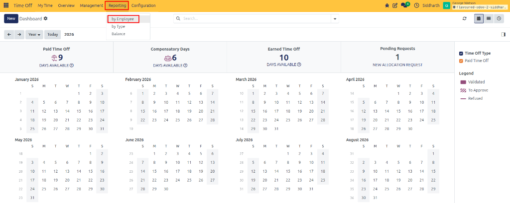
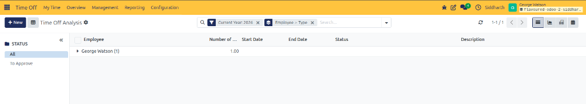
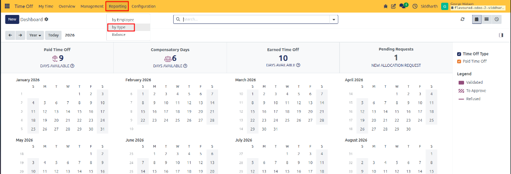
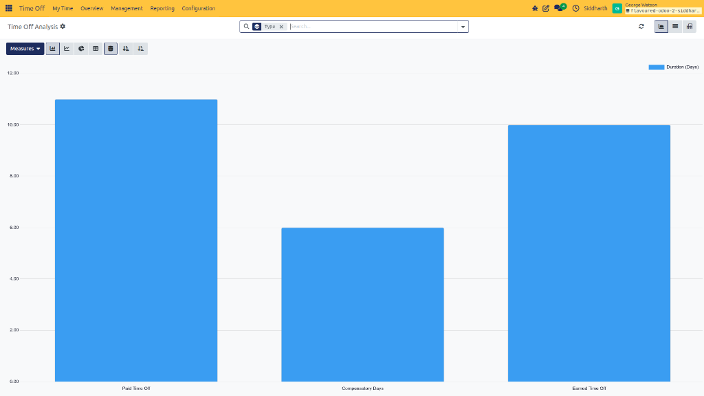
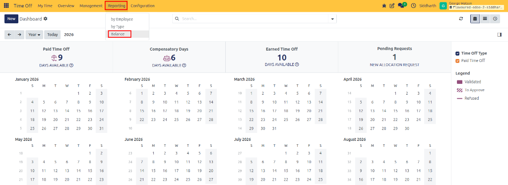
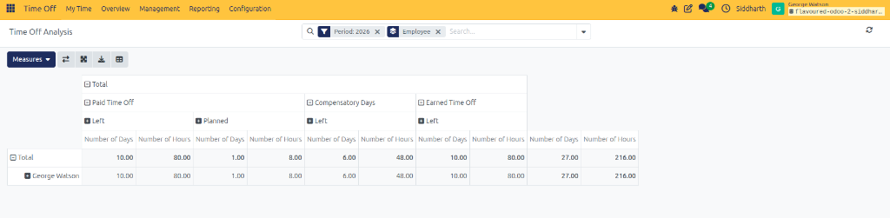

# Generate and Analyze Time Off Reports

The **Reporting** engine in CURQ Time Off equips HR personnel and department managers with multi-dimensional analytical reports to audit employee absence patterns, evaluate leave type utilization, track liability balances, and forecast workforce availability across departments.

---

### Task 1: Analyze Absences by Employee

Inspect detailed leave records grouped by individual team members:

1. In the top navigation bar, click **Reporting** and select **by Employee**:

   

2. The report opens in a grouped list view:

   

3. Review the hierarchical data:
   * The search bar includes default groupings for `Current Year: 2026` and `Employee > Type`.
   * Use the left-side **Status** panel to filter between **All** requests and **To Approve**.
   * Click an employee row *(such as `George Watson (1)`)* to expand all leave types taken by that individual.
   * Expand a specific leave type to inspect individual request lines, start/end dates, total durations, and approval statuses.
4. **Switch Visualization Modes**:
   * **List**: Hierarchical row-based audit table.
   * **Graph**: Visual comparisons across departments and leave types.
   * **Pivot**: Multi-axis cross-tabulation table.
   * **Calendar**: Date-grid distribution of absences.

---

### Task 2: Analyze Absences by Time-Off Type

Evaluate which leave categories account for the greatest organizational absence:

1. In the top navigation bar, click **Reporting** and select **by Type**:

   

2. The report opens by default in a vertical bar chart:

   

3. Analyze leave distribution across categories *(such as `Paid Time Off`, `Compensatory Days`, and `Earned Time Off`)*.
4. Use the graph controls at the top left to toggle between **Bar Chart**, **Line Chart**, and **Pie Chart**, or adjust ordering via **Stacked**, **Ascending**, or **Descending**.
5. Apply search bar filters to isolate specific departments, fiscal quarters, or employment tags.

---

### Task 3: Audit Remaining and Planned Balances

Verify organizational leave liability and audit remaining employee balances:

1. In the top navigation bar, click **Reporting** and select **Balance**:

   

2. The **Balance** report opens in a multi-dimensional Pivot table layout:

   

3. Review the cross-tabulated metrics:
   * **Filter & Grouping**: Filtered by `Period: 2026` and grouped by `Employee` by default.
   * **Rows**: Employees listed with row-level metrics *(such as `George Watson`)*.
   * **Columns**: Configured leave categories *(such as `Paid Time Off`, `Compensatory Days`, and `Earned Time Off`)*.
   * **Measures**:
     * **Left**: Total remaining leave days and hours available for future booking *(e.g., `10.00` Days / `80.00` Hours Paid Time Off)*.
     * **Planned**: Days and hours allocated to future validated absences *(e.g., `1.00` Day / `8.00` Hours)*.
4. Use the pivot toolbar controls:
   * **Measures**: Add or toggle metric aggregations.
   * **Flip Axis**: Swap rows and columns for alternative perspectives.
   * **Expand All**: Open all child hierarchical levels simultaneously.
   * **Download xlsx**: Export the balance table to Excel.
   * **Insert in Spreadsheet**: Embed the pivot view directly into a CURQ spreadsheet for live reporting.
5. Click any pivot data cell to drill down into the specific allocation and request records contributing to that balance metric.

---

### Edge Cases & Recovery Steps

* **Empty Report View**: If no data appears in the report, check the search bar for restrictive date filters (e.g., ensuring `Current Year: 2026` or `Period: 2026` matches the period of requested absences) or clear active department filters.
* **Missing Individual Requests in Grouped View**: If clicking an employee row does not expand individual requests, verify that the active Group By includes both **Employee** and **Type**.

---

## Related Documentation

* [Navigate Time Off Dashboard and Calendar](./03-navigate-time-off-dashboard-and-calendar.md)
* [Review, Approve, and Manage Team Time Off](./04-review-approve-and-manage-team-time-off.md)
* [Time Off Types and Request Field Definitions](../settings-and-fields/01-time-off-types-and-request-field-definitions.md)
* [Configure Activity Types](./11-configure-activity-types.md)
