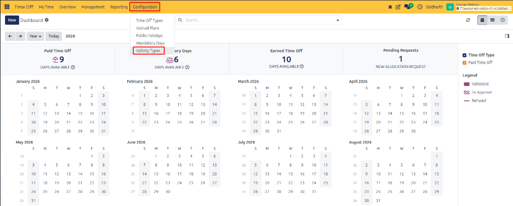
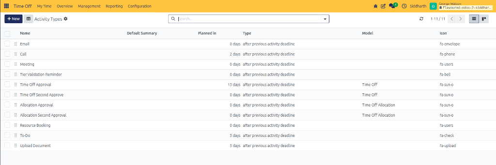
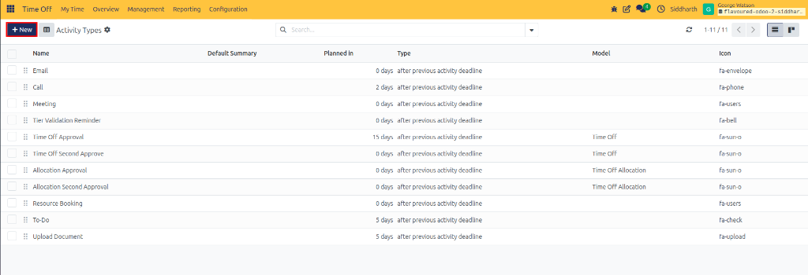
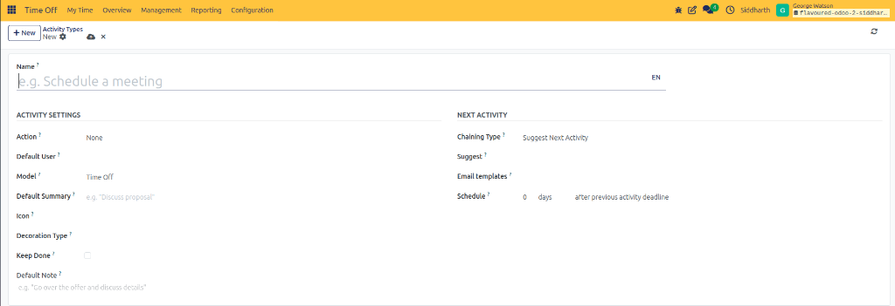

# Configure Activity Types

Activity Types allow human resources teams to standardize follow-up actions, schedule approval deadlines, set default reminder templates, and suggest next steps. Within the Time Off application, activity types support automated leave workflows—such as requesting medical certificates, scheduling manager review calls, or prompting HR allocation approvals.

---

### Task 1: Access the Activity Types Catalog

1. Open the **Time Off** application.
2. In the top navigation bar, click **Configuration** and select **Activity Types**:

   

3. The **Activity Types** list view displays all configured activities across the enterprise:

   

4. The catalog displays the activity name, default summary, scheduled planned deadline offset, trigger type, bound model, and associated icon.

---

### Task 2: Create a New Activity Type

1. In the top-left action bar, click **+ New** (highlighted in red) to open a blank activity configuration form:

   

2. The activity type configuration form opens:

   

3. In the **Name** field, enter a descriptive title *(such as `Time Off Approval`, `Medical Document Verification`, or `Return to Work Interview`)*.

---

### Task 3: Configure Activity Settings and Behavior

Under the **Activity Settings** section on the left, establish behavior and assignments:

* **Action**: Select the action category:
  * **None**: Standard generic activity.
  * **Upload Document**: Prompts the assigned user to attach a file *(such as a physician's note or medical certificate)*.
  * **Phonecall**: Schedules a telephone follow-up.
  * **Meeting**: Adds an event to the calendar.
  * **Reminder / To-Do**: Standard checklist task.
* **Default User**: Assign a default responsible user or leave blank to assign the record creator.
* **Model**: Specify the bound model:
  * **Time Off**: Restricts this activity to employee leave requests.
  * **Time Off Allocation**: Restricts this activity to entitlement grants.
* **Default Summary**: Pre-populate the subject line *(e.g., `Verify doctor's note for sick leave request`)*.
* **Icon**: Specify a FontAwesome icon *(such as `fa-sun-o`, `fa-upload`, or `fa-envelope`)*.
* **Decoration Type**: Choose a visual badge color (*Warning*, *Danger*, *Success*, or *Info*) for dashboard alerts.
* **Keep Done**: Toggle whether completed activities remain visible in the record chatter feed.
* **Default Note**: Add standard operating instructions or procedures into the rich-text note box.

> [!NOTE]
> For detailed specifications and field descriptions, see [Holidays, Mandatory Days, and Activity Specifications](../settings-and-fields/03-holidays-mandatory-days-and-activity-specifications.md).

---

### Task 4: Configure Next Activity Automation and Chaining

Under the **Next Activity** section on the right, automate workflow progression:

* **Chaining Type**:
  * **Suggest Next Activity**: Recommends a logical subsequent activity when this task is marked done.
  * **Trigger Next Activity**: Automatically schedules the subsequent activity immediately upon completion.
* **Suggest**: Select the follow-up activity to schedule next *(e.g., after `Upload Document` is marked done, suggest `Time Off Approval`)*.
* **Email templates**: Select an automated email notification template to send when the activity is triggered.
* **Schedule**: Set an automatic deadline offset relative to the trigger date *(e.g., `0 days` or `5 days` after previous activity deadline)*.

Click the cloud save icon in the upper-left form header (or navigate away) to save the activity type.

---

### Edge Cases & Recovery Steps

* **Activity Restricted to Wrong Model**: If an activity type does not appear in the Time Off request chatter, verify that the **Model** field is set to **Time Off** rather than an unrelated model.
* **Chained Activity Did Not Auto-Schedule**: If a follow-up activity was expected to schedule automatically upon completion, check that **Chaining Type** is set to **Trigger Next Activity** instead of **Suggest Next Activity**.

---

## Related Documentation

* [Review, Approve, and Manage Team Time Off](./04-review-approve-and-manage-team-time-off.md)
* [Configure Time Off Types](./07-configure-time-off-types.md)
* [Holidays, Mandatory Days, and Activity Specifications](../settings-and-fields/03-holidays-mandatory-days-and-activity-specifications.md)
